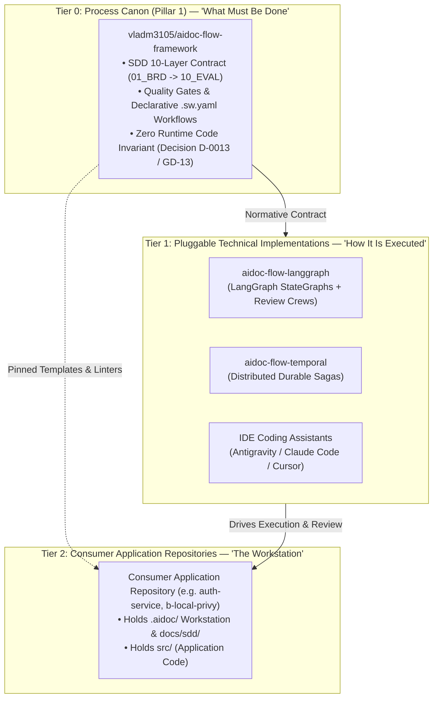
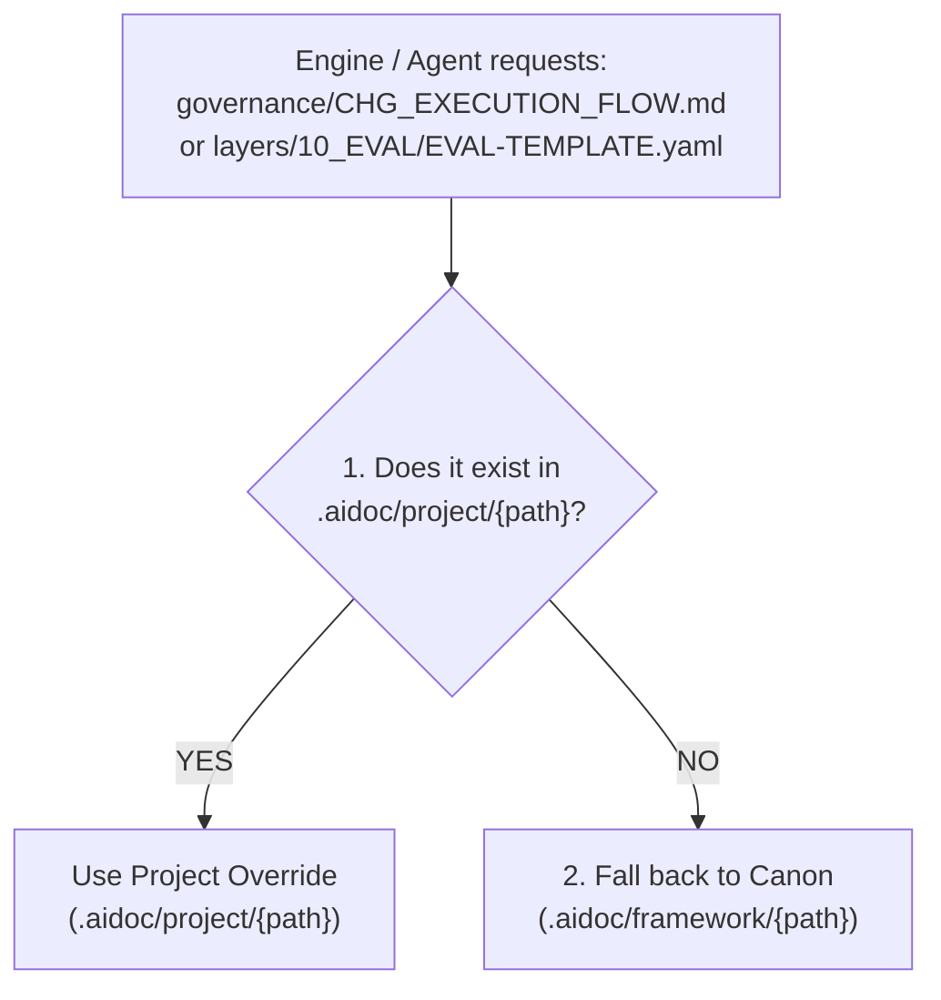
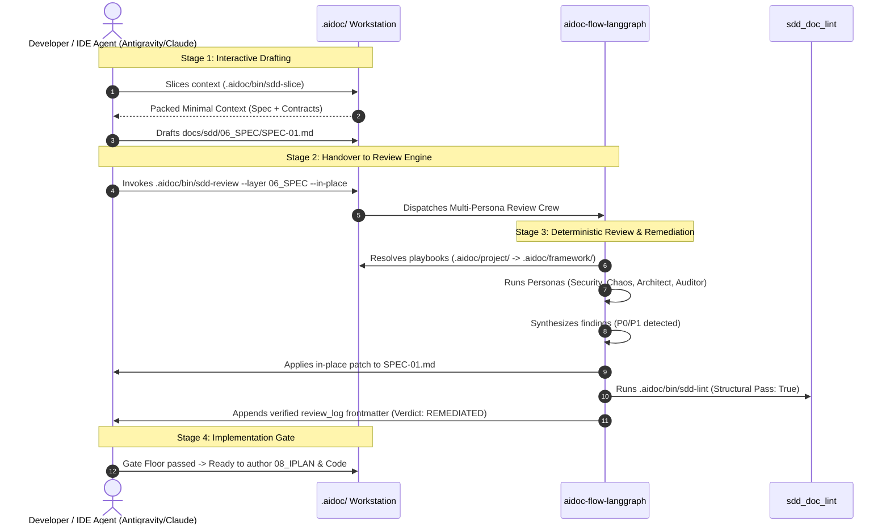

# `.aidoc/` Workstation Directory Standard & Dual-Control Architecture

## Document Control

| Field | Value |
|---|---|
| Version | 1.0 |
| Status | Approved |
| Last Updated | 2026-10-15 |
| Author | Framework Maintainer |
| Framework Version | 0.91.23 |
| Authority | [Decision D-0013 / GD-13](../framework/governance/DECISIONS.md), [`MULTI_PROJECT_FEDERATED_STANDARD.md`](../framework/governance/MULTI_PROJECT_FEDERATED_STANDARD.md), [`AIDOC.md`](../framework/governance/aidoc/AIDOC.md) |

---

## 1. Executive Summary & Purpose

This standard establishes the canonical **`.aidoc/` Workstation Directory Standard** and the **Dual-Control Architecture** across the Quad-Pillar federated ecosystem.

It defines how autonomous AI coding agents, human engineers, and background execution engines interact with consumer application repositories without coupling the engine-agnostic Process Canon to specific runtime engines or forking shared governance.

---

## 2. The 3-Tier Ecosystem Architecture

The architecture separates responsibilities into three distinct, non-overlapping tiers:



1. **Tier 0: Process Canon (`vladm3105/aidoc-flow-framework`):**
   The single source of truth for SDD rules, document schemas, review crew playbooks, and declarative CNCF Serverless Workflow state machines (`*.sw.yaml`). Governed by **Decision D-0013**: strictly vendor-neutral with zero runtime platform code.
2. **Tier 1: Pluggable Execution Engines (e.g., `vladm3105/aidoc-flow-langgraph`):**
   The concrete runtime orchestrators that execute the SDD flows. They compile multi-persona review crews into stateful graphs, manage crash recovery, and enforce remediation loops.
3. **Tier 2: Consumer Application Repositories (e.g., `auth-service`, `billing-service`):**
   Independent application repositories that adopt the framework through a standardized local `.aidoc/` directory.

---

## 3. Standardized `.aidoc/` Workstation Directory Topology

Every consumer project adopts the standardized `.aidoc/` workstation layout:

```text
<consumer-project>/
├── .aidoc/
│   ├── profile.yaml              # Declarative adaptation knobs (active layers, thresholds, tenant_id)
│   │
│   ├── project/                  # ⭐ TIER 1: PROJECT OVERRIDES & SPECIALIZED GOVERNANCE
│   │   ├── governance/           # Rewritten rules & specialized lifecycles
│   │   │   ├── CHG_EXECUTION_FLOW.md       # Custom change execution lifecycle
│   │   │   ├── GOVERNANCE_RULES.md         # Project-specific non-negotiables
│   │   │   └── WORKTREE_FLOW.md            # Project branching & worktree flow
│   │   ├── layers/               # Customized templates (e.g., specialized 10_EVAL)
│   │   ├── playbooks/            # Specialized review lenses (e.g., web3 security)
│   │   └── workflows/            # Custom declarative .sw.yaml state machines
│   │
│   ├── framework/                # ⭐ TIER 2: SHARED CANON (Pillar 1 - Process Canon)
│   │   ├── layers/               # Default templates (01_BRD .. 10_EVAL)
│   │   ├── playbooks/            # Standard persona playbooks (architect, security, etc.)
│   │   └── sdd_doc_lint/         # Canonical structural linters
│   │
│   ├── engine/                   # ⭐ TECHNICAL ENGINE BINDING
│   │   ├── engine.yaml           # Runtime config (engine: langgraph, mode: hybrid)
│   │   └── runner.sh             # Engine invocation hook
│   │
│   ├── contracts/                # ⭐ PILLAR 3: DATA CONTRACTS CANON (aidoc-data-contracts)
│   │   ├── contracts-registry.yaml
│   │   └── proto/                # Shared Proto3 schemas (iplan.proto, etc.)
│   │
│   ├── ctx-tools/                # ⭐ PILLAR 4: CONTEXT SLICING ENGINE (aidoc-context-tools)
│   │   └── config.yaml           # Token budgets & DAG traversal rules
│   │
│   └── bin/                      # ⭐ LIGHTWEIGHT PROJECT RUNNERS (Zero-Friction CLI)
│       ├── sdd-lint              # Runs linters (honoring .aidoc/project overrides)
│       ├── sdd-review            # Triggers LangGraph review crew (--standalone or --distributed)
│       └── sdd-slice             # Runs aidoc-context-tools to pack LLM context
│
├── docs/sdd/                     # Produced SDD specifications (01_BRD .. 10_EVAL)
└── src/                          # Project application source code
```

---

## 4. The Two-Tier Discovery Protocol (`ENGINE-DISCOV-01`)

To guarantee project flexibility without forking the Process Canon, all conforming execution engines must implement the **Two-Tier Discovery Protocol**:



### Discovery Precedence Order

```python
def resolve_resource(project_root: Path, relative_path: str) -> Path:
    """Resolve resources with project override precedence over canon defaults."""
    project_override = project_root / ".aidoc" / "project" / relative_path
    if project_override.exists():
        return project_override

    canon_default = project_root / ".aidoc" / "framework" / relative_path
    if canon_default.exists():
        return canon_default

    raise FileNotFoundError(
        f"Resource '{relative_path}' not found in .aidoc/project or .aidoc/framework"
    )
```

1. Check `.aidoc/project/{same-path}` first. If present, load the project-specific override.
2. If absent, fall back to `.aidoc/framework/{same-path}` (the shared canon default).
3. If absent in both locations, raise `ResourceNotFoundError`.

---

## 5. The Quality Gate Floor Invariant (`GATE-FLOOR-01`)

Project adaptation must never degrade system integrity. The framework enforces the **Quality Gate Floor Invariant**:

$$\text{Gate Floor} = (\text{sdd\_lint\_pass} == \text{true}) \land (\text{blocking\_findings} == 0)$$

1. **Strictly Additive or Specializing:** Project overrides in `.aidoc/project/` may introduce stricter thresholds, additional review personas (e.g. `pci_compliance_auditor.md`), or domain-specific checklists.
2. **Non-Weakening Invariant:** No override file in `.aidoc/project/` may:
   - Disable mandatory SDD layers (`BRD`, `SPEC`, `TDD`, `IPLAN`, `CHG`).
   - Demote blocking severity findings (P0/P1) to non-blocking advisory findings.
   - Suppress deterministic structural linter exit codes.
3. **CI Gate Enforcement:** Any project configuration or override violating `GATE-FLOOR-01` fails closed in CI with exit code 1 (`GATE-FLOOR-VIOLATION`).

---

## 6. Dual-Control Generator-Critic Architecture

To eliminate the LLM **"Self-Review Bias"** and **"Shortcut Syndrome"** (where an interactive agent rubber-stamps its own output), quality assurance is divided into two distinct roles:



### Stage 1: Interactive Generation (IDE Agent + Canon)

- **Role:** High-bandwidth interactive pairing between the human engineer and the IDE coding assistant.
- **Tools:** Consumes `.aidoc/framework/templates/` and `.aidoc/project/templates/` to rapidly draft requirements, specifications, and implementation plans.

### Stage 2: Deterministic Review & Remediation (LangGraph Engine)

- **Role:** Unskippable, adversarial quality evaluation.
- **Mechanism:** Compiled LangGraph `StateGraph`s execute multi-persona crews (Architect, Security, Auditor, Chaos) in parallel isolated contexts. Nodes are code-enforced: the agent cannot hallucinate past a review stage.
- **SAGA Remediation:** If blocking findings exist ($P0/P1 > 0$), the engine automatically patches the document, validates with `.aidoc/bin/sdd-lint`, and iterates up to `quality_loop_max_iterations` (default 3) before escalating to the developer.

---

## 7. Machine-Readable `review_log` Frontmatter Schema

All approved SDD artifacts must carry an immutable, machine-readable review record in their YAML frontmatter:

```yaml
---
id: "SPEC-AUTH-001"
title: "OAuth2 PKCE Token Exchange Service"
layer: "06_SPEC"
version: "1.0.0"
status: "Approved"
author: "tech_lead"
review_log:
  - pass: 1
    engine: "aidoc-flow-langgraph:0.2.0"
    mode: "team"
    verdict: "REMEDIATED" # Options: PASS | REMEDIATED | ESCALATED
    crew:
      - persona: "architect"
        weight: 30
        verdict: "PASS"
      - persona: "security_engineer"
        weight: 35
        verdict: "REMEDIATED"
      - persona: "auditor"
        weight: 35
        verdict: "PASS"
    findings_resolved: 2
    blocking_remaining: 0
    timestamp: "2026-10-15T14:30:00Z"
---
```

---

## 8. Distribution & Lightweight Workstation Packaging

To keep consumer repositories fast to clone and worktree-friendly:

| Component | Path | Distribution Mechanism | Responsibilities |
|---|---|---|---|
| **Process Canon** | `.aidoc/framework/` | Pinned shallow clone or git submodule | Layer templates, linters, default playbooks |
| **Project Overrides** | `.aidoc/project/` | Committed directly in project Git | Custom governance, specialized templates, custom flows |
| **Engine Binding** | `.aidoc/engine/` | Local config (`engine.yaml`) + runner | Configures engine runtime (LangGraph/Temporal) |
| **Data Contracts** | `.aidoc/contracts/` | Git submodule or native package dependency | Canonical Proto3 schemas & wire types |
| **Context Tools** | `.aidoc/ctx-tools/` | Installed tool (`aidoc-context-tools`) | `aidoc slice` context packing for LLMs |
| **CLI Runners** | `.aidoc/bin/` | Lightweight executable scripts | `.aidoc/bin/sdd-lint`, `sdd-review`, `sdd-slice` |

---

## 9. Summary Compliance Checklist for Consumers

1. **Zero-Runtime Application Tree:** Application code (`src/`) never imports runtime code from `.aidoc/framework/`.
2. **Discovery Compliance:** All local scripts and engine wrappers check `.aidoc/project/` before falling back to `.aidoc/framework/`.
3. **Gate Floor Verification:** All PRs run `.aidoc/bin/sdd-lint` and verify that `blocking_findings == 0` prior to merge.
4. **Dual-Control Enforcement:** Critical specifications (`06_SPEC`, `08_IPLAN`, `09_CHG`) pass through the multi-persona review crew before code authoring begins.
