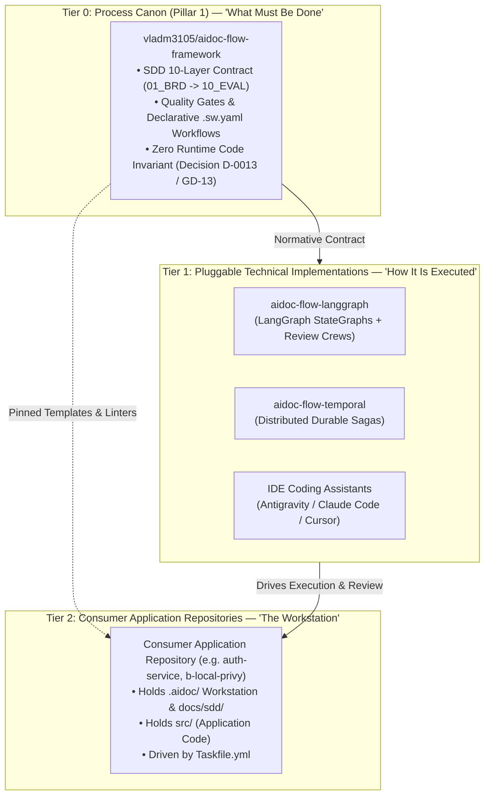
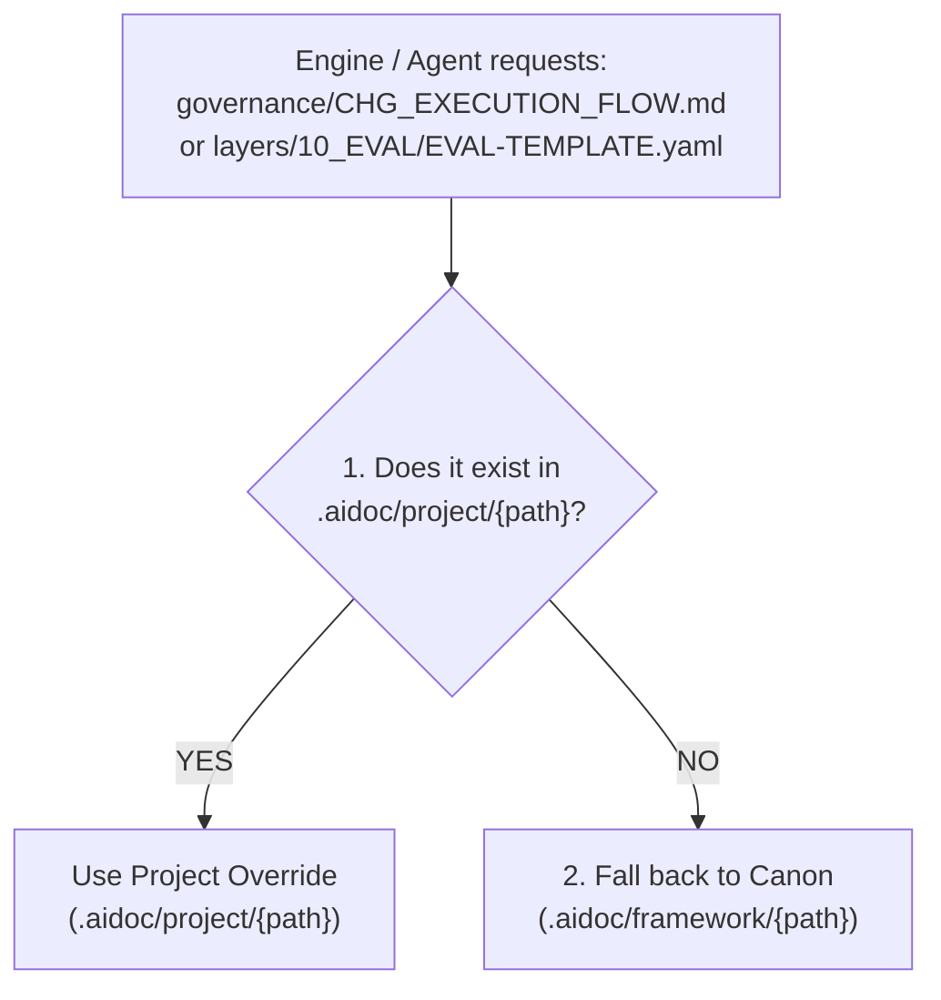
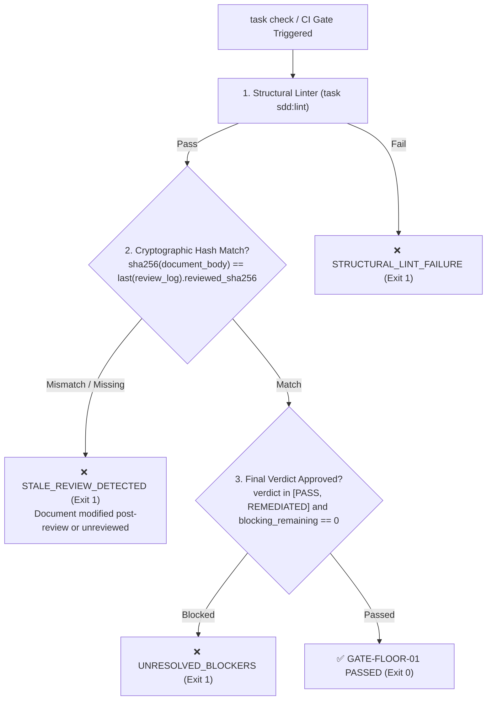
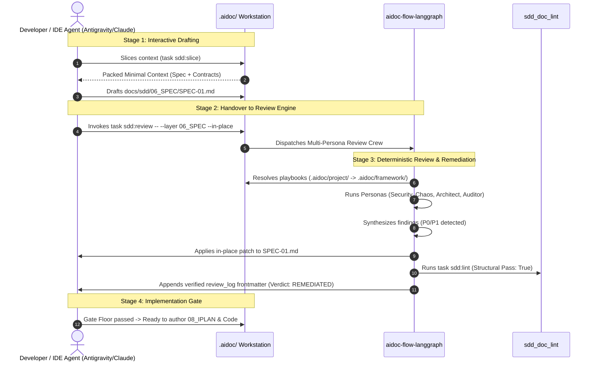

# `.aidoc/` Workstation Directory Standard & Dual-Control Architecture

## Document Control

| Field | Value |
|---|---|
| Version | 1.2 |
| Status | Approved |
| Last Updated | 2026-10-17 |
| Author | Framework Maintainer |
| Framework Version | 0.96.4 |
| Authority | [Decision D-0013 / GD-13](../framework/governance/DECISIONS.md), [`MULTI_PROJECT_FEDERATED_STANDARD.md`](../framework/governance/MULTI_PROJECT_FEDERATED_STANDARD.md), [`AIDOC.md`](../framework/governance/aidoc/AIDOC.md) |

---

## 1. Executive Summary & Purpose

This standard establishes the canonical **`.aidoc/` Workstation Directory Standard** and the **Dual-Control Architecture** across the Quad-Pillar federated ecosystem.

It defines how autonomous AI coding agents, human engineers, and background execution engines interact with consumer application repositories without coupling the engine-agnostic Process Canon to specific runtime engines or forking shared governance.

Consumer project workstations are bootstrapped and maintained by **`aidoc-project-onboarding`**:

* **Greenfield Inception:** `onboard greenfield --name <service> --profile <lang> --install` scaffolds the complete `.aidoc/` workstation layout.
* **Upstream Maintenance:** `onboard update --target .` reconciles `.aidoc/framework/` and `.aidoc/contracts/` pins with upstream releases without clobbering project adaptations in `.aidoc/project/`.

---

## 2. The 3-Tier Ecosystem Architecture

The architecture separates responsibilities into three distinct, non-overlapping tiers:



1. **Tier 0: Process Canon (`vladm3105/aidoc-flow-framework`):**
   The single source of truth for SDD rules, document schemas, review crew playbooks, and declarative CNCF Serverless Workflow state machines (`*.sw.yaml`). Governed by **Decision D-0013**: strictly vendor-neutral with zero runtime platform code.
2. **Tier 1: Pluggable Execution Engines (e.g., `vladm3105/aidoc-flow-langgraph`):**
   The concrete runtime orchestrators that execute the SDD flows. They compile multi-persona review crews into stateful graphs, manage crash recovery, and enforce remediation loops.
3. **Tier 2: Consumer Application Repositories (e.g., `auth-service`, `billing-service`):**
   Independent application repositories that adopt the framework through a standardized local `.aidoc/` directory.

---

## 3. Standardized `.aidoc/` Workstation Directory Topology

Every consumer project adopts the standardized `.aidoc/` workstation layout incorporating all four federated pillars:

```text
<consumer-project>/
├── .aidoc/
│   ├── profile.yaml              # Declarative adaptation knobs (active layers, thresholds, tenant_id)
│   ├── stack-policy.yaml         # ⭐ PILLAR 2: ENTERPRISE TECH STACK POLICY (schema 1.0.0)
│   ├── Taskfile.yml              # ⭐ CANONICAL SDD TASK DEFINITIONS (sdd:lint, sdd:review, sdd:slice, sdd:check)
│   │
│   ├── project/                  # ⭐ TIER 1: PROJECT OVERRIDES & SPECIALIZED GOVERNANCE
│   │   ├── Taskfile.yml          # Optional project-specific task overrides
│   │   ├── governance/           # Rewritten rules & specialized lifecycles
│   │   │   ├── CHG_EXECUTION_FLOW.md       # Custom change execution lifecycle
│   │   │   ├── GOVERNANCE_RULES.md         # Project-specific non-negotiables
│   │   │   └── WORKTREE_FLOW.md            # Project branching & worktree flow
│   │   ├── layers/               # Customized templates (e.g., specialized 10_EVAL)
│   │   ├── playbooks/            # Specialized review lenses (e.g., web3 security)
│   │   └── workflows/            # Custom declarative .sw.yaml state machines
│   │
│   ├── framework/                # ⭐ TIER 2: SHARED CANON (Pillar 1 - Process Canon)
│   │   ├── layers/               # Default templates (01_BRD .. 10_EVAL)
│   │   ├── playbooks/            # Standard persona playbooks (architect, security, etc.)
│   │   └── sdd_doc_lint/         # Canonical structural linters
│   │
│   ├── engine/                   # ⭐ TECHNICAL ENGINE BINDING
│   │   ├── engine.yaml           # Runtime config (engine: langgraph, mode: live|verify-only|mock)
│   │   └── runner.sh             # Engine invocation hook
│   │
│   ├── contracts/                # ⭐ PILLAR 3: DATA CONTRACTS CANON (aidoc-data-contracts)
│   │   ├── contracts-registry.yaml
│   │   └── proto/                # Shared Proto3 schemas (iplan.proto, etc.)
│   │
│   ├── ctx-tools/                # ⭐ PILLAR 4: CONTEXT SLICING ENGINE (aidoc-context-tools)
│   │   └── config.yaml           # Token budgets & DAG traversal rules
│   │
│   ├── cache/                    # ⭐ WORKSTATION CACHE (gitignored — local Kùzu index, AST cache)
│   │   └── kuzu.db/              # Ephemeral embedded graph database
│   │
│   └── bin/                      # (Optional) Backward-compatible CLI shims during migration
│       └── sdd-lint              # Compatibility shim delegating to task sdd:lint or python3 -m sdd_doc_lint
│
├── Taskfile.yml                  # Root project orchestrator (includes .aidoc/Taskfile.yml)
├── docs/sdd/                     # Produced SDD specifications (01_BRD .. 10_EVAL)
│   ├── graph/                    # ⭐ CANONICAL SDD-GRAPH v2.0 SLICES (*.graph.yaml)
│   ├── 01_BRD/                   # Layer 01 specifications
│   ├── ...                       # Intermediate layers
│   └── 10_EVAL/                  # Layer 10 evaluation & verification records
└── src/                          # Project application source code
```

---

## 4. The Two-Tier Discovery Protocol (`ENGINE-DISCOV-01`)

To guarantee project flexibility without forking the Process Canon, all conforming execution engines must implement the **Two-Tier Discovery Protocol**:



### Discovery Precedence Order

```python
def resolve_resource(project_root: Path, relative_path: str) -> Path:
    """Resolve resources with project override precedence over canon defaults."""
    project_override = project_root / ".aidoc" / "project" / relative_path
    if project_override.exists():
        return project_override

    canon_default = project_root / ".aidoc" / "framework" / relative_path
    if canon_default.exists():
        return canon_default

    raise FileNotFoundError(
        f"Resource '{relative_path}' not found in .aidoc/project or .aidoc/framework"
    )
```

1. Check `.aidoc/project/{same-path}` first. If present, load the project-specific override.
2. If absent, fall back to `.aidoc/framework/{same-path}` (the shared canon default).
3. If absent in both locations, raise `ResourceNotFoundError`.

### Atomic File Shadowing Rule

Discovery enforces **Atomic File Shadowing**:

* Any file placed in `.aidoc/project/{path}` completely shadows and replaces `.aidoc/framework/{path}` at the file level.
* **Partial key merging is not performed.** This eliminates non-deterministic inheritance bugs and ensures that configuration files, templates, and playbooks behave identically across all platforms and execution engines.

---

## 5. The Cryptographic Quality Gate Floor Invariant (`GATE-FLOOR-01`)

Project adaptation must never degrade system integrity. The framework enforces the **Cryptographic Quality Gate Floor Invariant**:

$$\text{Gate Floor} = (\text{sdd\_lint\_pass} == \text{true}) \land (\text{blocking\_findings} == 0) \land (\text{review\_sha256\_valid} == \text{true})$$



### 1. Invariant Rules

1. **Strictly Additive or Specializing:** Project overrides in `.aidoc/project/` may introduce stricter thresholds, additional review personas (e.g. `pci_compliance_auditor.md`), or domain-specific checklists.
2. **Non-Weakening Invariant:** No override file in `.aidoc/project/` may:
   * Disable mandatory SDD layers (`BRD`, `SPEC`, `TDD`, `IPLAN`, `CHG`).
   * Demote blocking severity findings (P0/P1) to non-blocking advisory findings.
   * Suppress deterministic structural linter exit codes.
3. **CI Gate Enforcement:** Any project configuration or override violating `GATE-FLOOR-01` fails closed in CI with exit code 1 (`GATE-FLOOR-VIOLATION`).

### 2. Canonical Hash Normalization Algorithm

To prevent false-positive validation failures caused by OS-dependent line endings (`\r\n` vs `\n`) or trailing whitespace, `reviewed_sha256` is strictly computed using the **Canonical Hash Normalization Algorithm**:

```python
import hashlib
import re

def compute_reviewed_sha256(raw_content: str) -> str:
    """Compute deterministic SHA-256 over document body excluding frontmatter."""
    # 1. Strip YAML frontmatter between leading ^--- and closing ^---
    body = re.sub(r"^---\n.*?\n---\n?", "", raw_content, flags=re.DOTALL)
    # 2. Normalize all line endings to POSIX LF (\n)
    normalized = body.replace("\r\n", "\n").replace("\r", "\n")
    # 3. Strip leading and trailing whitespace
    normalized = normalized.strip()
    # 4. Return lowercase hexadecimal SHA-256 of UTF-8 encoded bytes
    return hashlib.sha256(normalized.encode("utf-8")).hexdigest()
```

### 3. Brownfield Grandfathering & Mutation Scoping

* **Active PR Scope:** Any document added or modified in the current Pull Request must carry a valid `reviewed_sha256` matching the normalized body.
* **Grandfathered Scope:** Pre-existing completed documents in brownfield repositories without a `review_log` remain valid until modified by an authorizing Change Request.
* **Tamper Proofing:** Any approved document carrying a `review_log` is verified against its hash; post-review mutation triggers `STALE_REVIEW_DETECTED`.

---

## 6. Dual-Control Generator-Critic Architecture

To eliminate LLM **"Self-Review Bias"** and **"Shortcut Syndrome"** (where an interactive agent rubber-stamps its own output), quality assurance is divided into two distinct roles:



### Stage 1: Interactive Generation (IDE Agent + Canon)

* **Role:** High-bandwidth interactive pairing between the human engineer and the IDE coding assistant.
* **Tools:** Consumes `.aidoc/framework/templates/` and `.aidoc/project/templates/` to rapidly draft requirements, specifications, and implementation plans.

### Stage 2: Deterministic Review & Remediation (LangGraph Engine)

* **Role:** Unskippable, adversarial quality evaluation.
* **Mechanism:** Compiled LangGraph `StateGraph`s execute multi-persona crews (Architect, Security, Auditor, Chaos) in parallel isolated contexts. Nodes are code-enforced: the agent cannot hallucinate past a review stage.
* **SAGA Remediation:** If blocking findings exist ($P0/P1 > 0$), the engine automatically patches the document, validates with `task sdd:lint`, and iterates up to `quality_loop_max_iterations` (default 3) before escalating to the developer.

### The 3 Engine Operating Modes (`.aidoc/engine/engine.yaml`)

```yaml
# .aidoc/engine/engine.yaml
engine: "aidoc-flow-langgraph"
version: "0.2.0"
mode: "live" # Options: live | verify-only | mock

thresholds:
  min_crew_score: 85
  max_remediation_iterations: 3
  fail_on_p0: true
  fail_on_p1: true
```

1. **`live` Mode (Authoring in IDE / Local Dev):**
   * Dispatches the full LangGraph multi-persona review crew (Architect, Security, Auditor).
   * Executes the automated SAGA remediation loop for $P0/P1$ findings up to `max_remediation_iterations`.
   * On clean completion, calculates normalized $\text{SHA-256}(\text{body})$ and appends the verified `review_log` frontmatter.
2. **`verify-only` Mode (Headless / Pull Request CI):**
   * **Zero LLM tokens, zero API calls, air-gap safe.**
   * Verifies that the document carries a `review_log` entry with `verdict: PASS | REMEDIATED`, `blocking_remaining: 0`, and that `reviewed_sha256` strictly matches the normalized document body.
3. **`mock` / `dry-run` Mode (Integration Testing):**
   * Runs the LangGraph state machine with deterministic, heuristic rule-based checks to validate workflow graphs without invoking external LLMs.

---

## 7. Machine-Readable `review_log` Frontmatter Schema

All approved SDD artifacts must carry an immutable, machine-readable review record in their YAML frontmatter:

```yaml
---
id: "SPEC-AUTH-001"
title: "OAuth2 PKCE Token Exchange Service"
layer: "06_SPEC"
version: "1.0.0"
status: "Approved"
author: "tech_lead"
review_log:
  - pass: 1
    engine: "aidoc-flow-langgraph:0.2.0"
    mode: "live"
    verdict: "REMEDIATED" # Options: PASS | REMEDIATED | ESCALATED
    reviewed_sha256: "b94d27b9934d3e08a52e52d7da7dabfac484efe37a5380ee9088f7ace2efcde9" # pragma: allowlist secret
    crew:
      - persona: "architect"
        weight: 30
        verdict: "PASS"
      - persona: "security_engineer"
        weight: 35
        verdict: "REMEDIATED"
      - persona: "auditor"
        weight: 35
        verdict: "PASS"
    findings_resolved: 2
    blocking_remaining: 0
    timestamp: "2026-10-15T14:30:00Z"
---
```

---

## 8. Distribution, Packaging & Taskfile Integration

### Workstation Git Tracking Policy Table

| Path | Git Tracking Policy | Rationale |
|:---|:---|:---|
| `.aidoc/profile.yaml` | **Tracked** | Core project configuration contract |
| `.aidoc/stack-policy.yaml` | **Tracked** | Pillar 2 Enterprise Technology Stack contract |
| `.aidoc/Taskfile.yml` | **Tracked** | Canonical task runner definitions |
| `.aidoc/project/` | **Tracked** | Project overrides and specialized playbooks |
| `.aidoc/engine/engine.yaml` | **Tracked** | Engine selection and mode configuration |
| `.aidoc/ctx-tools/config.yaml`| **Tracked** | Context slicing budgets and DAG config |
| `.aidoc/framework/` | **Submodule OR Dynamic Clone** | If submodule: committed pin; if dynamic: managed via `onboard update` |
| `.aidoc/contracts/` | **Submodule OR Package** | Pinned to `aidoc-data-contracts` |
| `.aidoc/bin/` | **Optional / Deprecated** | Backward-compatible shims only |

> **Rule:** Raw filesystem symlinks (`.aidoc/framework -> ../../aidoc-framework`) in version control are strictly forbidden.

### Canonical SDD Tasks (`.aidoc/Taskfile.yml`)

```yaml
# .aidoc/Taskfile.yml — Canonical SDD Tasks
version: '3'

vars:
  SDD_DIR: '{{.SDD_DIR | default "docs/sdd"}}'
  ENGINE_CONFIG: '{{.ENGINE_CONFIG | default ".aidoc/engine/engine.yaml"}}'

tasks:
  lint:
    desc: "Run structural SDD linter over docs/sdd with project overrides"
    preconditions:
      - sh: 'python3 -c "import sdd_doc_lint" 2>/dev/null || test -d .aidoc/framework/sdd_doc_lint'
        msg: "sdd_doc_lint not found. Install dependencies or sync .aidoc/framework."
    cmds:
      - python3 -m sdd_doc_lint {{.SDD_DIR}} {{.CLI_ARGS}}

  review:
    desc: "Execute multi-persona review crew (live or verify-only mode)"
    cmds:
      - python3 -m aidoc_flow_langgraph.cli review --config {{.ENGINE_CONFIG}} {{.CLI_ARGS}}

  slice:
    desc: "Slice and pack SDD context DAG for LLM prompts (with native fallback)"
    cmds:
      - >-
        python3 -c "import aidoc_context" 2>/dev/null &&
        python3 -m aidoc_context.cli.main slice {{.CLI_ARGS}} ||
        python3 -m sdd_doc_lint --slice {{.CLI_ARGS}}

  check:
    desc: "Full SDD Gate: adaptation profile + structural linting + cryptographic review verification"
    cmds:
      - task: profile-lint
      - task: lint
      - task: review
        vars: { CLI_ARGS: "--verify-only" }

  graph-check:
    desc: "Run Binary Topological Validation (BTV) over docs/sdd/graph/"
    cmds:
      - python3 -m sdd_doc_lint --graph-check {{.SDD_DIR}}/graph/ {{.CLI_ARGS}}

  chg-lint:
    desc: "Run CHG structural linter on Change Requests in docs/sdd/09_CHG/"
    cmds:
      - python3 -m sdd_doc_lint.chg_lint {{.CLI_ARGS}}

  swf-lint:
    desc: "Run Serverless Workflow linter on declarative state machines"
    cmds:
      - python3 -m sdd_doc_lint.swf_lint {{.CLI_ARGS | default .SDD_DIR}}

  profile-lint:
    desc: "Validate adaptation profile against schema 1.1.0"
    cmds:
      - python3 -m sdd_doc_lint.profile_lint {{.CLI_ARGS | default ".aidoc/profile.yaml"}}
```

### Consumer Root Taskfile Integration (`Taskfile.yml`)

```yaml
# Root Taskfile.yml in consumer application
version: '3'

includes:
  sdd:
    taskfile: .aidoc/Taskfile.yml
    dir: .
    optional: true

vars:
  EXTRA_FAST_CHECKS: 'sdd:check' # Plugs directly into aidoc-local-flow-ci fast gate

tasks:
  check:
    desc: "Fast gate: runs linting, typechecking, and full SDD verification"
    cmds:
      - task: sdd:check
      - task: lint
      - task: test:fast
```

---

## 9. Summary Compliance Checklist for Consumers

1. **Zero-Runtime Application Tree:** Application code (`src/`) never imports runtime code from `.aidoc/framework/`.
2. **Discovery Compliance:** All local scripts and engine wrappers check `.aidoc/project/` before falling back to `.aidoc/framework/`.
3. **Gate Floor Verification:** All PRs run `task sdd:check` (or `task check`) and verify that `blocking_findings == 0` and `reviewed_sha256` matches prior to merge.
4. **Dual-Control Enforcement:** Critical specifications (`06_SPEC`, `08_IPLAN`, `09_CHG`) pass through the multi-persona review crew before code authoring begins.
