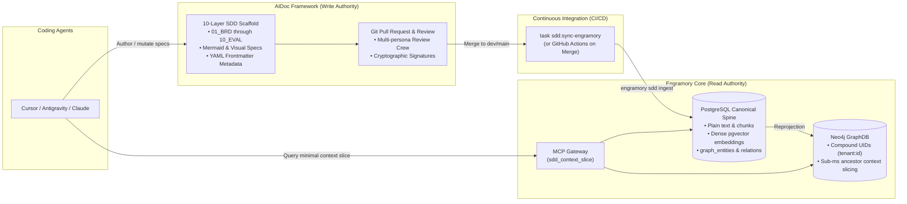

# Engramory Knowledge Sync Architecture for AIDoc Framework

## 1. Overview

This document specifies how specifications generated and governed by **AIDoc Framework** (`vladm3105/aidoc-flow-framework`) are integrated into **Engramory** (`vladm3105/aidoc-flow-engramory`), the enterprise memory and knowledge graph engine.

AIDoc Framework implements the **Write Model (Ground Truth / Docs-as-Code)**, while Engramory serves as the **Read Model (High-Performance Query Engine / Graph & RAG)**.

---

## 2. Architecture & Separation of Concerns



---

## 3. Principles of the Dual-Core Pattern

1. **Git is the Canonical Source of Truth**:
   - Every requirement, decision (ADR), specification, test scenario, and change envelope lives as version-controlled Markdown and YAML in `docs/sdd/` (or `framework/layers/`).
   - Human review, PR gating, git blame, commit histories, and visual diagrams (Mermaid, PlantUML) belong in Git.
   - Databases are **rebuildable projections**, not primary sources of truth.
2. **Engramory is the Primary Query & Retrieval Surface**:
   - AI coding agents should never load thousands of raw markdown files into their context window.
   - Instead, agents query Engramory via the Model Context Protocol (MCP) tool `sdd_context_slice` to receive the minimal, deterministic ancestor closure for their task (~1,500 tokens).
3. **Rich Visualizations & Media**:
   - Visual diagrams (Mermaid charts, sequence flows, architectural diagrams) are stored in Markdown files.
   - Engramory stores document summaries and provides clickable file URIs (`file:///docs/sdd/05_ADR/ADR-001.md`), allowing agents or human developers to inspect the full visual specification on demand.

---

## 4. Continuous Ingestion Protocol

### 4.1 Ingestion Command

To synchronize the project's SDD corpus into Engramory:

```bash
uv run engramory sdd ingest \
  --sdd-root docs/sdd \
  --tenant-id default \
  --project-id $(basename $(git rev-parse --show-toplevel))
```

During ingestion, Engramory guarantees:

- **Referential Integrity**: Automatic stub entity generation for forward or draft references, preventing database foreign key errors.
- **Atomic Bulk Upserts**: All entities and relations are persisted within a single transaction.
- **Tenant Isolation**: Neo4j graph nodes are tagged with compound `uid = "{tenant_id}:{id}"` so multiple projects never collide in shared graph environments.

### 4.2 Taskfile Integration (`.aidoc/Taskfile.yml`)

Add the `sync-engramory` task to `.aidoc/Taskfile.yml`:

```yaml
  sync-engramory:
    desc: "Synchronize local 10-layer SDD corpus into Engramory knowledge graph"
    cmds:
      - >-
        if command -v engramory >/dev/null 2>&1; then
          engramory sdd ingest --sdd-root "{{.SDD_DIR}}" {{.CLI_ARGS}};
        elif uv run engramory --version >/dev/null 2>&1; then
          uv run engramory sdd ingest --sdd-root "{{.SDD_DIR}}" {{.CLI_ARGS}};
        else
          echo "sdd:sync-engramory: engramory CLI not found; skipping.";
        fi
```

### 4.3 GitHub Actions Workflow (`.github/workflows/engramory-sync.yml`)

Run synchronization automatically whenever changes to `docs/sdd/**` merge into `dev` or `main`:

```yaml
name: Engramory Knowledge Sync

on:
  push:
    branches: [main, dev]
    paths:
      - 'docs/sdd/**'
      - 'framework/layers/**'

jobs:
  sync:
    runs-on: ubuntu-latest
    steps:
      - uses: actions/checkout@v4
      - uses: actions/setup-python@v5
        with:
          python-version: "3.12"
      - name: Install Engramory CLI
        run: pip install git+https://github.com/vladm3105/aidoc-flow-engramory.git
      - name: Sync Knowledge Graph
        env:
          ENGRAMORY_PG_DSN: ${{ secrets.STAGE_ENGRAMORY_PG_DSN }}
          NEO4J_URI: ${{ secrets.STAGE_NEO4J_URI }}
          NEO4J_USER: ${{ secrets.STAGE_NEO4J_USER }}
          NEO4J_PASSWORD: ${{ secrets.STAGE_NEO4J_PASSWORD }}
        run: |
          engramory sdd ingest --sdd-root docs/sdd --project-id aidoc-framework
```

---

## 5. Agent Workflow in AIDoc Framework Projects

1. **Task Assignment**: The coding agent is assigned an implementation task (e.g. `IPLAN-AUTH-004`).
2. **Context Retrieval**: The agent calls `sdd_context_slice(task_id="IPLAN-AUTH-004")` on Engramory MCP.
3. **Reasoning & Code Generation**: The agent feeds the clean, upstream closure (ADRs, SPECs, BDD scenarios) to the LLM (via LiteLLM proxy).
4. **Local Verification**: The agent runs `aidoc-ctx check-invariants` locally to ensure no public interface contracts were broken.
5. **Git PR**: The agent commits code changes and updated SDD specifications to Git.
6. **Continuous Sync**: On PR merge, CI triggers `engramory sdd ingest`, updating the central knowledge graph for all subsequent agent tasks.
