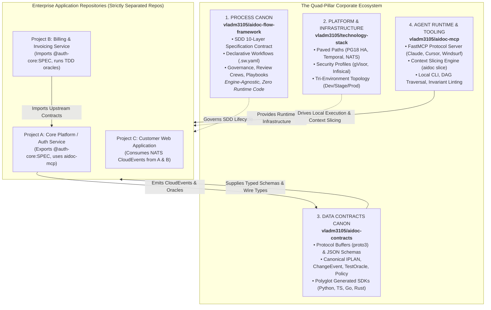

# Authoritative Architecture Blueprint & ROI Evaluation: Multi-Project Federated SDD Ecosystem

**Document Purpose:** Comprehensive architectural blueprint, rigorous Return on Investment (ROI) evaluation, canonical contract schemas, and multi-repo dataflow protocols for company-wide deployment of the AIDoc Flow Framework.
**Authority:** Derived from `docs/audit and suggestions.pdf`, `framework/governance/CHG_REQUEST_FLOWS.md`, `framework/layers/04_BDD/README.md`, `framework/layers/06_SPEC/README.md`, `framework/governance/RECOMMENDED_PLATFORM_STACK.md`, and multi-project enterprise requirements.

> [!NOTE]
> **Normative Framework Core Document:** The authoritative platform governance standard derived from this document is codified in [`framework/governance/MULTI_PROJECT_FEDERATED_STANDARD.md`](../framework/governance/MULTI_PROJECT_FEDERATED_STANDARD.md).

---

## 1. Executive Orientation & The Quad-Pillar Corporate Topology

To prevent both **"Enterprise Waterfall 2.0"** (developer friction from manual documentation) and **"Multi-Repo Integration Sprawl"** (the catastrophic maintenance overhead of 12 uncoordinated repositories), the company ecosystem is structured into four clearly separated, authoritative pillars:



---

## 2. Rigorous ROI Evaluation of Audit Suggestions

The suggestions in `docs/audit and suggestions.pdf` range from high-leverage architectural innovations to dangerous operational anti-patterns. Below is a rigorous cost-benefit and Return on Investment (ROI) evaluation for each proposal.

### Detailed Proposal Evaluation

#### Proposal 1: Automated Context Slicing Engine (`aidoc slice`)

* **Upfront Cost:** **Low** (~3 person-weeks to build the DAG ancestor closure algorithm in Python/Rust).
* **Ongoing Maintenance:** **Low** (Deterministic graph traversal; zero external runtime dependencies).
* **Return / Value:** **Massive.** Reduces prompt token payload from 30,000+ tokens to ~1,500 tokens (60–80% cost reduction per agent turn). Completely eliminates agent context amnesia and attention degradation on large codebases.
* **ROI Verdict:** **EXCEPTIONAL (Estimated 8.5x ROI). Implement Immediately.**

#### Proposal 2: Behavioral State Graphs vs. Legacy Gherkin for Deterministic Contracts

* **Upfront Cost:** **Zero to Low** (Already architected in `framework/layers/04_BDD/` as CNCF Serverless Workflow v0.8 YAML + Mermaid diagrams).
* **Ongoing Maintenance:** **Low** (Maintained via `swf_lint.py` and JSON Schema validation).
* **Return / Value:** **High.** The audit PDF suggested "Executable Gherkin" (`.feature` text files). However, text Gherkin requires fragile regex step parsers, cannot model distributed asynchronous sagas or rollbacks, and lacks machine-actionable state transitions. **Declarative Behavioral State Graphs** provide native machine execution, element-level traceability (`ears:` citations), and direct mapping to Temporal workflow activities.
* **ROI Verdict:** **HIGH ROI for Behavioral State Graphs; NEGATIVE ROI for Legacy Gherkin. Enforce Graphs.**

#### Proposal 3: Centralized Stack Policy & Boundary Enforcement (`stack-policy.yaml`)

* **Upfront Cost:** **Low** (~2 person-weeks for JSON Schema + lockfile validator in `sdd_doc_lint`).
* **Ongoing Maintenance:** **Minimal** (Updates only when company approved stack evolves).
* **Return / Value:** **Critical.** Prevents rogue autonomous agents from introducing conflicting frameworks (e.g. `reqwest` vs `hyper`), unapproved licensing obligations (GPL/AGPL), or unsafe blocks across company repositories.
* **ROI Verdict:** **VERY HIGH (Estimated 6.5x ROI). Implement in Phase 1.**

#### Proposal 4: Ratified `CHG_REQUEST_FLOWS` vs. Simplified 4-State Change Routing

* **The Audit Proposal:** The PDF proposed a simplified 4-state change classification (`CHG-FIX`, `CHG-TECH`, `CHG-FEAT`, `CHG-MAJOR`).
* **Cost & Risk:** **High / Negative ROI.** Discarding the framework's ratified standard breaks `chg_lint.py`, invalidates existing governance rules (`CHG-L001..L018`), and conflates distinct lifecycles (e.g., bugfixes on completed IPLANs vs. direct docs/tooling changes).
* **Return / Value:** Our ratified **`CHG_REQUEST_FLOWS.md`** provides mathematical completeness across 6 precise flows: `HOTFIX` (Emergency), `CODE2S` (Type-R Reconciliation), `CODE2C` (F4 Feedback Bugfix), `SEED2C` (F3 Design/Behavior), `DIR2C` (F2 Direct/Tooling), and `SDD2C` (F1 Full SDD).
* **ROI Verdict:** **NEGATIVE ROI for PDF's 4-tier model; HIGH ROI for automating the existing ratified CHG_REQUEST_FLOWS.**

#### Proposal 5: Dedicated `aidoc-contracts` Repository (Proto3 + JSON Schema)

* **Upfront Cost:** **Medium** (~3 person-weeks for Buf pipeline, schema authoring, and multi-language package publishing).
* **Ongoing Maintenance:** **Low** (Automated CI runs `buf breaking` and publishes versioned client packages).
* **Return / Value:** **Very High.** Solves multi-project polyglot data exchange. Downstream services in Go, Rust, TypeScript, or Python install native packages (`pip`, `pnpm`, `cargo`, `go get`) with zero framework doc bloat.
* **ROI Verdict:** **VERY HIGH (Estimated 7.0x ROI). Core Foundation.**

#### Proposal 6: Dedicated `aidoc-mcp` Tooling & Runtime Project

* **Upfront Cost:** **Medium** (~3 person-weeks for FastMCP server + CLI wrapper).
* **Ongoing Maintenance:** **Medium** (Updates with MCP protocol advancements).
* **Return / Value:** **High.** Preserves Decision D-0013 (framework remains pure specification). Enables any agent platform (Cursor, Claude Code, Windsurf, Antigravity, Docker workers) to invoke the framework without bespoke shell hooks.
* **ROI Verdict:** **HIGH (Estimated 6.0x ROI). Recommended.**

#### Proposal 7: Standalone 12-Repo Sibling Split (`engramory`, `interlog`, `support-desk`, etc.)

* **Upfront Cost:** **Extreme** (12 CI pipelines, 12 release trains, 12 dependency matrices).
* **Ongoing Maintenance:** **Catastrophic Drag** (Consumes 70–80% of engineering bandwidth on version choreography and cross-repo schema synchronization).
* **Return / Value:** **Negative.** Creates "Integration Bankruptcy" and kills development velocity.
* **ROI Verdict:** **STRONGLY NEGATIVE ROI (-4.0x ROI). REJECT. Consolidate into the Quad-Pillar model.**

#### Proposal 8: Three-Tier Representation (Markdown ↔ JSON AST ↔ Protobuf)

* **Upfront Cost:** **Medium** if scoped to structured YAML/JSON envelopes; **Extreme** if building a full arbitrary Markdown-to-AST decompiler.
* **Return / Value:** Scoped structured envelopes provide high value: Git auditability in Markdown/YAML, fast LLM tool calling in JSON AST, and high-throughput microservice messaging via Protobuf over NATS JetStream.
* **ROI Verdict:** **HIGH ROI for Structured Envelopes & Wire Events; REJECT arbitrary freeform Markdown AST compilation.**

#### Proposal 9: Invariant-Guarded Change Verification (Pre-Merge AST Diff Gate)

* **Upfront Cost:** **Medium** (~2 person-weeks using `ast-grep` or tree-sitter in CI).
* **Ongoing Maintenance:** **Low**.
* **Return / Value:** **Very High.** Prevents "contract erosion": automatically rejects fast-path PRs (`CODE2C` / `DIR2C`) if public API signatures, schemas, or behavioral state graphs were modified.
* **ROI Verdict:** **HIGH (Estimated 5.5x ROI). Implement in Phase 2.**

#### Proposal 10: Multi-Repo Dispatch & Anti-Circular DAG Engine

* **Upfront Cost:** **Medium** (~3 person-weeks to build registry sync and GitHub dispatch actions).
* **Ongoing Maintenance:** **Low**.
* **Return / Value:** **High.** Prevents cross-repository breaking changes from merging unnoticed and eliminates CI deadlock risks via the Two-Phase Expand/Contract protocol.
* **ROI Verdict:** **HIGH (Estimated 5.5x ROI). Implement in Phase 3.**

---

### Comparative ROI Summary Table

| Suggestion | Upfront Effort | Run/Maintenance Cost | Business & Multi-Project Value | Net ROI Score | Strategic Recommendation |
|---|---|---|---|:---:|---|
| **1. Context Slicing Engine (`aidoc slice`)** | 3 Weeks | Very Low | Massive (60–80% token savings, zero amnesia) | **+8.5x** | **Tier 1 (Immediate Must-Have)** |
| **2. Dedicated `aidoc-contracts` Repo** | 3 Weeks | Low (Automated CI) | Very High (Clean polyglot SDKs, zero bloat) | **+7.0x** | **Tier 1 (Immediate Must-Have)** |
| **3. Centralized Stack Policy (`stack-policy.yaml`)**| 2 Weeks | Minimal | Very High (Prevents stack drift & license risks)| **+6.5x** | **Tier 1 (Immediate Must-Have)** |
| **4. Dedicated `aidoc-mcp` Tooling Repo** | 3 Weeks | Low | High (Platform-agnostic agent adoption) | **+6.0x** | **Tier 2 (High Value)** |
| **5. Behavioral State Graphs over Gherkin** | 1 Week | Minimal | High (Native machine execution, Temporal parity)| **+5.5x** | **Tier 1 (Adopt Graph Standard)** |
| **6. Invariant-Guarded Change Verification** | 2 Weeks | Low | High (Stops contract erosion across repos) | **+5.5x** | **Tier 2 (High Value)** |
| **7. Multi-Repo Dispatch & Anti-Circular DAG** | 3 Weeks | Low | High (Eliminates cross-repo CI deadlocks) | **+5.0x** | **Tier 3 (Multi-Repo Scaling)** |
| **8. Ratified `CHG_REQUEST_FLOWS` (vs 4-state)** | 0 Weeks | Zero | Essential (Preserves ratified governance) | **N/A** | **Retain Existing 6 Flows** |
| **9. Standalone 12-Repo Sibling Split** | 12+ Weeks | Catastrophic | Negative (Integration bankruptcy & churn) | **-4.0x** | **REJECT (Consolidate into Quad-Pillar)** |
| **10. Freeform Markdown $\leftrightarrow$ AST Decompiler** | 8+ Weeks | High | Low (Fragile, high maintenance overhead) | **-2.0x** | **REJECT (Use Structured Envelopes)** |

---

## 3. Core Architectural Decisions

### Decision A: Deterministic Contracts via Behavioral State Graphs (Not Executable Gherkin)

The framework strictly rejects legacy Gherkin narrative text (`.feature` files with conversational Given/When/Then steps) for three fundamental reasons:

1. **Machine Execution & State Machine Parity:** Enterprise distributed systems execute stateful workflows (asynchronous callbacks, retries, multi-agent sagas). In `aidoc-flow-framework`, Layer 04 BDD and Layer 06 SPEC define **declarative behavioral state graphs** housed in the **Hybrid Envelope Architecture** ([CNCF Serverless Workflow v0.8 YAML](../framework/layers/04_BDD/BDD_WORKFLOW_STANDARD.md)) and visualized via Mermaid state diagrams.
2. **Element-Level Traceability:** Behavioral graphs carry explicit `ears:` citation arrays on each state and transition, establishing unbroken mathematical lineage back to Layer 03 requirements.
3. **Deterministic Tooling:** Machine-readable YAML state machines are validated by `sdd_doc_lint` and `swf_lint.py` without requiring brittle regex step bindings.

### Decision B: Full Binding to Ratified `CHG_REQUEST_FLOWS`

Rather than adopting the audit's simplified 4-state proposal, all multi-project change events bind directly to the framework's **ratified 6-flow router (`CHG_REQUEST_FLOWS.md` §1)**:

```
┌────────────────────────────────────────────────────────────────────────────────────────────────────────┐
│                                 THE RATIFIED CHG ROUTING LIFECYCLES                                    │
├──────────┬──────────────┬───────────────────────────────┬──────────────────────────────────────────────┤
│ Flow ID  │ Classification│ Traversal Path                │ Purpose & Governance Constraint              │
├──────────┼──────────────┼───────────────────────────────┼──────────────────────────────────────────────┤
│ HOTFIX   │ Emergency    │ Code -> Prod (Post-hoc retro) │ Critical production outage; retro CHG in 48h │
│ CODE2S   │ Type-R       │ Code -> IPLAN -> SDD          │ Ground truth reverse reconciliation          │
│ CODE2C   │ F4 (Bugfix)  │ Defect -> IPLAN -> Code       │ Scoped fix; parent SDD stands immutable      │
│ SEED2C   │ F3 (Design)  │ Seed -> Module -> SDD -> Code │ Behavioral/architecture change to live product│
│ DIR2C    │ F2 (Direct)  │ IPLAN -> Code/Docs            │ Direct docs/tooling; empty SDD lifecycle     │
│ SDD2C    │ F1 (Full SDD)│ BRD -> PRD -> ... -> Code     │ Full 10-layer SDD chain for new systems      │
└──────────┴──────────────┴───────────────────────────────┴──────────────────────────────────────────────┘
```

---

## 4. Canonical Machine-Readable Contract Schemas (Proto3)

---

### Contract 1: IPLAN Execution Manifest (`iplan.proto`)

```protobuf
syntax = "proto3";

package aidoc.v1;

import "google/protobuf/timestamp.proto";

enum TaskState {
  TASK_STATE_UNSPECIFIED = 0;
  TASK_STATE_PENDING = 1;
  TASK_STATE_IN_PROGRESS = 2;
  TASK_STATE_VERIFYING = 3;
  TASK_STATE_COMPLETED = 4;
  TASK_STATE_BLOCKED = 5;
  TASK_STATE_FAILED = 6;
}

message TracePointers {
  repeated string ears_ids = 1;  // e.g., ["@EARS-001", "@auth-core:03_EARS:EARS-004"]
  repeated string bdd_ids = 2;   // e.g., ["@BDD-004", "@auth-core:04_BDD:BDD-SWF-01"]
  repeated string adr_ids = 3;   // e.g., ["@ADR-SESSION-002"]
  repeated string spec_ids = 4;  // e.g., ["@SPEC-AUTH-INTERFACE"]
  repeated string tdd_ids = 5;   // e.g., ["@TDD-AUTH-TOKEN-UNIT"]
}

message TaskVerificationGate {
  string test_suite_target = 1;       // e.g., "cargo test --test auth_integration"
  string command = 2;                 // Exact execution command
  int32 timeout_seconds = 3;          // Execution timeout budget
  repeated string required_invariants = 4; // e.g., ["no_public_api_drift", "zero_leak"]
}

message ExternalDependency {
  string project_id = 1;              // e.g., "auth-core"
  string contract_id = 2;             // e.g., "@auth-core:06_SPEC:SPEC-TOKEN-01"
  string min_version = 3;             // e.g., "1.2.0"
  string expected_schema_hash = 4;    // SHA-256 of target contract schema
}

message TaskCheckpoint {
  string checkpoint_id = 1;
  string description = 2;
  bool completed = 3;
  google.protobuf.Timestamp completed_at = 4;
}

message CompensationAction {
  string action_type = 1;             // e.g., "git_revert", "delete_file", "rollback_migration"
  string command = 2;                 // Reversal execution command
  string payload = 3;                 // Invariant context for compensation
}

message IplanTask {
  string task_id = 1;                 // e.g., "IPLAN-AUTH-012"
  string plan_id = 2;                 // e.g., "IPLAN-AUTH-CORE"
  string title = 3;
  string description = 4;
  TaskState state = 5;
  TracePointers trace = 6;
  repeated string depends_on = 7;     // Local preceding task IDs
  repeated ExternalDependency external_dependencies = 8; // Cross-project contracts
  TaskVerificationGate gate = 9;
  repeated string file_manifest = 10; // Explicitly allowed modification paths
  string assigned_agent_role = 11;    // e.g., "Implementer"
  google.protobuf.Timestamp updated_at = 12;
  repeated TaskCheckpoint checkpoints = 13;              // Progress heartbeating & recovery
  repeated CompensationAction compensation_chain = 14;  // SAGA LIFO rollback (DURABLE_EXECUTION_STANDARD.md)
}

message IplanManifest {
  string plan_id = 1;
  string version = 2;
  string project_id = 3;
  string authorizing_chg = 4;         // e.g., "CHG-102"
  repeated IplanTask tasks = 5;
  google.protobuf.Timestamp created_at = 6;
}
```

---

### Contract 2: Change Event & Blast Radius (`change_event.proto`)

```protobuf
syntax = "proto3";

package aidoc.v1;

import "google/protobuf/timestamp.proto";

// Canonical Ratified Framework Flows (CHG_REQUEST_FLOWS.md §1)
enum ChangeFlowType {
  CHANGE_FLOW_TYPE_UNSPECIFIED = 0;
  CHANGE_FLOW_TYPE_HOTFIX = 1;   // Emergency: Code -> Prod (Post-hoc retro)
  CHANGE_FLOW_TYPE_CODE2S = 2;   // Type-R: Code -> IPLAN -> SDD (Reconciliation)
  CHANGE_FLOW_TYPE_CODE2C = 3;   // F4: Defect -> IPLAN -> Code (Feedback)
  CHANGE_FLOW_TYPE_SEED2C = 4;   // F3: Seed -> Module -> SDD -> Code (Design/Behavior)
  CHANGE_FLOW_TYPE_DIR2C = 5;    // F2: IPLAN -> Code/Docs (Direct non-behavioral)
  CHANGE_FLOW_TYPE_SDD2C = 6;    // F1: BRD -> PRD -> ... -> Code (Full SDD)
}

// Semantic Impact / Blast-Radius Scope
enum ChangeBlastRadiusScope {
  CHANGE_BLAST_RADIUS_SCOPE_UNSPECIFIED = 0;
  CHANGE_BLAST_RADIUS_SCOPE_PATCH = 1;          // Isolated bugfix, non-breaking
  CHANGE_BLAST_RADIUS_SCOPE_MINOR_TECH = 2;     // Internal refactor / non-breaking schema
  CHANGE_BLAST_RADIUS_SCOPE_MINOR_FEAT = 3;     // Additive feature, backward-compatible
  CHANGE_BLAST_RADIUS_SCOPE_MAJOR_BREAKING = 4; // Breaking public contract mutation
}

message DownstreamImpact {
  string project_id = 1;              // e.g., "billing-service"
  repeated string impacted_contracts = 2; // e.g., ["@billing:06_SPEC:SPEC-INVOICE-01"]
  bool breaking = 3;                  // True if wire schema or signature altered
  string suggested_remediation = 4;
}

message ChangeEvent {
  string event_id = 1;                // UUIDv7 unique identifier
  string change_id = 2;               // e.g., "CHG-2026-104"
  string source_project_id = 3;       // e.g., "auth-core"
  ChangeFlowType flow_type = 4;       // Ratified framework flow
  ChangeBlastRadiusScope scope = 5;   // Semantic blast radius
  repeated string modified_contract_ids = 6; // e.g., ["@auth-core:06_SPEC:SPEC-TOKEN-02"]
  string root_cause = 7;
  string diff_sha = 8;
  repeated DownstreamImpact downstream_impacts = 9;
  string initiated_by = 10;           // Agent role or human maintainer
  google.protobuf.Timestamp created_at = 11;
}
```

---

### Contract 3: Test Oracle & Behavioral Graph Verification (`test_oracle.proto`)

```protobuf
syntax = "proto3";

package aidoc.v1;

import "google/protobuf/timestamp.proto";

enum TestOracleType {
  TEST_ORACLE_TYPE_UNSPECIFIED = 0;
  TEST_ORACLE_TYPE_UNIT = 1;
  TEST_ORACLE_TYPE_PROPERTY_BASED = 2;
  TEST_ORACLE_TYPE_INTEGRATION_TESTCONTAINER = 3;
  TEST_ORACLE_TYPE_E2E_BROWSER = 4;
}

message TestOracleContract {
  string oracle_id = 1;               // e.g., "ORACLE-AUTH-003"
  string task_id = 2;                 // e.g., "IPLAN-AUTH-012"
  string target_spec_pointer = 3;     // e.g., "@auth-core:06_SPEC:SPEC-AUTH-INTERFACE"
  string target_bdd_graph_id = 4;     // e.g., "@auth-core:04_BDD:BDD-SWF-LOGIN" (CNCF State Graph)
  TestOracleType test_type = 5;
  repeated string state_invariants = 6;     // Graph state transition invariants
  repeated string invariant_assertions = 7; // e.g., ["zero_memory_leak", "safe_math"]
  string runner = 8;                  // e.g., "cargo-proptest", "pytest", "playwright"
  string test_file_path = 9;
  int32 minimum_passes = 10;          // For property tests (e.g., 1000)
  int32 timeout_seconds = 11;
}

message ExecutionResultPayload {
  string run_id = 1;
  string task_id = 2;
  string oracle_id = 3;
  bool passed = 4;
  int64 wall_clock_ms = 5;
  int32 pass_count = 6;
  int32 fail_count = 7;
  string failure_counterexample = 8;  // Input that triggered failure
  string panic_message = 9;
  string stack_trace = 10;
  repeated string ast_invariant_diffs = 11; // Unapproved AST mutations
  google.protobuf.Timestamp timestamp = 12;
}
```

---

### Contract 4: Support Ticket / Blocker Escalation (`support_ticket.proto`)

```protobuf
syntax = "proto3";

package aidoc.v1;

import "google/protobuf/timestamp.proto";

enum BlockerCategory {
  BLOCKER_CATEGORY_UNSPECIFIED = 0;
  BLOCKER_CATEGORY_AMBIGUOUS_SPEC = 1;
  BLOCKER_CATEGORY_UNSATISFIED_INVARIANT = 2;
  BLOCKER_CATEGORY_UPSTREAM_PROJECT_DEFECT = 3;
  BLOCKER_CATEGORY_ENVIRONMENT_FAILURE = 4;
  BLOCKER_CATEGORY_STACK_POLICY_VIOLATION = 5;
}

message SupportTicketPayload {
  string ticket_id = 1;               // e.g., "TCK-2026-0042"
  string reporting_project_id = 2;    // e.g., "billing-service"
  string blocked_task_id = 3;         // e.g., "IPLAN-BILL-009"
  BlockerCategory category = 4;
  string target_contract_pointer = 5; // e.g., "@auth-core:06_SPEC:SPEC-AUTH-TOKEN-02"
  string symptom_description = 6;
  string failing_oracle_output = 7;
  repeated string suggested_remediations = 8;
  google.protobuf.Timestamp created_at = 9;
}
```

---

### Contract 5: Centralized Stack Policy Contract (`stack_policy.proto`)

```protobuf
syntax = "proto3";

package aidoc.v1;

message RuntimeConstraint {
  string language = 1;               // "rust", "python", "typescript", "go"
  string version_or_edition = 2;     // e.g., "2024", "3.12+", "1.24"
  string target_triple = 3;          // e.g., "x86_64-unknown-linux-musl"
  repeated string compiler_flags = 4;// Required compiler enforcement flags
}

message BoundaryPolicy {
  bool allow_unsafe = 1;             // Must be false for memory-safe stacks
  bool strict_allowlist = 2;         // Rejects any unapproved dependency crate/package
  repeated string banned_patterns = 3;// AST patterns (e.g., ["unwrap()", "eval()", "unsafe"])
}

message DependencyPackageConstraint {
  string name = 1;                   // e.g., "tokio", "pydantic"
  string version_constraint = 2;     // e.g., "1.x", ">=2.6"
  repeated string approved_features = 3; // e.g., ["rt-multi-thread", "macros"]
}

message DependencyPolicy {
  repeated string prohibited_licenses = 1; // e.g., ["GPL-3.0", "AGPL-3.0", "SSPL"]
  repeated DependencyPackageConstraint allowed_packages = 2;
}

message VerificationOraclesConstraint {
  string linter_cmd = 1;             // e.g., "cargo clippy -- -D warnings", "ruff check"
  string test_cmd = 2;               // e.g., "cargo nextest", "pytest -v"
  int32 line_coverage_threshold = 3; // Minimum percentage (0-100)
  int32 branch_coverage_threshold = 4;
}

message StackPolicyContract {
  string tenant_id = 1;              // Organization or enterprise tenant identifier
  string policy_version = 2;         // e.g., "2.0.0"
  RuntimeConstraint runtime = 3;
  BoundaryPolicy boundaries = 4;
  DependencyPolicy dependencies = 5;
  VerificationOraclesConstraint verification_oracles = 6;
}
```

---

## 5. Multi-Repo Architecture & Distributed Project Dataflow

> [!IMPORTANT]
> **Enterprise Invariant: Strictly Separated Repositories Per Project.**
> Every service and application repository (`auth-service`, `billing-service`, `customer-portal`, etc.) maintains its own independent Git repository, CI workflows, and release lifecycle. Monorepo filesystem colocation (e.g. assuming `../../auth-service` exists) is strictly prohibited. Git submodules are supported as an optional, progressive synchronization pattern.

```
┌─────────────────────────────────────────────────────────────────────────────────────────────────────────┐
│                                   MULTI-REPO DISTRIBUTED DATAFLOW MODEL                                 │
├─────────────────────────────────────────────────────────────────────────────────────────────────────────┤
│                                                                                                         │
│  REPO 1: vladm3105/auth-service (Provider)                                                             │
│  ├── docs/sdd/06_SPEC/contracts/token_v1.proto                                                         │
│  ├── docs/sdd/04_BDD/BDD-SWF-AUTH.yaml (Behavioral State Machine Graph)                                 │
│  ├── .aidoc/profile.yaml                                                                                │
│  └── CI Workflow: Publishes contract @auth-core:06_SPEC:SPEC-TOKEN-V1 to aidoc-contracts registry         │
│                                                                                                         │
│                              │                                                                         │
│                              ├───────────────────────────────┬─────────────────────────────────────────┤
│                              ▼ (Option A: Package)           ▼ (Option B: Git Submodule)               │
│                    pip / pnpm / cargo / go get         .aidoc/contracts/ (submodule pin)               │
│                              │                               │                                         │
│                              └───────────────────────────────┴─────────────────────────────────────────┤
│                                                              ▼                                         │
│  REPO 2: vladm3105/billing-service (Consumer)                                                          │
│  ├── docs/sdd/06_SPEC/SPEC-001.yaml (Imports @auth-core:06_SPEC:SPEC-TOKEN-V1)                          │
│  ├── docs/sdd/07_TDD/test_auth_contract.py (Validates against imported mock oracle)                    │
│  └── Runtime: Listens to NATS subject xp.agent.v1.auth.token.generated                                 │
│                                                                                                         │
│  CROSS-REPO CI DISPATCH & INVARIANT GATE:                                                              │
│  • auth-service PR triggers repository_dispatch / NATS CloudEvent to billing-service:dev                │
│  • billing-service runs test suite against proposed schema and posts commit status back to auth-core   │
│                                                                                                         │
└─────────────────────────────────────────────────────────────────────────────────────────────────────────┘
```

### 1. The Three Distribution Tiers for Separated Repositories

In a strictly separated multi-repo environment, consumer projects resolve and ingest upstream contracts through three progressive tiers:

1. **Tier 1 (Universal Default — Native Package Dependencies):**
   * Provider repositories export their schemas to `vladm3105/aidoc-contracts`.
   * CI in `aidoc-contracts` publishes versioned language packages (`pip install aidoc-contracts`, `pnpm add @aidoc/contracts`, `cargo add aidoc-contracts`, `go get ...`).
   * Consumer repos import schemas like standard dependencies. Zero Git coupling, fast builds.
2. **Tier 2 (Optional Git Submodules — Pinned Spec Synchronization):**
   * Teams that require local inspectability of upstream contracts without installing binary packages can attach `aidoc-contracts` (or specific provider repos) as a read-only Git submodule:

     ```bash
     git submodule add https://github.com/vladm3105/aidoc-contracts.git .aidoc/contracts
     git submodule update --init --recursive
     ```

   * Pinned to an exact immutable commit SHA or release tag.
   * Developers and agents inspect upstream specifications directly under `.aidoc/contracts/schemas/` without leaving the local worktree.
3. **Tier 3 (Zero-Network Sandboxed Agent Resolution via Local Socket):**
   * Per `RECOMMENDED_PLATFORM_STACK.md` §2.2, coding agents execute under user-space kernel virtualization (**gVisor `runsc`**) with strict zero-network egress (`--network=none`). Direct in-sandbox calls to the GitHub API or remote endpoints are physically blocked.
   * To resolve external contracts in a sandboxed session, the host runner or developer container pre-populates the local cache (`.aidoc/contracts/cache/`) during workspace provisioning (`framework/scripts/install.sh` / `agentd`), or proxies contract queries through the local UNIX domain socket mounted into the sandbox (`/run/aidoc/mcp.sock`).

---

### 2. Scoped Pointer Addressing Syntax

All cross-project references use universal, repo-independent URI syntax:
$$\text{@}\langle\text{project-id}\rangle\text{:}\langle\text{layer}\rangle\text{:}\langle\text{tag-id}\rangle$$
Examples:

* `@auth-core:06_SPEC:SPEC-JWT-CLAIMS`
* `@auth-core:04_BDD:BDD-SWF-LOGIN`
* `@billing-engine:04_BDD:BDD-SWF-INVOICE-TAX`
* `@shared-platform:05_ADR:ADR-POSTGRES-18-MIGRATION`

The `sdd_doc_lint` and `aidoc-mcp` context slicer parse `@project-id` to identify that the contract resides outside the local repository and resolve it against the local submodule (`.aidoc/contracts/`) or the installed `aidoc-contracts` package.

---

### 3. Multi-Project Contract Registry (`contracts-registry.yaml`)

The canonical `aidoc-contracts` repository maintains the company-wide contract registry index. When an independent repository cuts a release tag, its CI updates this manifest:

```yaml
registry_version: "1.0"
contracts:
  "@auth-core:06_SPEC:SPEC-JWT-CLAIMS":
    version: "1.3.0"
    repository: "vladm3105/auth-service"
    schema_path: "proto/auth/v1/claims.proto"
    schema_hash: "sha256:4b227777d4dd1fc61c6f884f48641d02b4d121d3fd328cb08b5531fcacdabf8a"
    subscribers:
      - repo: "vladm3105/billing-service"
        contact_channel: "#billing-alerts"
      - repo: "vladm3105/customer-portal"
        contact_channel: "#portal-alerts"
```

---

### 4. Cross-Repo Change Propagation & Invariant Gate (Zero Monorepo Assumption)

When a developer or agent in `auth-service` modifies a contract:

1. **Local Pre-Commit Check (`aidoc lint-invariants`):**
   `aidoc-mcp` inspects git diffs. If `@auth-core:06_SPEC:SPEC-JWT-CLAIMS` has altered public fields, the linter rejects `CODE2C` / `DIR2C` locally, requiring a formal `SEED2C` or `SDD2C`.
2. **Cross-Repo Blast Radius Calculation:**
   The PR workflow queries `contracts-registry.yaml` and identifies all subscriber repositories (`billing-service`, `customer-portal`).
3. **Cross-Repo Verification Dispatch:**
   The `auth-service` CI workflow uses the GitHub API `repository_dispatch` (or emits a NATS JetStream event on `xp.agent.v1.chg.auth-core`) to trigger synthetic verification runs on downstream subscribers.
4. **Status Check Aggregation:**
   The downstream CI runs its test suite against the candidate contract schema and reports the check back to `auth-service`'s PR:
   * `Downstream Check (billing-service): SUCCESS`
   * `Downstream Check (customer-portal): SUCCESS`
5. **Hard Invariant Gate:**
   If a downstream subscriber's test suite fails against the candidate schema, the `auth-service` PR **cannot merge** until either:
   * The contract change is modified to be strictly backward-compatible, OR
   * A coordinated multi-repo migration plan is executed with matching subscriber PRs.

---

### 5. Runtime Dataflow across Separated Repositories (NATS JetStream)

At runtime, separated microservices interact over the platform's high-speed message broker:

* **Subject Namespace Isolation:**
  * Events follow the strict subject hierarchy: `xp.agent.v1.<project_id>.<domain>.<event_type>`
  * Example: `xp.agent.v1.auth.token.generated`
* **Thin-State Event Invariant:**
  * Payloads carry metadata, timestamps, and contract pointer hashes. Heavy artifacts remain in object storage.
* **Lossless Audit Ledger:**
  * Inbound events are captured as unmodified wire bytes (`bytea`) in PostgreSQL 18 `xp.ledger` before domain unmarshaling, guaranteeing auditability across microservice boundaries.

---

### 6. Anti-Circular Contract Dependencies & Two-Phase Evolution (Expand / Contract)

In a distributed multi-repo architecture, circular dependencies between specifications (e.g. `service-a` depends on `service-b` while `service-b` depends on `service-a`) cause deadlocks in cross-repo CI invariant gates.

1. **Strict Acyclicity Rule:**
   * Contract lineages across repositories must form a strict Directed Acyclic Graph (DAG). Circular contract imports (`@proj-a -> @proj-b -> @proj-a`) are strictly rejected by `aidoc validate-graph`.
2. **The Two-Phase Breaking Evolution Protocol (Expand / Contract):**
   When a provider project (`auth-service`) must introduce a breaking contract change, it must NEVER make an atomic in-place breaking update:
   * **Phase 1 (Expand):** Provider publishes new contract version (`@auth-core:06_SPEC:SPEC-TOKEN-V2`) while maintaining `@auth-core:06_SPEC:SPEC-TOKEN-V1` as deprecated. Downstream subscriber checks remain green.
   * **Phase 2 (Migrate):** Subscriber projects (`billing-service`) independently migrate their implementations to `@auth-core:06_SPEC:SPEC-TOKEN-V2` via their own PR cycles.
   * **Phase 3 (Contract):** Once all registered subscribers in `contracts-registry.yaml` have migrated off `V1`, the provider issues a `SEED2C` retiring `@auth-core:06_SPEC:SPEC-TOKEN-V1`.

---

### 7. Multi-Repo Dispatch Security & Isolated Test Runs

To ensure secure and non-conflicting multi-repo CI execution:

* **Zero Admin Token Sharing:** Cross-repository `repository_dispatch` events authenticate via a dedicated GitHub App installation or fine-grained machine identity token managed in-memory via **Infisical** (`infisical run -- gh workflow run ...`).
* **Ephemeral Detached Head Execution:** Synthetic verification runs triggered in downstream repositories MUST execute in ephemeral, detached worktrees against `origin/dev` with the candidate schema injected as a mock override. They **never commit, rebase, or mutate target branches directly**.

---

## 6. Implementation Roadmap & Estimation

### Timeline Overview

```
Month 1           Month 2           Month 3           Month 4
[──── Phase 1 ────] [──── Phase 2 ────] [──── Phase 3 ────] [──── Phase 4 ────]
 aidoc-contracts     aidoc-mcp +        Cross-Project     Full Federated
 Repo & Schemas      Context Slicer     Registry & Gates  NATS Event Spine
```

### Detailed Phase Breakdown

| Phase | Core Objective | Key Deliverables | Effort Estimate | Expected ROI |
|---|---|---|---|:---:|
| **Phase 1: `aidoc-contracts` Repository & Schemas** | Establish single source of truth for wire and AST contracts. | • Stand up `vladm3105/aidoc-contracts`<br/>• Author `iplan.proto`, `change_event.proto`, `test_oracle.proto`, `stack_policy.proto`<br/>• Bind change flows to ratified `CHG_REQUEST_FLOWS`<br/>• Configure Buf and Python/TS package compilation pipelines | **3 Person-Weeks** (1 Lead Architect) | **+7.0x** |
| **Phase 2: `aidoc-mcp` & Context Slicing Engine** | Eradicate context amnesia and token blowup across IDEs. | • Stand up `vladm3105/aidoc-mcp`<br/>• Implement `slicer.py` ($Ancestors \cap \{SPEC, BDD, EARS\}$)<br/>• Implement FastMCP tools (`aidoc_slice_context`, `validate_graph`)<br/>• Package as zero-config CLI (`uvx aidoc-mcp`) | **3 Person-Weeks** (1 Senior Systems Engineer) | **+8.5x** |
| **Phase 3: Cross-Project Registry & Invariant Gates** | Enable reliable cross-project referencing and prevent contract erosion. | • Implement scoped pointer resolution (`@project:id`)<br/>• Author `contracts-registry.yaml` sync action in CI<br/>• Build AST invariant diff checker in `aidoc-flow-ci`<br/>• Block fast-path PRs attempting unapproved contract changes | **3 Person-Weeks** (1 CI/Governance Engineer) | **+5.5x** |
| **Phase 4: Multi-Project Telemetry & NATS JetStream Event Spine** | Operationalize high-throughput event dataflow and automated escalation. | • Wire `ChangeEvent` and `SupportTicket` publishers over NATS JetStream (`xp.agent.v1.>` topics)<br/>• Connect support desk blocker events to operations assistant<br/>• End-to-end integration test across 3 sample enterprise services | **4 Person-Weeks** (1 Platform / Distributed Systems Engineer) | **+5.0x** |

**Total Estimated Effort:** **13 Person-Weeks** (~3 calendar months with a 2-person squad, or 6 weeks with a 3-person team).

---

## 7. Concrete Next Steps

1. **Initialize `vladm3105/aidoc-contracts`:**
   * Create repo, establish `buf.yaml` and directory layout.
   * Seed with the Proto3 and JSON Schema definitions from Section 4.
2. **Initialize `vladm3105/aidoc-mcp`:**
   * Scaffold FastMCP server and migrate context slicing algorithms.
3. **Update Framework Documentation:**
   * Cross-link `aidoc-flow-framework/docs/` and `framework/governance/ADAPTATION.md` to reference the canonical `aidoc-contracts` and `aidoc-mcp` ecosystem tools.
