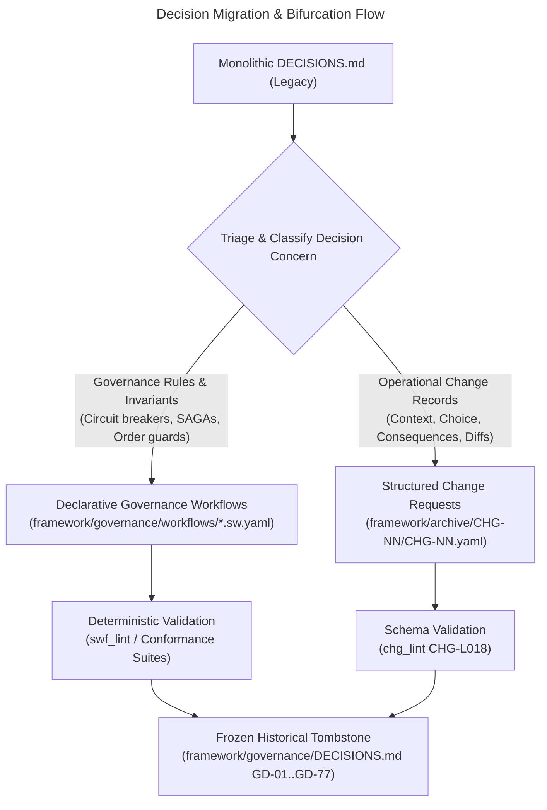
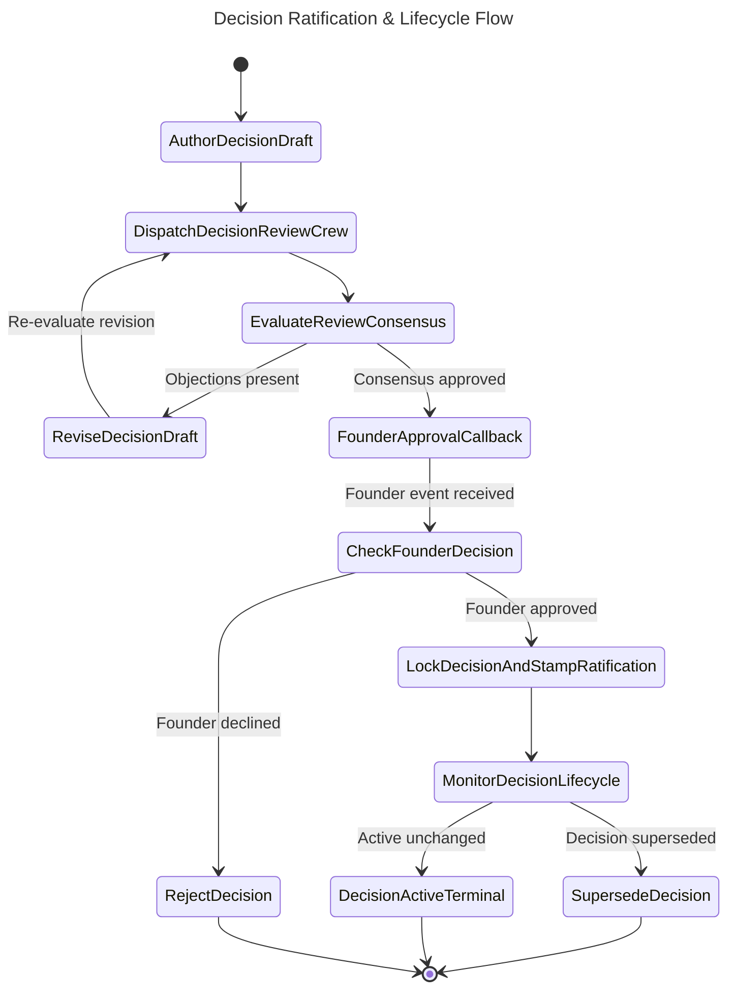

# Decision Workflow: Architecture, Governance, and Change Request Decisions

## Document Control {#sec-document-control}

| Field | Value |
|---|---|
| Version | 1.6 |
| Status | Approved |
| Last Updated | 2026-10-26 |
| Author | Framework Maintainer |
| Framework Version | 0.96.22 |


Defines the authorship boundaries, lifecycle, and decision-making procedures across
seed, module, SDD architectural decision records (Layer 05 ADR), and Change Requests (Layer 09 CHG).
This document prevents duplication, eliminates split-brain registries, and ensures every architectural
and governance choice is formally tracked by its authorizing change vehicle. It is engine-agnostic —
it constrains the artifacts and state machines, not any platform's runtime.

## Purpose {#sec-purpose}

The SDD framework has four distinct tiers where decisions are recorded, each with
a different author, content scope, and lifecycle:
1. **Initial Suggestions**: Seed documents explore options before development starts.
2. **Living Source of Truth**: Modules refine invariants and constraints.
3. **Project System Architecture**: SDD ADRs (Layer 05) select concrete system components.
4. **Change Request Governance**: Every Change Request (`CHG-NN`) articulates a formal decision record (`DEC-CHG-NN`).

Clarifying these boundaries eliminates duplication, prevents stale documents, and ensures complete
auditability between code diffs and architectural choices.

## Four-Tier Decision Model {#sec-four-tier-decision-model}

```
Tier 1: Seed             Tier 2: Module           Tier 3: SDD ADR          Tier 4: CHG Decision
(Architect)              (Product Owner)          (Dev Team)               (Change Author / Agent)
────────────────         ──────────────────       ───────────────          ───────────────────────
Suggestions              ALL source material      ONE selected option      FORMAL change decision
2-3 options              Refined decisions        Formal architecture      Context + Choice + Invariants
Options + rationale      Invariants + constraints Context-Decision-Conseq  Every CHG (C1, C2, C3, EMG)
Frozen per version       Living document          Versioned per CHG        Mandatory in CHG Section 1B
```

### Tier 1: Seed Documents {#sec-tier-1-seed-documents}

- **Author:** System architect, with stakeholder/management input
- **Content:** Initial architecture suggestions, 2-3 options per decision,
  design principles, rationale for each option
- **Location:** `<project>/seed/architecture/`, `<project>/seed/agent-surface/`
  (canonical Tier 1 Inputs path; scaffold: `framework/templates/SEED-TEMPLATE.md`)
- **Lifecycle:** Frozen per version once the first BRD of a cycle is authored
  (per `SEED_CONTRACT.md` R1); supersedes version via F3 Phase 0a per GD-36

**What seed docs contain:**
- "Here are 3 options for telemetry collection"
- "Option A: managed Grafana Cloud. Option B: self-hosted. Option C: hybrid"
- "Design principle: vendor-neutral, PII-safe, layered"
- "ADR-14 accepted this strategy but was never implemented"

**What seed docs do NOT contain:**
- Final implementation decisions
- Code-level constraints
- Business requirements (those belong in BRD)

### Tier 2: Module Docs {#sec-tier-2-module-docs}

- **Author:** Product owner, refined by development team
- **Content:** ALL source material for a module — overview, refined decisions,
  invariants, constraints, seed references, business rules, acceptance criteria
- **Location:** `<project>/modules/MODULE-NN_name.md` (can have multiple files per module)
- **Lifecycle:** Living document, updated as understanding evolves

**What module docs contain:**
- Refined design principles (from seed, validated against codebase reality)
- Invariants (non-negotiable constraints)
- Business rules and acceptance criteria
- Seed references with context
- Architecture diagrams
- Implementation roadmap
- Dependencies and constraints

**Module is the single source of truth.** Everything needed to write a BRD for
this module lives in the module doc.

### Tier 3: SDD ADR (Layer 5) {#sec-tier-3-sdd-adr-layer-5}

- **Author:** Development team (AI agent + human tech lead)
- **Content:** ONE selected architecture and technology stack selection with Context-Decision-Consequences (the formal selection gate immediately after BDD per [`TECHNOLOGY_STACK_USAGE_GUIDE.md`](TECHNOLOGY_STACK_USAGE_GUIDE.md))
- **Location:** `<project>/sdd/05_ADR/ADR-NN_name.yaml`
- **Lifecycle:** Versioned per CHG (rewritten, not appended)

**What SDD ADRs contain:**
- "We chose PostgreSQL 18 with native UUIDv7 and xp.ledger over ClickHouse for transactional ledger state"
- Context: why this decision matters, citing upstream `@ears` timing constraints and `@bdd` failure scenarios
- Decision: what was selected from the approved platform stack (`vladm3105/technology-stack`)
- Consequences: what this enables and constrains for downstream SPEC (Layer 06)
- Alternatives considered: evaluated via quantitative MCDA utility scoring

**What SDD ADRs do NOT contain:**
- Full preliminary analysis of 2-3 options (that's in the seed)
- Business requirements (that's in the BRD)
- Implementation details (that's in the SPEC)

### Tier 4: Change Request Decision Record (`DEC-CHG-NN`) {#sec-tier-4-change-request-decision-record-dec-chg-nn}

- **Author:** Change request author (human engineer or autonomous AI agent)
- **Content:** Formal decision record embedded in the Change Request Section 1B
- **Location:** Embedded in `CHG-NN.yaml` (archived under `docs/sdd/09-CHG/archive/CHG-NN/` or `framework/archive/CHG-NN/`)
- **Lifecycle:** Authored during CHG proposal, reviewed in PR, locked upon merge; archived permanently in `framework/archive/CHG-NN/`. (Master markdown register `framework/governance/DECISIONS.md` retired in CHG-95 / GD-78; active rules codified in `workflows/*.sw.yaml`).

**What CHG Decision records contain:**
- `decision_id`: Unambiguous identifier tied 1:1 to the change vehicle (e.g. `DEC-CHG-80`)
- `title`: Concise summary of the decision
- `status`: Lifecycle status (`Proposed` | `Ratified` | `Superseded`)
- `context`: Defect, operational challenge, or requirement driving the decision
- `choice`: Concrete architectural, operational, or procedural rule adopted
- `consequences`: Invariants enforced, downstream constraints, and capabilities enabled
- `alternatives_considered`: Alternative designs considered and explicit rationale for rejection

---

## Mandatory Decision Tracking in Change Requests (CHGs) {#sec-mandatory-decision-tracking-in-change-requests-chgs}

To eliminate unrecorded architectural drift, **every Change Request MUST carry a populated `decision:` block in Section 1B of `CHG-TEMPLATE.yaml`**. There are no exceptions for small changes.

### Sizing and Rigor Guidelines {#sec-sizing-and-rigor-guidelines}

| Change Scope | Required Detail in `decision:` block | Example |
|---|---|---|
| **Major / Spec / Architectural (C3 / C2 Spec)** | Complete Context, Choice, Invariants, and explicit Alternatives with rejection rationale. | GD-70 / DEC-CHG-76 (3-Tier Durable Execution Standard) |
| **Operational / Policy (C2 / C1 Repo)** | Clear Context and Choice defining the repo rule or workflow behavior; alternatives noted. | DEC-CHG-80 (Mandatory CHG decisions; retirement of plans/DECISIONS.md) |
| **Minor / Leaf Doc Sync / Bugfix (C1 / DIR2C / CODE2C)** | Concise 1–2 sentence statement of the choice made and why the alternative (e.g., status quo or workaround) was rejected. | DEC-CHG-79 (Harden startup quickstart commands; reject online-only installation) |

### Linter Enforcement (`CHG-L018`) {#sec-linter-enforcement-chg-l018}

The structural linter `sdd_doc_lint/chg_lint.py` automatically enforces rule **`CHG-L018`** (governance alias `GOV-022`) on every CHG document:
- The top-level `decision` section must be present and formatted as a mapping.
- The fields `decision_id`, `title`, `choice`, and `consequences` must be present and non-empty.
- Any CHG lacking this block or carrying placeholder empty fields fails validation with exit code 1.

---

## Decision Surfaces and Deprecation of Legacy Monolithic Registers {#sec-decision-surfaces-and-deprecation-of-legacy-monolithic-registers}

Historically, decisions were split between `plans/DECISIONS.md` (repo working log) and `framework/governance/DECISIONS.md` (spec governance). This created confusion, drift, token bloat, and dual-maintenance overhead.

### Deprecation and Tombstone Policy {#sec-deprecation-and-tombstone-policy}

1. **`plans/DECISIONS.md` is RETIRED**:
   - The file is converted into a permanent, frozen tombstone per Decision `DEC-CHG-80` (GD-71).
   - Historical records (`D-0065` through `D-0086`) remain in place strictly to preserve permalinks, CI workflow citations, and git history.
   - **No new entries may be authored in `plans/DECISIONS.md`.**
2. **`framework/governance/DECISIONS.md` is RETIRED**:
   - The file is converted into a permanent, frozen tombstone per Decision `DEC-CHG-95` (GD-78).
   - Historical records (`GD-01` through `GD-77`) remain in place strictly to preserve permalinks, conformance test assertions, and git history.
   - **No new entries may be authored in `framework/governance/DECISIONS.md`.**
3. **Primary Authoring Surface for All Changes**:
   - Every framework change authors its formal decision directly inside its authorizing Change Request (`CHG-NN.yaml` Section 1B `decision:` block) and archives it under `framework/archive/CHG-NN/`.
4. **Primary Surface for Active Governance Rules & Invariants**:
   - Active governance rules, state machines, and invariants are codified in declarative CNCF Serverless Workflows (`framework/governance/workflows/*.sw.yaml`), governance standards (`GOVERNANCE_WORKFLOW_STANDARD.md`, `CHG_REQUEST_FLOWS.md`, `WORKTREE_FLOW.md`), and layer specifications.

---

## Decision Threshold Matrix {#sec-decision-threshold-matrix}

| Change Scope | Primary Decision Location | Master Monolithic Register? | Active Rule Encoding |
|---|---|---|---|
| **C3 Major Spec Change** | Embedded in `CHG-NN.yaml` (`framework/archive/CHG-*/`) | No (Retired Tombstone at GD-77) | Declarative CNCF Workflow (`*.sw.yaml`) + Spec |
| **C2 Spec / Workflow Standard** | Embedded in `CHG-NN.yaml` (`framework/archive/CHG-*/`) | No (Retired Tombstone at GD-77) | Declarative CNCF Workflow (`*.sw.yaml`) + Spec |
| **C2 / C1 Repo Operational Policy** | Embedded in `CHG-NN.yaml` (`framework/archive/CHG-*/`) | No (Retired Tombstone at GD-77) | Governance Markdown Standard / Linter Rule |
| **C1 Maintenance / Scoped Leaf Sync** | Embedded in `CHG-NN.yaml` (`framework/archive/CHG-*/`) | No (Retired Tombstone at GD-77) | Leaf spec / Document Control |
| **Consuming Project System Architecture** | Embedded in project `CHG-NN.yaml` | No | Project SDD ADR (`sdd/05_ADR/ADR-NN.yaml`) |

---

## Authorship Matrix {#sec-authorship-matrix}

| Artifact | Author | Contains | Lifecycle |
|----------|--------|----------|-----------|
| Seed doc | System architect + stakeholders | Suggestions, options, principles | Frozen per version (GD-36) |
| Module doc | Product owner + dev team | ALL source material, refined decisions | Living document |
| BRD | Dev team (from module) | Business requirements, seed disposition | Approved when PRD starts |
| SDD ADR | Dev team | ONE selected architecture | Versioned per CHG |
| SPEC | Dev team | Implementation specification | Versioned per CHG |
| IPLAN | Dev team | Execution plan | Completed when code is green |
| CHG Decision | Change author (human or AI) | Concrete change decision, invariants, consequences | Locked on CHG merge |

---

## Executable CNCF Decision Migration Flow {#sec-executable-cncf-decision-migration-flow}

To permanently eliminate split-brain divergence and context bloat from monolithic markdown ledgers, the framework formalizes a dual-path decision migration lifecycle in:
`framework/governance/workflows/decision-migration-flow.sw.yaml`.

This workflow bifurcates legacy narrative decisions into their two native surfaces:
1. **Governance Invariants**: Codified as declarative CNCF Serverless Workflows (`workflows/*.sw.yaml`), standards, and schemas.
2. **Operational Change Records**: Codified as structured YAML Change Requests (`framework/archive/CHG-NN/CHG-NN.yaml` Section 1B).

<!-- @diagram: flow-decision-migration-lifecycle -->


### Migration State Mapping {#sec-migration-state-mapping}

| Workflow State | CNCF State Type | Operational Semantics |
|---|---|---|
| `IngestDecisionRecord` | `operation` | Parses decision source and entry identifier |
| `ClassifyDecisionConcern` | `switch` | Bifurcates entry into governance invariant rule vs. operational change record |
| `CodifyGovernanceWorkflowGraph` | `operation` | Codifies governance rule into declarative `.sw.yaml` workflow and catalogs in standard |
| `ValidateWorkflowWithSwfLint` | `operation` | Validates workflow definition via `sdd_swf_lint` (specVersion 0.8, reachability) |
| `PopulateChangeRequestEnvelope` | `operation` | Embeds formal Context, Choice, Consequences, and Alternatives into `CHG-NN.yaml` Section 1B |
| `ValidateChangeWithChgLint` | `operation` | Enforces structural rule `CHG-L018` via `chg_lint.py` |
| `VerifyHistoricalTombstoneIntegrity` | `operation` | Asserts `framework/governance/DECISIONS.md` is sealed as read-only tombstone at GD-77 |
| `DecisionMigrationTerminal` | `inject` (end) | Terminal success state certifying dual-channel migration completed |
| `EscalateUnclassifiedDecision` | `operation` (end) | Terminal fallback state escalating ambiguous entries to human review |

---

## Executable CNCF Decision Ratification Flow {#sec-executable-cncf-decision-ratification-flow}

Decisions that alter framework governance or shared contracts pass through
a formal ratification state machine. To guarantee procedural consistency and provide multi-agent
graph orchestrators with deterministic state transitions, the ratification lifecycle is
formalized in:
`framework/governance/workflows/decision-ratification-flow.sw.yaml`.

The workflow conforms to the CNCF Serverless Workflow v0.8 specification (`specVersion: "0.8"`):

<!-- @diagram: state-decision-ratification-flow -->


### State-to-Primitive Mapping {#sec-state-to-primitive-mapping}

| Workflow State | CNCF State Type | Operational Semantics |
|---|---|---|
| `AuthorDecisionDraft` | `operation` | Collects candidate decision draft (Context, Decision, Consequences, Alternatives) in status Proposed |
| `DispatchDecisionReviewCrew` | `parallel` | Dispatches independent review personas (Architect, Auditor, Security) simultaneously (`completionType: allOf`) |
| `EvaluateReviewConsensus` | `switch` | Evaluates whether review crew reached consensus without blocking objections |
| `ReviseDecisionDraft` | `operation` | Updates decision draft with review crew feedback before re-dispatching |
| `FounderApprovalCallback` | `callback` | Suspends execution awaiting asynchronous human founder OK (`FounderDecisionApprovalEvent`) |
| `CheckFounderDecision` | `switch` | Branches based on founder verdict (`APPROVED` vs declined) |
| `LockDecisionAndStampRatification` | `operation` | Finalizes ratification, sets status to Locked, archives in `framework/archive/CHG-NN/CHG-NN.yaml`, and dispatches workflow sync if normative |
| `MonitorDecisionLifecycle` | `switch` | Monitors whether the decision remains active or has been superseded by a newer decision |
| `SupersedeDecision` | `operation` (end) | Marks decision as Superseded with pointer to replacing decision ID |
| `DecisionActiveTerminal` | `inject` (end) | Terminal active state certifying decision is in active, locked enforcement |
| `RejectDecision` | `operation` (end) | Terminal rejection state recording rationale and setting status to Rejected |

---

## Cross-References {#sec-cross-references}

- `SEED_CONTRACT.md` — Seed lifecycle, disposition rules, and supersede flow
- `framework/templates/SEED-TEMPLATE.md` — Canonical seed document template
- `DOC_GOVERNANCE_CORE.md` — Version bumping, template policy
- `DECISIONS.md` — Retired framework governance decisions register (frozen tombstone at GD-77)
- `plans/DECISIONS.md` — Retired repository working log (frozen tombstone at D-0086)
- `framework/governance/chg/CHG-TEMPLATE.yaml` — Canonical Change Request template with mandatory Section 1B `decision:` block
- `framework/governance/LINT_RULES.md` — Enforces `CHG-L018` mandatory decision check
- `workflows/decision-migration-flow.sw.yaml` — Canonical CNCF Serverless Workflow state machine for decision migration
- `workflows/decision-ratification-flow.sw.yaml` — Canonical CNCF Serverless Workflow state machine for decision ratification
- `GOVERNANCE_WORKFLOW_STANDARD.md` — Normative specification for CNCF Serverless Workflow adoption
- `DIAGRAM_STANDARDS.md` — Visualization standards and Mermaid syntax for governance workflows
- `layers/09_CHG/gates/` — Gate definitions for CHG approval
- `registry/LAYER_REGISTRY.yaml` — Layer definitions and dependencies
