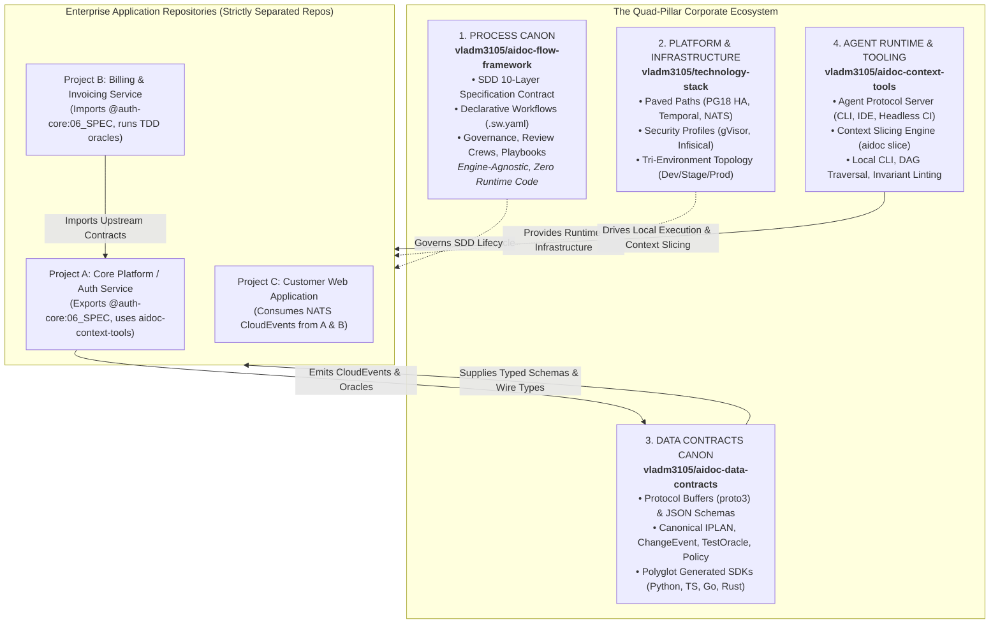
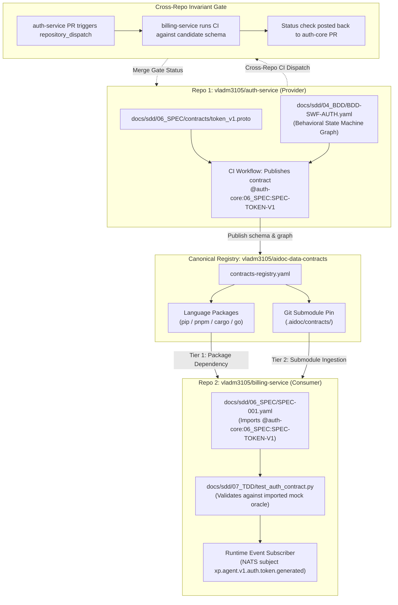
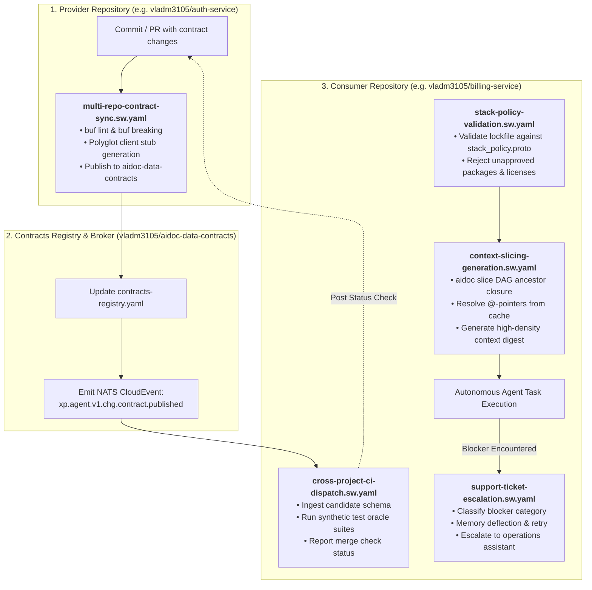

# Multi-Project Federated Architecture Standard: Quad-Pillar Topology, Cross-Project Dataflow, and Machine-Readable Contracts

## Document Control

| Field | Value |
|---|---|
| Version | 1.0 |
| Status | Approved |
| Last Updated | 2026-10-14 |
| Author | Framework Maintainer |
| Framework Version | 0.93.0 |
| Authority | [Decision D-0013 / GD-13](DECISIONS.md), [RECOMMENDED_PLATFORM_STACK.md](RECOMMENDED_PLATFORM_STACK.md), [DURABLE_EXECUTION_STANDARD.md](DURABLE_EXECUTION_STANDARD.md), [CHG_REQUEST_FLOWS.md](CHG_REQUEST_FLOWS.md), [ADAPTATION.md](ADAPTATION.md) |

---

## 1. Purpose & Foundational Law

The **`aidoc-flow-framework`** establishes a 10-layer Specification-Driven Development (SDD) contract
(BRD $\rightarrow$ PRD $\rightarrow$ EARS $\rightarrow$ BDD $\rightarrow$ ADR $\rightarrow$ SPEC $\rightarrow$ TDD $\rightarrow$ IPLAN $\rightarrow$ Code $\rightarrow$ EVAL $\rightarrow$ Verified).
This standard serves as the **authoritative governance specification for multi-project enterprise environments**, standardizing how multiple independent, polyglot software repositories interact, share contracts, enforce architectural policies, and exchange dataflow events without semantic drift or integration failure.

### The Two Fatal Failure Modes of Multi-Project Agentic Systems

Autonomous multi-agent engineering across multiple repositories invariably encounters two destructive extremes:

1. **The "Enterprise Waterfall 2.0" Trap (Process Shock):**
   Forcing developers and AI agents to manually draft and synchronize monolithic Markdown documents across 10 distinct layers for every small change. This leads to severe developer fatigue, context-window saturation, high inference costs, and teams actively bypassing or disabling the framework.
2. **The "12-Repo Integration Bankruptcy" Trap (Sprawl & Entropy):**
   Fragmenting the platform into a sprawling constellation of 10+ uncoordinated standalone repositories (e.g. separate repos for testing, memory, logging, interlog, router, support desk, operations). Engineering teams exhaust their entire velocity debugging schema mismatches, version synchronization, and broken CI pipelines across decoupled repos.

### The Federated Paved-Path Invariant

To resolve these failure modes, the enterprise ecosystem adopts a **compiler-style federated architecture**:
* Documentation is treated as **machine-addressable contracts, directed acyclic graphs (DAGs), and automated test oracles**, not prose homework.
* The enterprise stack is consolidated into the **Quad-Pillar Corporate Ecosystem**, strictly separating specification rules, platform infrastructure, wire contracts, and agent tooling.
* Individual project repositories maintain **100% repository isolation** with zero assumed filesystem co-location, interacting exclusively through typed contract packages, versioned submodules, and asynchronous message streams.

---

## 2. The Quad-Pillar Corporate Ecosystem

The enterprise architecture is strictly partitioned into four authoritative, decoupled pillars:



### Pillar Definitions & Roles

1. **Process Canon (`vladm3105/aidoc-flow-framework`):**
   The single normative specification defining the 10 SDD layers, review crews, quality gates, and declarative state machine workflows. Governed by **Decision D-0013 / GD-13**: strictly engine-agnostic and vendor-neutral, containing zero platform runtime code.
2. **Platform & Infrastructure (`vladm3105/technology-stack`):**
   The authoritative reference architecture (Standard v2.0) defining approved enterprise paved paths: Debian 13, Docker CE / gVisor (`runsc`), 3-node HA PostgreSQL 18, shared multi-tenant Temporal Server, clustered NATS JetStream, ClickHouse OLAP, and Infisical secret management.
3. **Data Contracts Canon (`vladm3105/aidoc-data-contracts`):**
   The single source of truth for wire-level and in-memory schema models. Houses Protocol Buffers (proto3) and JSON Schemas (Draft 2020-12). Publishes versioned native client libraries (`pip install aidoc-data-contracts`, `pnpm add @aidoc/data-contracts`, `cargo add aidoc-data-contracts`, `go get ...`). Enforces schema backward compatibility via `buf breaking`.
4. **Agent Runtime & Tooling (`vladm3105/aidoc-context-tools`):**
   The executable developer and agent interface. Implements a standardized Agent Tooling Protocol server compatible with autonomous coding agents, IDE assistants, and headless CI workers. Houses the **Context Slicing Engine (`aidoc slice`)**, local DAG linters, and invariant checkers.

---

## 3. Multi-Repo Isolation & Distribution Model

> [!IMPORTANT]
> **Enterprise Invariant: Strictly Separated Repositories Per Project.**  
> Every service and application repository (`auth-service`, `billing-service`, `customer-portal`, etc.) maintains its own independent Git repository, CI workflows, and release lifecycle. Monorepo filesystem colocation (e.g. assuming `../../auth-service` exists) is strictly prohibited. Git submodules are supported as an optional, progressive synchronization pattern.



### The Three Progressive Distribution Tiers

Consumer projects resolve and ingest upstream contracts through three progressive tiers:

1. **Tier 1 (Universal Default — Native Package Dependencies):**
   Provider repositories publish their public schemas to `vladm3105/aidoc-data-contracts`. CI publishes versioned language packages (`pip install aidoc-data-contracts`, `pnpm add @aidoc/data-contracts`, `cargo add aidoc-data-contracts`, `go get ...`). Consumer repositories import schemas as standard build dependencies.
2. **Tier 2 (Optional Git Submodules — Pinned Spec Synchronization):**
   Teams requiring local in-tree inspection of upstream contracts without installing package binaries attach `aidoc-data-contracts` (or provider repos) as a read-only Git submodule under `.aidoc/contracts/` pinned to a release tag:
   ```bash
   git submodule add https://github.com/vladm3105/aidoc-data-contracts.git .aidoc/contracts
   git submodule update --init --recursive
   ```
3. **Tier 3 (Zero-Network Sandboxed Agent Resolution via Local Socket):**
   Per [`RECOMMENDED_PLATFORM_STACK.md`](RECOMMENDED_PLATFORM_STACK.md) §2.2, autonomous coding agents execute inside **gVisor (`runsc`)** sandboxes with strict zero-network egress (`--network=none`). Direct in-sandbox calls to the GitHub API are physically blocked. External contracts are pre-populated into `.aidoc/contracts/cache/` during workspace initialization (`framework/scripts/install.sh` / `agentd`), or queried through the local UNIX domain socket `/run/aidoc/agent.sock`.

### Scoped Pointer Addressing Syntax

All cross-project references use universal, repo-independent URI syntax:
$$\text{@}\langle\text{project-id}\rangle\text{:}\langle\text{layer}\rangle\text{:}\langle\text{tag-id}\rangle$$
Examples:
- `@auth-core:06_SPEC:SPEC-JWT-CLAIMS`
- `@auth-core:04_BDD:BDD-SWF-LOGIN`
- `@billing-engine:04_BDD:BDD-SWF-INVOICE-TAX`
- `@shared-platform:05_ADR:ADR-POSTGRES-18-MIGRATION`

### Multi-Project Contract Registry (`contracts-registry.yaml`)

The canonical `aidoc-data-contracts` repository maintains the company-wide contract registry index (starter template: [`framework/templates/CONTRACTS-REGISTRY-TEMPLATE.yaml`](../templates/CONTRACTS-REGISTRY-TEMPLATE.yaml)). When an independent repository cuts a release tag, its CI updates this manifest:
```yaml
registry_version: "1.0"
contracts:
  "@auth-core:06_SPEC:SPEC-JWT-CLAIMS":
    version: "1.3.0"
    schema_type: "protobuf"
    repository: "vladm3105/auth-service"
    schema_path: "proto/auth/v1/claims.proto"
    schema_hash: "sha256:4b227777d4dd1fc61c6f884f48641d02b4d121d3fd328cb08b5531fcacdabf8a"
    subscribers:
      - repo: "vladm3105/billing-service"
        contact_channel: "#billing-alerts"
      - repo: "vladm3105/customer-portal"
        contact_channel: "#portal-alerts"

  "@auth-core:04_BDD:BDD-SWF-LOGIN":
    version: "1.1.0"
    schema_type: "swf_graph"
    repository: "vladm3105/auth-service"
    schema_path: "docs/sdd/04_BDD/BDD-SWF-LOGIN.sw.yaml"
    schema_hash: "sha256:8f4c2199b9dd1fc61c6f884f48641d02b4d121d3fd328cb08b5531fcacdab99e"
    subscribers:
      - repo: "vladm3105/customer-portal"
        contact_channel: "#portal-alerts"
```

---

## 4. Deterministic Contracts via Behavioral State Graphs

> [!IMPORTANT]
> **Normative Law: Behavioral State Graphs Prohibit Legacy Gherkin.**  
> The framework formally proscribes legacy Gherkin narrative text (`.feature` files with conversational Given/When/Then steps) for machine-driven contracts. Behavioral requirements in Layer 04 BDD and interface contracts in Layer 06 SPEC MUST be modeled as **declarative behavioral state graphs** housed in the **Hybrid Envelope Architecture** ([CNCF Serverless Workflow v0.8 YAML](../layers/04_BDD/BDD_WORKFLOW_STANDARD.md)) and visualized via Mermaid state diagrams.

### Why Legacy Gherkin Is Proscribed
1. **Lack of Machine-Actionable State Transitions:** Conversational `.feature` files rely on brittle regular expression matching against arbitrary prose strings. They cannot formally define asynchronous callbacks, distributed transaction rollbacks, or state machine boundaries.
2. **Absence of SAGA Compensation Modeling:** In autonomous distributed systems, failures require formal compensation (SAGA pattern). CNCF state graphs natively define compensation states (`compensatedBy`), while Gherkin has no structural mechanism for compensation.
3. **Element-Level Lineage:** Behavioral state graphs carry structured `ears:` citation lists on every state and transition, maintaining unbroken mathematical traceability from Layer 03 EARS to Layer 07 TDD test fixtures.

### Dual-Template Architecture in Layer 04 (BDD)
Consuming projects instantiate BDD scenarios using two validated templates:
* **Standard Atomic Scenarios (`BDD-TEMPLATE.yaml`):** Structured Given-When-Then YAML for single-turn, atomic behavior verifications.
* **Stateful Behavioral Workflows (`BDD-SWF-TEMPLATE.yaml`):** Hybrid Envelope housing a CNCF Serverless Workflow state machine for multi-step journeys, asynchronous sagas, and distributed state transitions.

---

## 5. Change Request Lifecycle Governance

All cross-project and internal change events bind strictly to the framework's **ratified 6-flow router ([`CHG_REQUEST_FLOWS.md`](CHG_REQUEST_FLOWS.md) §1)**:

| Flow ID | Classification | Traversal Path | Purpose & Governance Constraint |
|---|---|---|---|
| `HOTFIX` | Emergency | Code $\rightarrow$ Prod (Post-hoc retro) | Critical production outage; retro CHG in 48h |
| `CODE2S` | Type-R | Code $\rightarrow$ IPLAN $\rightarrow$ SDD | Ground truth reverse reconciliation |
| `CODE2C` | F4 (Bugfix) | Defect $\rightarrow$ IPLAN $\rightarrow$ Code | Scoped fix; parent SDD stands immutable |
| `SEED2C` | F3 (Design) | Seed $\rightarrow$ Module $\rightarrow$ SDD $\rightarrow$ Code | Behavioral/architecture change to live product |
| `DIR2C` | F2 (Direct) | IPLAN $\rightarrow$ Code/Docs | Direct docs/tooling; empty SDD lifecycle |
| `SDD2C` | F1 (Full SDD) | BRD $\rightarrow$ PRD $\rightarrow$ ... $\rightarrow$ Code | Full 10-layer SDD chain for new systems |

### The Anti-Contract Erosion Gate (Pre-Merge Invariant)

To protect downstream subscriber repositories from breaking changes:
1. **Local Pre-Commit Check (`aidoc lint-invariants`):**
   `aidoc-context-tools` inspects git diffs before commit. If an agent attempts to route a change as `CODE2C` (bugfix) or `DIR2C` (direct tooling) that alters a public API signature, database schema, or behavioral state graph, the linter **fails immediately**, forcing promotion to `SEED2C` or `SDD2C`.
2. **Cross-Repo Blast Radius Calculation:**
   The PR workflow queries `contracts-registry.yaml` and identifies all subscriber repositories (`billing-service`, `customer-portal`).
3. **Cross-Repo Verification Dispatch:**
   The provider's CI workflow triggers a `repository_dispatch` event (or emits a NATS JetStream event on `xp.agent.v1.chg.<project>`) to execute synthetic verification test suites against downstream subscribers.
4. **Hard Invariant Gate:**
   If any downstream subscriber fails against the candidate contract schema, the provider PR **cannot merge** until either backward compatibility is restored, or a coordinated multi-repo migration plan is executed.

### Anti-Circular Dependency Rule & Two-Phase Evolution (Expand / Contract)

1. **Strict Acyclicity Rule:**
   Cross-repository contract dependencies must form a strict Directed Acyclic Graph (DAG). Circular dependencies (`@proj-a -> @proj-b -> @proj-a`) are strictly rejected by `aidoc validate-graph`.
2. **Two-Phase Breaking Evolution Protocol (Expand / Contract):**
   Breaking contract changes must never be applied in-place:
   - **Phase 1 (Expand):** Provider publishes `@auth-core:06_SPEC:SPEC-TOKEN-V2` while maintaining `V1` as deprecated. Downstream subscriber checks remain green.
   - **Phase 2 (Migrate):** Subscribers independently update their implementations to `V2` via their own PR cycles.
   - **Phase 3 (Contract):** Once all registered subscribers have migrated off `V1`, the provider issues a `SEED2C` change retiring `V1`.

---

## 6. Canonical Machine-Readable Contract Schemas (Proto3)

---

### Contract 1: IPLAN Execution Manifest (`iplan.proto`)

```protobuf
syntax = "proto3";

package aidoc.v1;

import "google/protobuf/timestamp.proto";

enum TaskState {
  TASK_STATE_UNSPECIFIED = 0;
  TASK_STATE_PENDING = 1;
  TASK_STATE_IN_PROGRESS = 2;
  TASK_STATE_VERIFYING = 3;
  TASK_STATE_COMPLETED = 4;
  TASK_STATE_BLOCKED = 5;
  TASK_STATE_FAILED = 6;
}

message TracePointers {
  repeated string ears_ids = 1;  // e.g., ["@EARS-001", "@auth-core:03_EARS:EARS-004"]
  repeated string bdd_ids = 2;   // e.g., ["@BDD-004", "@auth-core:04_BDD:BDD-SWF-01"]
  repeated string adr_ids = 3;   // e.g., ["@ADR-SESSION-002"]
  repeated string spec_ids = 4;  // e.g., ["@SPEC-AUTH-INTERFACE"]
  repeated string tdd_ids = 5;   // e.g., ["@TDD-AUTH-TOKEN-UNIT"]
}

message TaskVerificationGate {
  string test_suite_target = 1;       // e.g., "cargo test --test auth_integration"
  string command = 2;                 // Exact execution command
  int32 timeout_seconds = 3;          // Execution timeout budget
  repeated string required_invariants = 4; // e.g., ["no_public_api_drift", "zero_leak"]
}

message ExternalDependency {
  string project_id = 1;              // e.g., "auth-core"
  string contract_id = 2;             // e.g., "@auth-core:06_SPEC:SPEC-TOKEN-01"
  string min_version = 3;             // e.g., "1.2.0"
  string expected_schema_hash = 4;    // SHA-256 of target contract schema
}

message TaskCheckpoint {
  string checkpoint_id = 1;
  string description = 2;
  bool completed = 3;
  google.protobuf.Timestamp completed_at = 4;
}

message CompensationAction {
  string action_type = 1;             // e.g., "git_revert", "delete_file", "rollback_migration"
  string command = 2;                 // Reversal execution command
  string payload = 3;                 // Invariant context for compensation
}

message IplanTask {
  string task_id = 1;                 // e.g., "IPLAN-AUTH-012"
  string plan_id = 2;                 // e.g., "IPLAN-AUTH-CORE"
  string title = 3;
  string description = 4;
  TaskState state = 5;
  TracePointers trace = 6;
  repeated string depends_on = 7;     // Local preceding task IDs
  repeated ExternalDependency external_dependencies = 8; // Cross-project contracts
  TaskVerificationGate gate = 9;
  repeated string file_manifest = 10; // Explicitly allowed modification paths
  string assigned_agent_role = 11;    // e.g., "Implementer"
  google.protobuf.Timestamp updated_at = 12;
  repeated TaskCheckpoint checkpoints = 13;              // Progress heartbeating & recovery
  repeated CompensationAction compensation_chain = 14;  // SAGA LIFO rollback (DURABLE_EXECUTION_STANDARD.md)
}

message IplanManifest {
  string plan_id = 1;
  string version = 2;
  string project_id = 3;
  string authorizing_chg = 4;         // e.g., "CHG-102"
  repeated IplanTask tasks = 5;
  google.protobuf.Timestamp created_at = 6;
}
```

---

### Contract 2: Change Event & Blast Radius (`change_event.proto`)

```protobuf
syntax = "proto3";

package aidoc.v1;

import "google/protobuf/timestamp.proto";

// Canonical Ratified Framework Flows (CHG_REQUEST_FLOWS.md §1)
enum ChangeFlowType {
  CHANGE_FLOW_TYPE_UNSPECIFIED = 0;
  CHANGE_FLOW_TYPE_HOTFIX = 1;   // Emergency: Code -> Prod (Post-hoc retro)
  CHANGE_FLOW_TYPE_CODE2S = 2;   // Type-R: Code -> IPLAN -> SDD (Reconciliation)
  CHANGE_FLOW_TYPE_CODE2C = 3;   // F4: Defect -> IPLAN -> Code (Feedback)
  CHANGE_FLOW_TYPE_SEED2C = 4;   // F3: Seed -> Module -> SDD -> Code (Design/Behavior)
  CHANGE_FLOW_TYPE_DIR2C = 5;    // F2: IPLAN -> Code/Docs (Direct non-behavioral)
  CHANGE_FLOW_TYPE_SDD2C = 6;    // F1: BRD -> PRD -> ... -> Code (Full SDD)
}

// Semantic Impact / Blast-Radius Scope
enum ChangeBlastRadiusScope {
  CHANGE_BLAST_RADIUS_SCOPE_UNSPECIFIED = 0;
  CHANGE_BLAST_RADIUS_SCOPE_PATCH = 1;          // Isolated bugfix, non-breaking
  CHANGE_BLAST_RADIUS_SCOPE_MINOR_TECH = 2;     // Internal refactor / non-breaking schema
  CHANGE_BLAST_RADIUS_SCOPE_MINOR_FEAT = 3;     // Additive feature, backward-compatible
  CHANGE_BLAST_RADIUS_SCOPE_MAJOR_BREAKING = 4; // Breaking public contract mutation
}

message DownstreamImpact {
  string project_id = 1;              // e.g., "billing-service"
  repeated string impacted_contracts = 2; // e.g., ["@billing:06_SPEC:SPEC-INVOICE-01"]
  bool breaking = 3;                  // True if wire schema or signature altered
  string suggested_remediation = 4;
}

message ChangeEvent {
  string event_id = 1;                // UUIDv7 unique identifier
  string change_id = 2;               // e.g., "CHG-2026-104"
  string source_project_id = 3;       // e.g., "auth-core"
  ChangeFlowType flow_type = 4;       // Ratified framework flow
  ChangeBlastRadiusScope scope = 5;   // Semantic blast radius
  repeated string modified_contract_ids = 6; // e.g., ["@auth-core:06_SPEC:SPEC-TOKEN-02"]
  string root_cause = 7;
  string diff_sha = 8;
  repeated DownstreamImpact downstream_impacts = 9;
  string initiated_by = 10;           // Agent role or human maintainer
  google.protobuf.Timestamp created_at = 11;
}
```

---

### Contract 3: Test Oracle & Behavioral Graph Verification (`test_oracle.proto`)

```protobuf
syntax = "proto3";

package aidoc.v1;

import "google/protobuf/timestamp.proto";

enum TestOracleType {
  TEST_ORACLE_TYPE_UNSPECIFIED = 0;
  TEST_ORACLE_TYPE_UNIT = 1;
  TEST_ORACLE_TYPE_PROPERTY_BASED = 2;
  TEST_ORACLE_TYPE_INTEGRATION_TESTCONTAINER = 3;
  TEST_ORACLE_TYPE_E2E_BROWSER = 4;
}

message TestOracleContract {
  string oracle_id = 1;               // e.g., "ORACLE-AUTH-003"
  string task_id = 2;                 // e.g., "IPLAN-AUTH-012"
  string target_spec_pointer = 3;     // e.g., "@auth-core:06_SPEC:SPEC-AUTH-INTERFACE"
  string target_bdd_graph_id = 4;     // e.g., "@auth-core:04_BDD:BDD-SWF-LOGIN" (CNCF State Graph)
  TestOracleType test_type = 5;
  repeated string state_invariants = 6;     // Graph state transition invariants
  repeated string invariant_assertions = 7; // e.g., ["zero_memory_leak", "safe_math"]
  string runner = 8;                  // e.g., "cargo-proptest", "pytest", "playwright"
  string test_file_path = 9;
  int32 minimum_passes = 10;          // For property tests (e.g., 1000)
  int32 timeout_seconds = 11;
  repeated string mock_fixture_paths = 12;  // Static mock or fixture JSON/YAML files
  string testcontainer_image = 13;          // e.g., "ghcr.io/vladm3105/auth-mock-oracle:1.3"
  string expected_schema_hash = 14;         // SHA-256 validation for imported contract
}

message ExecutionResultPayload {
  string run_id = 1;
  string task_id = 2;
  string oracle_id = 3;
  bool passed = 4;
  int64 wall_clock_ms = 5;
  int32 pass_count = 6;
  int32 fail_count = 7;
  string failure_counterexample = 8;  // Input that triggered failure
  string panic_message = 9;
  string stack_trace = 10;
  repeated string ast_invariant_diffs = 11; // Unapproved AST mutations
  google.protobuf.Timestamp timestamp = 12;
}
```

---

### Contract 4: Support Ticket / Blocker Escalation (`support_ticket.proto`)

```protobuf
syntax = "proto3";

package aidoc.v1;

import "google/protobuf/timestamp.proto";

enum BlockerCategory {
  BLOCKER_CATEGORY_UNSPECIFIED = 0;
  BLOCKER_CATEGORY_AMBIGUOUS_SPEC = 1;
  BLOCKER_CATEGORY_UNSATISFIED_INVARIANT = 2;
  BLOCKER_CATEGORY_UPSTREAM_PROJECT_DEFECT = 3;
  BLOCKER_CATEGORY_ENVIRONMENT_FAILURE = 4;
  BLOCKER_CATEGORY_STACK_POLICY_VIOLATION = 5;
}

message SupportTicketPayload {
  string ticket_id = 1;               // e.g., "TCK-2026-0042"
  string reporting_project_id = 2;    // e.g., "billing-service"
  string blocked_task_id = 3;         // e.g., "IPLAN-BILL-009"
  BlockerCategory category = 4;
  string target_contract_pointer = 5; // e.g., "@auth-core:06_SPEC:SPEC-AUTH-TOKEN-02"
  string symptom_description = 6;
  string failing_oracle_output = 7;
  repeated string suggested_remediations = 8;
  google.protobuf.Timestamp created_at = 9;
}
```

---

### Contract 5: Centralized Stack Policy Contract (`stack_policy.proto`)

```protobuf
syntax = "proto3";

package aidoc.v1;

message RuntimeConstraint {
  string language = 1;               // "rust", "python", "typescript", "go"
  string version_or_edition = 2;     // e.g., "2024", "3.12+", "1.24"
  string target_triple = 3;          // e.g., "x86_64-unknown-linux-musl"
  repeated string compiler_flags = 4;// Required compiler enforcement flags
}

message BoundaryPolicy {
  bool allow_unsafe = 1;             // Must be false for memory-safe stacks
  bool strict_allowlist = 2;         // Rejects any unapproved dependency crate/package
  repeated string banned_patterns = 3;// AST patterns (e.g., ["unwrap()", "eval()", "unsafe"])
}

message DependencyPackageConstraint {
  string name = 1;                   // e.g., "tokio", "pydantic"
  string version_constraint = 2;     // e.g., "1.x", ">=2.6"
  repeated string approved_features = 3; // e.g., ["rt-multi-thread", "macros"]
}

message DependencyPolicy {
  repeated string prohibited_licenses = 1; // e.g., ["GPL-3.0", "AGPL-3.0", "SSPL"]
  repeated DependencyPackageConstraint allowed_packages = 2;
}

message VerificationOraclesConstraint {
  string linter_cmd = 1;             // e.g., "cargo clippy -- -D warnings", "ruff check"
  string test_cmd = 2;               // e.g., "cargo nextest", "pytest -v"
  int32 line_coverage_threshold = 3; // Minimum percentage (0-100)
  int32 branch_coverage_threshold = 4;
}

message StackPolicyContract {
  string tenant_id = 1;              // Organization or enterprise tenant identifier
  string policy_version = 2;         // e.g., "2.0.0"
  RuntimeConstraint runtime = 3;
  BoundaryPolicy boundaries = 4;
  DependencyPolicy dependencies = 5;
  VerificationOraclesConstraint verification_oracles = 6;
}
```

A starter template for repo-level stack policies is provided at [`framework/templates/STACK-POLICY-TEMPLATE.yaml`](../templates/STACK-POLICY-TEMPLATE.yaml).

---

## 7. Context Slicing Engine Specification (`aidoc slice`)

To protect agent reasoning capacity and prevent token budget exhaustion, agents executing tasks in Layer 08 IPLAN MUST NOT ingest monolithic upstream documents. The Context Slicing Engine extracts the minimal necessary ancestor closure:

$$\text{Context}(T_k) = \text{Ancestors}(T_k) \cap \{\text{SPEC}, \text{BDD}, \text{EARS}, \text{ADR}\}$$

### Reference Implementation (`slicer.py`)

```python
"""AIDoc DAG Context Slicing Engine (aidoc slice)."""

from dataclasses import dataclass
from typing import Dict, List, Set, Optional, Callable

@dataclass
class ArtifactNode:
    node_id: str
    layer: str  # EARS, BDD, ADR, SPEC, TDD, IPLAN
    content: str
    dependencies: List[str]  # Upstream node IDs (@-pointers)

class AidocDependencyGraph:
    def __init__(self, external_resolver: Optional[Callable[[str], Optional[ArtifactNode]]] = None):
        self.nodes: Dict[str, ArtifactNode] = {}
        self.external_resolver = external_resolver

    def add_node(self, node_id: str, layer: str, content: str, dependencies: List[str]):
        self.nodes[node_id] = ArtifactNode(node_id, layer, content, dependencies)

    def slice_subgraph(
        self, target_task_id: str, allowed_layers: Optional[Set[str]] = None
    ) -> List[ArtifactNode]:
        """Extracts transitive ancestor closure for target task."""
        if allowed_layers is None:
            allowed_layers = {"EARS", "BDD", "ADR", "SPEC", "TDD"}
        
        visited: Set[str] = set()
        ordered_closure: List[ArtifactNode] = []

        def dfs(current_id: str):
            if current_id in visited:
                return
            visited.add(current_id)

            node = self.nodes.get(current_id)
            if not node and self.external_resolver and current_id.startswith("@"):
                # Dynamically resolve cross-project contract pointer from aidoc-data-contracts cache
                node = self.external_resolver(current_id)
                if node:
                    self.nodes[current_id] = node

            if not node:
                return

            for parent_id in node.dependencies:
                dfs(parent_id)

            if node.layer in allowed_layers and node.node_id != target_task_id:
                ordered_closure.append(node)

        dfs(target_task_id)
        return ordered_closure

    def render_context_digest(self, target_task_id: str) -> str:
        """Compiles a high-density, token-efficient context digest."""
        ancestors = self.slice_subgraph(target_task_id)
        task_node = self.nodes.get(target_task_id)

        digest = [
            f"=== CONTEXT DIGEST FOR TASK: {target_task_id} ===",
            f"TASK DEFINITION: {task_node.content if task_node else 'N/A'}\n",
            "=== STRICT CONTRACT BOUNDARIES (ANCESTOR CLOSURE) ==="
        ]
        for anc in ancestors:
            digest.append(f"[{anc.layer}] {anc.node_id}:\n{anc.content}\n---")
        digest.append("=== END OF DIGEST (WRITE CODE TO SATISFY THESE ONLY) ===")
        return "\n".join(digest)
```

---

## 8. Declarative Workflow & State Graph Modeling Specifications (Next-Phase Foundation)

In alignment with [`GOVERNANCE_WORKFLOW_STANDARD.md`](GOVERNANCE_WORKFLOW_STANDARD.md), all multi-project orchestrations must be formalized as declarative CNCF Serverless Workflow v0.8 YAML state machines (`.sw.yaml`) and visualized via Mermaid state diagrams:

### End-to-End Multi-Project Workflow Architecture



### Planned Workflow State Machines

1. **`multi-repo-contract-sync.sw.yaml`:**
   Orchestrates contract publishing from provider repositories to `aidoc-data-contracts`, runs `buf lint` and `buf breaking`, compiles polyglot stubs, and emits notification CloudEvents over NATS JetStream.
2. **`cross-project-ci-dispatch.sw.yaml`:**
   Triggered on provider PRs altering exported contracts. Dispatches synthetic verification runs to subscriber repositories, aggregates status checks, and posts the final merge-blocking check back to the provider PR.
3. **`context-slicing-generation.sw.yaml`:**
   Invoked by `aidoc-context-tools`. Parses local and imported repository DAGs, computes ancestor closure, validates graph acyclicity, and outputs the targeted context digest.
4. **`stack-policy-validation.sw.yaml`:**
   Pre-execution gate validating proposed lockfiles (`Cargo.lock`, `package-lock.json`, `poetry.lock`) against `stack-policy.yaml`. Rejects unapproved dependencies and prohibited licenses before implementation starts.
5. **`support-ticket-escalation.sw.yaml`:**
   Catches agent execution blocks, classifies symptoms (`AMBIGUOUS_SPEC`, `UPSTREAM_DEFECT`, `POLICY_VIOLATION`), queries engramory memory for historical deflection, and escalates unresolved blocks to the operations assistant.
