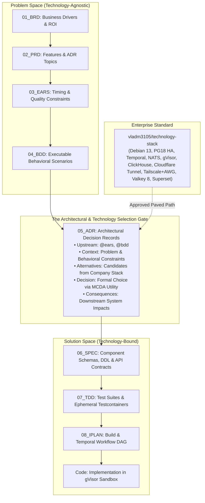

# Recommended Platform Technology Stack: Authoritative Reference Architecture & SDD Layer Mapping

## Document Control

| Field | Value |
|---|---|
| Version | 2.2 |
| Status | Approved |
| Last Updated | 2026-10-13 |
| Author | Framework Maintainer |
| Framework Version | 0.91.13 |
| Authority | [Decision GD-73](DECISIONS.md#gd-73) (DEC-CHG-86), [Decision GD-72](DECISIONS.md#gd-72) (DEC-CHG-83), [Decision D-0013 / GD-13](DECISIONS.md), [CHG-91](../archive/CHG-91/CHG-91.yaml), [CHG-92](../archive/CHG-92/CHG-92.yaml) & [CHG-93](../archive/CHG-93/CHG-93.yaml) |
| Technology Stack Source | [vladm3105/technology-stack](https://github.com/vladm3105/technology-stack) (Standard v2.0, Specifications 00–19) |

---

## 1. Purpose & Relationship to Framework Core

The **`aidoc-flow-framework`** establishes a 10-layer Specification-Driven Development (SDD) contract
(BRD $\rightarrow$ PRD $\rightarrow$ EARS $\rightarrow$ BDD $\rightarrow$ ADR $\rightarrow$ SPEC $\rightarrow$ TDD $\rightarrow$ IPLAN $\rightarrow$ Code $\rightarrow$ EVAL $\rightarrow$ Verified).
Per **[Decision D-0013 / GD-13](DECISIONS.md)**, the core framework specifications (`framework/layers/` and `framework/governance/`)
are **strictly engine-agnostic and vendor-neutral**: they define life-cycles, interface schemas, declarative workflow graphs (`.sw.yaml`),
quality gates, and review crews without tying projects to any proprietary software or commercial SaaS.

This document serves as the **authoritative platform governance guidance**. It defines our ecosystem's
**recommended reference architecture**, mapping the vendor-agnostic framework contracts directly to our
enterprise technology stack codified in the canonical upstream repository **[vladm3105/technology-stack](https://github.com/vladm3105/technology-stack)** (Standard v2.0). Projects adopting this stack use the operational blueprints in
[`framework/governance/aidoc/`](aidoc/) and companion specifications 00–19 to instantiate runtimes with zero architectural drift.

---

## 2. The Six Architectural Pillars & Operational Principles

```
┌──────────────────────────────────────────────────────────────────────────────────────────────────┐
│                                     THE SIX PILLARS OF OUR STACK                                 │
├───────────────────────────────┬──────────────────────────────────┬───────────────────────────────┤
│ 1. Strictly Open Source       │ 2. Zero-Trust Defense in Depth   │ 3. AI-First & Model Context Native  │
│ 100% open-source software     │ gVisor syscall isolation, eBPF   │ Laya + LiteLLM smart router,  │
│ (MIT / Apache 2.0 / BSD-3); no│ Falco EDR, CrowdSec IPS,         │ Langfuse Prompt CMS, Bytebase │
│ commercial SaaS traps.        │ Tailscale VPN, socket proxy.     │ native AI schema migration.   │
├───────────────────────────────┼──────────────────────────────────┼───────────────────────────────┤
│ 4. Unified OLAP Telemetry     │ 5. Multi-Tenant Consolidation    │ 6. Polyglot & Container-Native│
│ ClickHouse single store for   │ 3-node HA PostgreSQL 18 cluster, │ Container workspace (zero host│
│ HyperDX (APM), Langfuse (AI), │ two-tier ledger, shared Temporal,│ pollution); uv, cargo, Go,    │
│ Coroot (eBPF), & Superset BI. │ and shared NATS JetStream broker.│ Node.js 24 LTS / TS via pnpm. │
└───────────────────────────────┴──────────────────────────────────┴───────────────────────────────┘
```

1. **Strictly Open Source**: Every runtime dependency is permissively licensed (MIT, Apache 2.0, BSD-3) and self-hostable without commercial licensing, telemetry callbacks, or proprietary cloud lock-in.
2. **Zero-Trust Defense in Depth**: Dynamic code execution and autonomous coding agents operate under strict user-space kernel virtualization (**gVisor `runsc`**), modern-eBPF threat monitoring (**Falco**), perimeter mesh (**Tailscale**) with on-demand disposable travel bastions (**AmneziaWG / AWG**), edge ingress via **Cloudflare Tunnel** (`cloudflared`) and **Traefik v3**, host daemon protection via **`docker-socket-proxy`**, ingress intrusion prevention (**CrowdSec**), and machine identity in-memory secrets injection (**Infisical**).
3. **AI-First & Model Context Protocol Native**: Models are unified behind **LiteLLM** and dynamically routed by **Laya** via local UNIX domain sockets (`/var/run/litellm.sock`); prompts and evaluation datasets are governed in **Langfuse**; database schemas are inspected, verified for drift, and migrated via **Bytebase Model Context Protocol**.
4. **Unified OLAP Telemetry & Business Intelligence**: Telemetry and analytical data planes are consolidated into a single columnar **ClickHouse** cluster powering full-stack APM (**HyperDX**), LLM observability (**Langfuse**), kernel network profilers (**Coroot**), and agentic business intelligence (**Apache Superset** with headless Playwright visual critic).
5. **Multi-Tenant Infrastructure Consolidation & Two-Tier Ledger**: Core platform state is centralized into shared, resilient clusters partitioned cleanly by namespace or account: a 3-node HA **PostgreSQL 18** cluster, a shared **Temporal Server**, and clustered **NATS JetStream**. Employs a **Two-Tier Lossless Ledger**: Tier A Wire Ledger (`xp.ledger` exact unmodified wire bytes `bytea` with UUIDv7 partitioning) for non-repudiation auditability, and Tier B Double-Entry Financial Ledger ($\sum \text{debits} = \sum \text{credits}$, fixed-point 64-bit integer precision).
6. **Polyglot High Performance & Container-Native Tooling**: Adheres to zero host pollution via the unified workspace container (`platform-dev-tools:latest`). Enforces a dual execution boundary (`dev-cli` for developer tooling vs. `agent-sandbox` under gVisor). Standardizes build toolchains across Python 3.15 default (via Astral `uv` with `python-build-standalone`), Rust stable (`cargo`), Go 1.25, and Node.js 24 LTS / TypeScript (`pnpm`).

### Five Non-Negotiable Operational Tenets

1. **Three-Layer Orchestration**: Reasoning lives in cognitive graphs (LangGraph Core), effects live in idempotent activities, and control flow lives in durable workflows (Temporal Server).
2. **An Agent Is Not a Principal**: AI models and autonomous agent roles hold no credentials, have no network identity, and cannot open connections of their own.
3. **Thin Payloads & Out-of-Band Content**: Telemetry spans, workflow histories, and queue messages carry only identifiers, URIs, and SHA-256 hashes. Raw code diffs, conversation text, and artifacts reside in restricted object storage (S3 / MinIO).
4. **Consolidated Infrastructure**: All projects share central multi-tenant services (HA PostgreSQL 18, shared Temporal server, central OpenTelemetry collector) rather than duplicating infrastructure per repository.
5. **Lossless Audit Fidelity**: Inbound messages and external webhooks are preserved in exact unmodified wire bytes (`bytea`) with UUIDv7 monotonic timestamps in `xp.ledger` before projecting into transactional domain stores.

---

## 3. Master Platform Technology Matrix

The following authoritative matrix synthesizes Specifications 00 through 19 from [vladm3105/technology-stack](https://github.com/vladm3105/technology-stack):

| Layer / Category | Platform Component | Version / Runtime | Core Role & Rationale | SDD Framework Contract |
|---|---|---|---|---|
| **Host Hypervisor** | **Debian 13 (Trixie)** | Linux Kernel 6.12+ LTS | Minimal footprint (~90 MB idle RAM), native BTF (`/sys/kernel/btf/vmlinux`), cgroups v2 PSI. Self-hosted CI runner hardening: Astral `uv` (`python-build-standalone`) and virtualenv `$PATH` prepending to prevent `mise`/`asdf` shim collision `execvp` recursion. | Host OS foundation for CI runners and workers. |
| **Container Engine** | **Docker CE** | Latest Upstream Engine | Containerization hardened with `docker-socket-proxy` (POST=0, read-only metadata) to prevent daemon compromise. | Runtime container executor. |
| **Agent Syscall Sandbox** | **gVisor (`runsc`)** | User-Space Linux Kernel | Virtualizes Linux syscalls for coding agents and shell activities with `--network=none`, dropped capabilities (`--cap-drop=ALL`), and read-only rootfs. | [`WORKTREE_FLOW.md`](WORKTREE_FLOW.md) §2.3 Sandboxed Agent Profile. |
| **Client UX & Remote Desktop** | **WezTerm + Sunshine / Moonlight** | GPU PTY + NVENC/VAAPI | WezTerm for CLI/agent terminal handoff over Tailscale SSH; Moonlight client streaming Sunshine on Windows/Linux hosts (60–120 FPS) over Tailscale mesh with zero open ports. | Secure developer interface & terminal gateway. |
| **Terminal & Execution Daemon**| **agentd over tmux** | Go Daemon + C Engine | Headless PTY execution daemon (gRPC `:9090`, WebSocket `:9091`) managing gVisor sandboxes via isolated `tmux` (`-S /run/agentd/tmux.sock -f /dev/null`); observable via WezTerm over Tailscale/OpenSSH. | Autonomous agent execution daemon. |
| **Edge Ingress & Gateway**| **Traefik v3 + Cloudflare Tunnel** | v3.1+ & `cloudflared` | Outbound-only Cloudflare Tunnel (`cloudflared`) provides zero-open-port public ingress with Anycast DDoS/WAF protection; Traefik routes internal containers, TLS (Full Strict), and OTLP spans. | Platform boundary ingress & edge routing. |
| **Perimeter Defense & VPN** | **Tailscale + On-Demand AWG + CrowdSec** | Mesh VPN + Obfuscated Bastion + IPS | Tailscale provides zero-maintenance primary mesh VPN (replacing legacy ZeroTier); On-Demand AmneziaWG (AWG) provides disposable travel bastion; CrowdSec blocks web attackers dynamically in `nftables`. | Perimeter security & transport isolation. |
| **Identity & SSO** | **Authentik** | Go / Python Core | Open-source IdP with reverse-proxy Outposts for forward-auth SSO across consoles (Bytebase, HyperDX, Coroot, Langfuse, Superset) backed by PostgreSQL 18 + Valkey 8. | Actor authentication & gate enforcement. |
| **Secret Management** | **Infisical** | In-Memory Vault | Injects encrypted secrets directly into process RAM (`infisical run -- <cmd>`); ephemeral machine identities for autonomous agents. | Worktree and agent runner credential boundary. |
| **AI Model Gateway & Router** | **Laya + LiteLLM** | OpenAI-Compatible Router | Laya routes intent/complexity; LiteLLM manages spend caps, fallbacks, semantic caching (via Valkey 8), and streams standardized `gen_ai.*` OTel spans; mounted via `/var/run/litellm.sock`. | [`ENGINE_TELEMETRY.md`](ENGINE_TELEMETRY.md) & Model Proxy Socket. |
| **Workflow Engine** | **Temporal Server** | Shared Multi-Tenant Cluster | Durable execution engine for SDD lifecycles, SAGA compensations, retries, and crash recovery; projects isolated by namespaces. | [`DURABLE_EXECUTION_STANDARD.md`](DURABLE_EXECUTION_STANDARD.md) Tier 1 Durable Workflow. |
| **Agent Reasoning** | **LangGraph Core** | Standard Python Callables | Cyclical agent reasoning loops executed inside plain Temporal Activities (`@activity.defn`) with heartbeating (1 history event per cycle). | [`DURABLE_EXECUTION_STANDARD.md`](DURABLE_EXECUTION_STANDARD.md) Tier 2 Cognitive Flows. |
| **Database Migrations** | **Bytebase** | AI Schema Migration Engine | Manages DDL migrations for PostgreSQL 18 and ClickHouse; exposes native Model Context Protocol to coding agents. | Layer 06 SPEC / Layer 07 TDD Schema Contracts. |
| **Primary Relational DB** | **PostgreSQL 18** | `postgres:18-alpine` | Application state, native UUIDv7, async direct I/O, `pgvector`, and two-tier ledger: Tier A lossless wire ledger `xp.ledger` partitioned audit tables + Tier B double-entry ledger. | Layer 06 SPEC Database Contracts. |
| **Cache & Ephemeral Queue**| **Redis 7.2 / Valkey 8** | `valkey:8-alpine` | Ephemeral caching, rate-limit counters, LiteLLM semantic caching, and asynchronous Celery queues for Authentik and Langfuse (100% BSD-3 open source compliance). | High-speed in-memory state & rate limiting. |
| **Analytical OLAP Store** | **ClickHouse** | Columnar Engine | Unified storage for HyperDX, Langfuse, Coroot, and Superset with 85–90% disk compression. | Out-of-band audit and telemetry data plane. |
| **Observability (APM)** | **HyperDX** | Full-Stack APM | Replaces Grafana/Loki/Tempo; ClickHouse telemetry + PostgreSQL 18 `hyperdx` DB via stateless FerretDB proxy (Apache 2.0) for UI/metadata and alert configs. UI on `:8080`. | System-wide trace correlation & session replay. |
| **LLM Observability** | **Langfuse** | Self-Hosted v3 | Authoritative Prompt CMS with immutable versions; evaluation datasets and LLM-as-a-judge scoring. UI on `:3000`. | Layer 10 EVAL & [`ENGINE_TELEMETRY.md`](ENGINE_TELEMETRY.md). |
| **Zero-Code Profiler** | **Coroot** | Modern-eBPF Probe | Maps TCP service calls, latency histograms, and OOM kills without SDKs into ClickHouse. UI on `:8085`. | System health monitoring. |
| **Runtime Security (EDR)**| **Falco** | Modern-eBPF Probe | Sub-1% CPU syscall monitoring; flags container breakouts, shell escapes, and unauthorized network calls. | Deterministic runtime verification. |
| **Telemetry Pipeline** | **OTel Collector Contrib**| `otelcol-contrib` | Central hub (`:4317`/`:4318`), scrubs secrets/PII, tails host `.interlog/private.log` via `filelogreceiver`. | [`ENGINE_TELEMETRY.md`](ENGINE_TELEMETRY.md) Standard Spans. |
| **Asynchronous Messaging**| **NATS JetStream** | v2.12+ Clustered | Durable inter-project messaging with multi-account isolation (`nsc`), CloudEvents v1.0, and Protobuf contracts; air-gapped transport isolation (`xp.agent.v1.>`). | Layer 06 SPEC Event Contracts. |
| **Object Storage** | **MinIO / S3** | S3-Compatible Storage | Stores large artifacts, diffs, plans, conversation blobs, and prompt text exceeding 256 KB. | Out-of-band artifact plane. |
| **Business Intelligence** | **Apache Superset** | Agentic BI Engine | Business intelligence with Model Context Protocol and Playwright visual critic loop; high-polish CSS injection. UI on `:8088`. | Fleet metrics & visual analytics. |
| **Supply Chain Security**| **Trivy** | Ephemeral Scanner | Scans Docker images, container filesystems, and dependencies for CVEs, outdated packages, and leaked credentials. | CI/CD supply-chain quality gate. |
| **Infrastructure as Code**| **OpenTofu + Ansible + Compose v2**| Declarative IaC / CaC | OpenTofu for multi-cloud topology, Ansible for runner provisioning, and Universal 5-Profile Docker Compose v2 (core, ingress, storage, dev, stage). | Environment reproducibility & cloud portability. |
| **Dynamic Software Inventory**| **Syft + Steampipe + Superset** | Tri-Tier Asset Engine | Micro Syft SBOM generation, macro Steampipe zero-ETL SQL queries over live infrastructure, and Superset fleet dashboards. | Live software inventory & license governance. |
| **Autonomous Sentinel** | **Self-Healing Sentinel Worker** | Neuro-Symbolic Agent | Scheduled and on-demand surveillance worker monitoring OSV.dev vulnerabilities, GitHub releases, contextual triage, and PR remediation via `ntfy`. | Infrastructure self-healing & maintenance. |
| **Agent Operational CLI Tools**| **xh, gh, Playwright, dive (--ci), ntfy** | Native Single Binaries / Runtimes | Machine-operable tools executed directly by autonomous AI agents: `xh` (HTTP/REST), `gh` (PRs/CI `--json`), `Playwright` (visual QA loop), `dive --ci` (image gating), `ntfy` (alerts). | Layer 09 Sandboxed Agent CLI Toolset. |
| **AI Structural Search & Linter**| **ast-grep (sg) + ruff** | Rust Native Binaries | Deterministic AST structural search/replace (`sg`) and ultra-fast Python linting/formatting (`ruff --output-format=json`). | Machine-readable diagnostics for agent loops. |
| **Distributed Debugging CLIs**| **nats-cli, nats-top, temporal CLI** | Static Go Binaries | Official CLI tools for real-time queue inspection, stream management, workflow tracing, activity error debugging, and deterministic replay. | Layer 07 / 08 Runtime inspection. |
| **Sampling Runtime Profiler**| **py-spy** | Rust Native Binary | Low-overhead Python runtime sampling profiler; attaches to running agent processes without code modification to diagnose CPU spin and GIL deadlocks. | Runtime execution diagnostic. |
| **Stage-Only QA & Benchmarking**| **k6 + nats bench** | Go Static Binaries | **Strictly Staging Only.** Scriptable synthetic load generator (`k6`) for API/LiteLLM latency budgets ($p_{95} < 200\text{ms}$) and JetStream throughput stress testing. | Stage validation arsenal. |
| **Stage-Only Chaos & Resilience**| **toxiproxy / toxiproxy-cli** | Go Binary & TCP Proxy | **Strictly Staging Only.** Injects TCP network latency, bandwidth throttling, and dropped connections to verify Temporal worker retries and NATS reconnections. | Stage resilience verification. |
| **Human-Agent Supervision TUIs**| **hunk, lazygit, lazydocker, pgcli** | Terminal Native (ANSI/xterm)| Keyboard-driven terminal interfaces for human supervision: `hunk` (diff review), `lazygit` (rebase hygiene), `lazydocker` (container triage), `pgcli` (PG18 inspection). | In-terminal human supervision. |
| **Architecture Visualization**| **Mermaid** | v11+ / `mermaid-cli` (`mmdc`)| Authoritative declarative Diagrams-as-Code standard for all ecosystem architecture topologies, sequence flows, state machines, and ER schemas. | Declarative Architecture as Code. |
| **Programming Languages** | **Python, Rust, Go, TypeScript** | `uv`, `cargo`, `go`, `pnpm` | Multi-language polyglot stack: Python 3.15 default (Astral `uv` with `python-build-standalone`), Rust stable, Go 1.25, TypeScript (Node.js 24 LTS / `pnpm`). Container-native workspace container (`platform-dev-tools:latest`). | Polyglot runtime execution. |

---

## 4. SDD 10-Layer Execution Mapping

The following table details how each phase of the SDD lifecycle maps to the recommended platform technology stack:

```
┌──────────────────────────────────────────────────────────────────────────────────────────────────┐
│                             SDD LAYER TO PLATFORM RUNTIME MAPPING                                │
├───────┬──────────────────────────┬─────────────────────────────┬─────────────────────────────────┤
│ Layer │ SDD Artifact             │ Platform Runtime Role       │ Concrete Tooling Implementation │
├───────┼──────────────────────────┼─────────────────────────────┼─────────────────────────────────┤
│ 01    │ BRD (Business Context)   │ Tier 2 Cognitive Crew       │ LangGraph review in Temporal Act│
│ 02    │ PRD (Product Scope)      │ Tier 2 Cognitive Crew       │ LangGraph review in Temporal Act│
│ 03    │ EARS (Requirements)      │ Tier 2 Cognitive Crew       │ LangGraph decompose in Activity │
│ 04    │ BDD (Scenarios)          │ Tier 2 Cognitive Crew       │ LangGraph scenario generation   │
│ 05    │ ADR (Decisions)          │ Tier 2 Cognitive Crew       │ LangGraph trade-off evaluation  │
│ 06    │ SPEC (Contracts)         │ Tier 3 Schema & Interface   │ Bytebase Schema Engine + Protobuf/NATS + xp.ledger │
│ 07    │ TDD (Test Cases)         │ Tier 3 Test Verification    │ Pytest + Testcontainers (PG 18, Valkey 8, NATS)    │
│ 08    │ IPLAN (Plan & Manifest)  │ Tier 1 Durable State Machine│ Temporal Workflow Orchestration │
│ 09    │ Code (Source & Diffs)    │ Tier 3 Sandboxed Execution  │ gVisor runsc + agentd + Infisical + uv + ast-grep  │
│ 10    │ EVAL (Quality Gate)      │ Tier 2/3 Evaluation Gate    │ Langfuse Datasets + Playwright Visual + sdd_doc_lint│
└───────┴──────────────────────────┴─────────────────────────────┴─────────────────────────────────┘
```

### 4.1 Progressive Refinement & Layer 05 Selection Gate

Technology stack selection operates as a progressive refinement funnel governed by [`TECHNOLOGY_STACK_USAGE_GUIDE.md`](TECHNOLOGY_STACK_USAGE_GUIDE.md):



### Detailed Layer Blueprints

1. **Layers 01–05 (Specification & Deliberation):** Executed as cyclical multi-persona review crews ([`REVIEW_CREWS.yaml`](REVIEW_CREWS.yaml)) implemented via LangGraph StateGraphs inside plain Temporal activities. Prompts are resolved from the Langfuse Prompt CMS via `prompt_manifest_id`.
2. **Layer 06 (SPEC):** Specifications define:
   - Synchronous public APIs via typed OpenAPI / Protobuf contracts.
   - Asynchronous messaging interfaces via **CloudEvents v1.0** and **Protobuf** schemas (routed over NATS JetStream with air-gapped transport isolation `xp.agent.v1.>`).
   - Relational and vector database contracts via **PostgreSQL 18** idioms (UUIDv7 monotonic keys, `pgvector`, and `xp.ledger` partitioned tables) and **Bytebase Schema Engine** schema definitions.
   - In-memory caching and rate-limiting contracts via **Valkey 8**.
3. **Layer 07 (TDD):** Test suites validate component contracts using:
   - Fast unit tests with deterministic mocks.
   - Ephemeral integration test containers running true PostgreSQL 18, Valkey 8, and NATS JetStream instances for schema, cache, and migration idempotency testing.
   - Asynchronous message contract validation tests over NATS JetStream test fixtures.
   - Ephemeral supply chain and CVE security scans via **Trivy**.
4. **Layer 08 (IPLAN):** Translated 1:1 into a Temporal Workflow Definition where each task state maps to a governed activity, carrying SAGA compensation handlers in reverse LIFO order.
5. **Layer 09 (Code):** Autonomous coding agents execute within isolated Git worktrees running inside **gVisor (`runsc`)** containers managed by **`agentd over tmux`**:
   - Network egress is blocked (`--network=none`).
   - LLM access is restricted to the host UNIX domain socket `/var/run/litellm.sock` (`:rw`).
   - Secrets are loaded into process RAM only via `infisical run`.
   - Tool operations evaluate the deterministic quality floor (`sdd_doc_lint` + `swf_lint` + `pytest` + `ast-grep` + `ruff`).
6. **Layer 10 (EVAL):** Completed implementations are evaluated against benchmark datasets pulled from Langfuse. Quality scores (`relevance`, `faithfulness`, `task_completion`) are logged back to Langfuse and correlated with HyperDX traces via W3C `traceparent`. Frontend and visual artifacts undergo automated visual critic evaluations via headless **Playwright**.

### 4.2 Tri-Environment Continuum (Dev, Stage, Prod) & SDD Flow Promotion

In adherence to Specification 16 (`16-tri-environment-dev-stage-prod.md`), SDD execution maps across three continuous environments:

- **Dev Environment:** Local container-native workspace (`platform-dev-tools:latest`) with zero host pollution. Coding agents operate in gVisor sandboxes via `agentd over tmux`. LiteLLM mounts local sockets; SQLite or single-container PostgreSQL 18 validates schema drafts.
- **Stage Environment:** Strict mirror of production topology for verification. Runs the **Stage-Only QA Arsenal**: `k6` for synthetic API/LiteLLM latency budgets ($p_{95} < 200\text{ms}$), `nats bench` for queue throughput stress tests, `toxiproxy` for network fault injection, and Playwright for visual regression.
- **Prod Environment:** High-availability multi-tenant cluster: 3-node HA PostgreSQL 18 cluster with two-tier ledger (`xp.ledger`), shared Temporal cluster, clustered NATS JetStream, Cloudflare Tunnel ingress with Anycast DDoS protection, Falco runtime EDR, and Coroot zero-code APM.

---

## 5. Adoption & Operational Blueprints

### 5.1 Authoritative Specification Directory

The enterprise platform architecture is codified across 20 companion specifications in the canonical repository **[https://github.com/vladm3105/technology-stack](https://github.com/vladm3105/technology-stack)**:

| Spec # | Specification Document | Primary Scope & Governed Architecture |
|---|---|---|
| **00** | `00-architecture-summary.md` | Unified Master Architecture Blueprint, Core Tenets & Two-Tier Ledger |
| **01** | `01-concept-temporal-langgraph.md` | Durable Orchestration, Cognitive Graphs & Long-Running Workflows |
| **02** | `02-implementation-temporal-langgraph.md` | Reference Workers, Activities, Heartbeats & Sandbox Execution |
| **03** | `03-nats-interexchange-queue.md` | Asynchronous Inter-Project Messaging & JetStream Event Buses |
| **04** | `04-interexchange-protocol.md` | CloudEvents Envelope, I-JSON & Protobuf Wire Contracts |
| **05** | `05-database-stack.md` | PostgreSQL 18, Two-Tier Ledgers (`xp.ledger`), Valkey 8 & ClickHouse |
| **06** | `06-security-rbac.md` | Role-Based Access Control, gVisor Sandboxing & Infisical Secrets |
| **07** | `07-review-findings.md` | Architecture Decision Register & Resolved Tradeoffs (Findings 1–28) |
| **08** | `08-cli-agent-observability.md` | Terminal Agent Tracing, HyperDX APM & Stage QA Gates |
| **09** | `09-authoritative-platform-technology-stack.md` | Authoritative Platform Stack, Approved Tools & Pinning |
| **10** | `10-multi-agent-terminal-architecture-and-logging.md` | Multi-Agent Terminal Daemon (`agentd over tmux`) & Observability |
| **11** | `11-infrastructure-and-configuration-as-code.md` | IaC Standard, Universal 5-Profile Compose & Runner Hardening |
| **12** | `12-vpn-network-tailscale-and-on-demand-awg.md` | Tailscale Primary Mesh & On-Demand AmneziaWG (AWG) Bastion |
| **13** | `13-domain-hosting-dns-and-cloudflare-tunnel.md` | Cloudflare Tunnel Ingress, Zero Trust Access & Anycast DNS |
| **14** | `14-remote-desktop-sunshine-moonlight-tailscale.md` | Sunshine & Moonlight Remote Desktop over Tailscale (60–120 FPS) |
| **15** | `15-business-intelligence-superset-analytics-playwright.md` | Agentic Apache Superset with Model Context Protocol and Playwright Critic |
| **16** | `16-tri-environment-dev-stage-prod.md` | Tri-Environment Continuum Matrix (Dev, Stage, Prod) |
| **17** | `17-technology-stack-surveillance-and-update-governance.md` | Technology Stack Surveillance, OSV.dev Scanning & Update Governance |
| **18** | `18-agentic-infrastructure-sentinel-and-self-healing.md` | Agentic Infrastructure Sentinel & Autonomous Self-Healing Governance |
| **19** | `19-software-inventory-syft-steampipe-superset.md` | Dynamic Tri-Tier Software Inventory: Syft, Steampipe & Superset |

### 5.2 Framework Adoption Blueprints

To adapt a consumer project to this recommended platform stack, adopt the corresponding templates from [`framework/governance/aidoc/`](aidoc/) into `.aidoc/project/`:

1. **Orchestration & Cognitive Flows:** Adopt [`AIDOC-TEMPORAL-LANGGRAPH-RUNTIME-TEMPLATE.md`](aidoc/AIDOC-TEMPORAL-LANGGRAPH-RUNTIME-TEMPLATE.md) into `.aidoc/project/runtime/` (extract Section 3 into `temporal_langgraph.py`).
2. **Database & Schema Governance:** Adopt [`AIDOC-BYTEBASE-POSTGRES-SCHEMA-TEMPLATE.md`](aidoc/AIDOC-BYTEBASE-POSTGRES-SCHEMA-TEMPLATE.md) into `.aidoc/project/database/bytebase_postgres.md`.
3. **Asynchronous Messaging:** Adopt [`AIDOC-NATS-CLOUDEVENTS-PROTOBUF-TEMPLATE.md`](aidoc/AIDOC-NATS-CLOUDEVENTS-PROTOBUF-TEMPLATE.md) into `.aidoc/project/layers/06_SPEC/contracts/` (extract Section 2 into `nats_cloudevents.proto`).
4. **Agent Sandbox Profile:** Adopt [`AIDOC-GVISOR-SANDBOX-EXECUTION-PROFILE.md`](aidoc/AIDOC-GVISOR-SANDBOX-EXECUTION-PROFILE.md) into `.aidoc/project/security/` (extract Section 3 into `docker-compose.agent-runner.yaml` or Section 4 into task runner scripts).
5. **Observability & Evaluation:** Adopt [`AIDOC-LANGFUSE-HYPERDX-OBSERVABILITY-TEMPLATE.md`](aidoc/AIDOC-LANGFUSE-HYPERDX-OBSERVABILITY-TEMPLATE.md) into `.aidoc/project/observability/` (extract Section 4 into `otel_collector.yaml`).
6. **Browser & Visual Critic Testing:** Adopt [`AIDOC-BROWSER-TESTING-TEMPLATE.md`](aidoc/AIDOC-BROWSER-TESTING-TEMPLATE.md) into `.aidoc/project/qa/` for automated Playwright visual testing loops.

### 5.3 Fetching the Authoritative Technology Stack

To inspect, verify, or clone the live specifications (00–19) and container configurations, clone the canonical repository:

```bash
# Clone the canonical technology stack repository
git clone https://github.com/vladm3105/technology-stack.git
```
