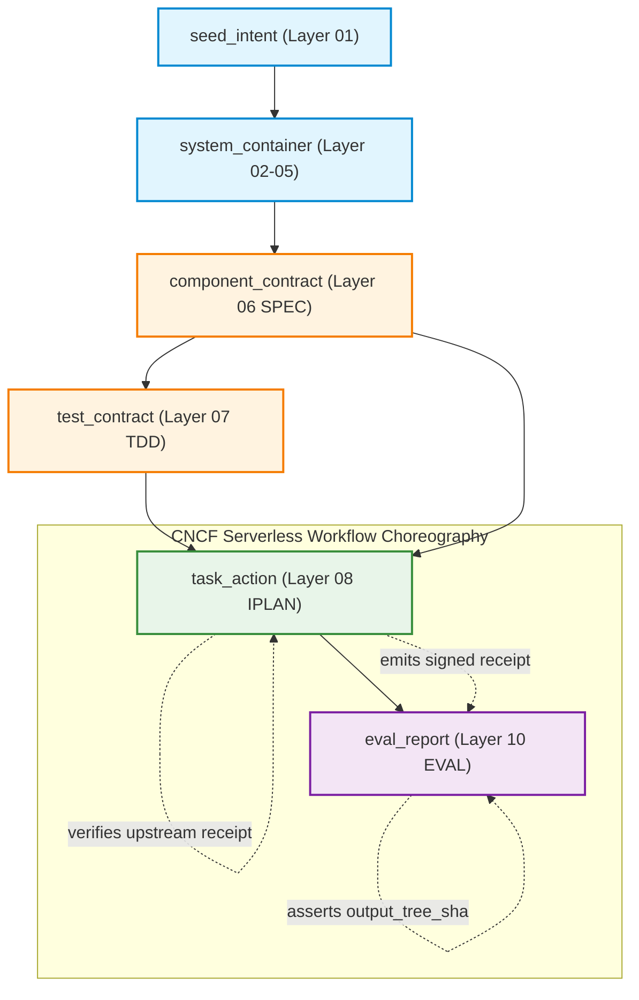

# The SDD Assembly Line to IPLAN & EVAL

## Document Control

| Field | Value |
|---|---|
| Version | 1.0 |
| Status | Approved |
| Last Updated | 2026-10-19 |
| Author | Framework Maintainer |
| Framework Version | 0.96.11 |

---

## 1. Executive Summary & Manufacturing Metaphor

The **Spec-Driven Development (SDD)** framework models the software development lifecycle not as an ad-hoc conversational negotiation, but as an **industrial precision manufacturing assembly line** for automated code mutation.

```
[ Raw Business Intent ]
          │
          ▼
   Layer 01 (BRD)  ──► Raw Material Intake & Feasibility
          │
   Layer 02 (PRD)  ──► Dimensioning & Measurable Criteria
          │
   Layer 03 (EARS) ──► Non-Ambiguous Logical Stamping
          │
   Layer 04 (BDD)  ──► Behavioral Fixture Tolerances
          │
   Layer 05 (ADR)  ──► Structural Boundary Seals
          │
   Layer 06 (SPEC) ──► Precision Blueprint & Toolchain Ownership
          │
   Layer 07 (TDD)  ──► Red-Phase Staging & Hermetic Fixtures
          │
          ▼
   Layer 08 (IPLAN) ──► Automated Code Mutation Factory Floor
          │
   Layer 09 (CHG)   ──► Traceability & Audit Packaging
          │
          ▼
   Layer 10 (EVAL)  ──► Cryptographic Verification & Tree Invariance Seal
```

### The Defect Amplification Law

In manual software development, defects that escape early phases waste developer hours. In **autonomous multi-agent coding environments**, upstream defects are catastrophic:

$$\text{Remediation Cost} \propto 10^{\text{Layer Distance}}$$

1. **At Layer 01–03 (Requirements)**: Clarifying an ambiguous SLA or missing error case takes seconds of specification authoring ($1\times$).
2. **At Layer 06 (SPEC)**: Correcting a missing type signature or undeclared toolchain requires updating interface contracts ($5\times$).
3. **At Layer 08 (IPLAN)**: When an autonomous coding agent encounters missing dependencies, ambiguous interfaces, or uncompensated test fixtures, it cannot ask rhetorical questions. It enters cyclic remediation retry loops, hits wall-clock timeouts (`stateExecTimeout`), hallucinates package versions, or triggers `ExecutionBlockedTerminal` ($50\times$).

The primary mission of Layers 01 through 07 is to **shield Layer 08 from ambiguity, dirty environment state, and toolchain friction**, allowing autonomous execution to run completely unattended to green completion.

---

## 2. Layer-by-Layer Manufacturing Sequence (01 to 10)

### 2.1 Layer 01 (BRD) — Raw Material Intake & Business Justification

- **Manufacturing Function**: Evaluates incoming problem statements, business requirements, and strategic intent.
- **Upstream Assurance Guard**: Rejects unvetted scope, missing stakeholder attribution, or unjustified resource allocations before engineering investment begins.
- **Governing Gate**: `GATE-01` (`GATE-01-E001` through `E003`).

### 2.2 Layer 02 (PRD) — Product Dimensioning & Measurable Bounds

- **Manufacturing Function**: Translates business problems into concrete product capabilities, user personas, and measurable acceptance metrics.
- **Upstream Assurance Guard**: Forbids subjective phrases ("fast", "intuitive", "scalable"). Enforces quantified SLAs (`@threshold:` constraints) and explicit boundary conditions.

### 2.3 Layer 03 (EARS) — Syntax Crystallization & Logical Stamping

- **Manufacturing Function**: Formats all product requirements into deterministic, machine-parsable Easy Approach to Requirements Syntax (EARS):
  - Ubiquitous: `THE <system> SHALL <response>`
  - Event-Driven: `WHEN <trigger> THE <system> SHALL <response>`
  - State-Driven: `WHILE <state> THE <system> SHALL <response>`
  - Optional: `WHERE <feature> THE <system> SHALL <response>`
  - Unwanted Event: `IF <condition> THEN THE <system> SHALL <response>`
- **Upstream Assurance Guard**: Eliminates natural language ambiguity. Ensures every requirement carries a single binary testable outcome.
- **Governing Gate**: `GATE-03` (`GATE-03-E003`, `GATE-03-E005`).

### 2.4 Layer 04 (BDD) — Behavioral Acceptance Contracts

- **Manufacturing Function**: Bridges formal EARS statements into executable scenario specifications (`Given-When-Then`).
- **Upstream Assurance Guard**: Forces explicit enumeration of system prerequisites (`Given`), stimulus actions (`When`), and observable state assertions (`Then`). Shields downstream test engineers from guessing system preconditions.
- **Governing Gate**: `GATE-03` (`GATE-03-E004`, `GATE-03-E006`).

### 2.5 Layer 05 (ADR) — Architectural Decision Boundaries

- **Manufacturing Function**: Evaluates structural trade-offs, technology choices, data boundaries, and architectural patterns.
- **Upstream Assurance Guard**: Seals architectural decisions against runtime drift. Prevents rogue dependencies or unapproved service boundaries from entering downstream component design.
- **Governing Gate**: `GATE-03` (`GATE-03-E001`, `GATE-03-E007`).

### 2.6 Layer 06 (SPEC) — Component Blueprint & Toolchain Ownership

- **Manufacturing Function**: The definitive blueprint for software components. Defines public APIs, type signatures, error codes, and **explicitly owns the toolchain**.
- **Upstream Assurance Guard**:
  - **Toolchain Ownership (`GATE-06-E005`)**: SPEC explicitly declares language, runtime version, package manager, and exact runner commands (`setup_command`, `type_check_command`, `test_runner_command`). IPLAN does not invent commands; it executes SPEC's declared toolchain.
  - **Topological Readiness (`GATE-06-E001`)**: SPEC must achieve binary topological validation (`tdd_ready_status: PASS`), ensuring zero cyclic dependencies or dangling interface citations.
- **Governing Gate**: `GATE-06` (`GATE-06-E001` through `GATE-06-E006`).

### 2.7 Layer 07 (TDD) — Pre-Flight Staging & Hermetic Fixtures

- **Manufacturing Function**: Stages unit, integration, and contract test cases red-first before implementation code exists.
- **Upstream Assurance Guard**:
  - **Fixture Hermeticity (`GATE-06-E006`)**: Any stateful test fixture allocating external resources (databases, testcontainers, mock servers, temporary directories) must declare automated saga teardown compensation (`compensatedBy: TeardownFixturesCompensation`).
  - **State Cleanliness**: Eliminates dirty state leakage that causes subsequent test runs or IPLAN validation steps to fail intermittently.

### 2.8 Layer 08 (IPLAN) — The Automated Code Mutation Factory Floor

- **Manufacturing Function**: The code implementation plane. Decomposes tasks into atomic work orders, executes code mutations, and runs verification suites.
- **Factory Execution Guards**:
  - **Test-First Order (`GATE-08-E002`)**: Test files are generated and committed before implementation code.
  - **Mandatory Saga Compensation (`GATE-08-E005`)**: Every mutating state in the CNCF Serverless Workflow state machine declares automated rollback compensation (`compensatedBy`).
  - **Step-Execution Completeness (`GATE-08-E006`)**: Every declared step must execute and produce evidence, or carry an authorized `skip_audit` rationale.
  - **Execution Timeouts (`GATE-08-E007`)**: State and action level timeouts (`stateExecTimeout`, `actionExecTimeout`) prevent infinite loops and hung agent subprocesses.
  - **Cryptographic Receipt Signing (`CHG-121`)**: Emits signed execution receipts (`iplan_receipt_ref`, `receipt_seal_hash`, `output_tree_sha`).
- **Governing Gate**: `GATE-08` (`GATE-08-E001` through `GATE-08-E007`).

### 2.9 Layer 09 (CHG) — Governance Packaging & Traceability Envelope

- **Manufacturing Function**: Binds the Change Request, approval records, decision blocks, and modified file manifests into an immutable governance ledger.
- **Upstream Assurance Guard**: Enforces change classification (HOTFIX, CODE2S, CODE2C, SEED2C, DIR2C, SDD2C) and ensures that all modified files ride an authorized change envelope.
- **Governing Gate**: `GATE-SPEC`, `chg_lint.py`.

### 2.10 Layer 10 (EVAL) — Post-Validation Quality Seal & Tree Invariance

- **Manufacturing Function**: The independent quality inspector at the end of the assembly line. Validates that the manufactured product satisfies all specifications before baseline deployment.
- **Post-Validation Invariants**:
  - **Sealed Receipt Ingestion**: Ingests `iplan_receipt_ref` and verifies the cryptographic `receipt_seal_hash`.
  - **Git Tree Invariance**: Validates that workspace Git tree matches `output_tree_sha`, catching untracked modifications or uncommitted drift.
  - **Switch Gating (`EvaluateReceiptGate`)**: Any seal tampering or tree divergence routes execution immediately to `ExecutionBlockedTerminal`.
- **Governing Gate**: `GATE-CODE`, `eval-verification-run.sw.yaml`.

---

## 3. Upstream Defect Shielding Matrix

The following matrix illustrates how upstream failures are arrested before contaminating Layer 08 (IPLAN) execution:

| Upstream Failure Mode | Defect Layer | Blast Radius on IPLAN / EVAL | Arresting Gate | Automated Prevention Mechanism |
|---|---|---|---|---|
| Ambiguous requirement prose ("system should be responsive") | Layer 02 (PRD) / 03 (EARS) | Agent writes arbitrary non-reproducible test assertions | `GATE-03-E003` | EARS syntax validation (`WHEN-THE-SHALL-WITHIN`) |
| Unspecified error return codes or exceptions | Layer 06 (SPEC) | Agent catches generic exceptions or loops on unhandled errors | `GATE-06-E001` | Binary topological validation (`tdd_ready_status: PASS`) |
| Missing or unpinned runtime/package manager | Layer 06 (SPEC) | Agent hallucinates package versions or uses incompatible compiler | `GATE-06-E005` | Mandatory `toolchain:` block in `component_overview:` |
| Stateful integration test leaves dirty database tables | Layer 07 (TDD) | Flaky test failures in IPLAN verification and EVAL test runs | `GATE-06-E006` | Mandatory `compensatedBy: TeardownFixturesCompensation` |
| Agent deletes or overwrites files without revert path | Layer 08 (IPLAN) | Irreversible corruption of repository state on task error | `GATE-08-E005` | Mandatory saga rollback compensation (`compensatedBy`) |
| Silent step omission during parallel execution | Layer 08 (IPLAN) | Partially implemented features passed off as complete | `GATE-08-E006` | Step-Execution Completeness Gate (`VerifyStepExecutionCompleteness`) |
| Runaway loop or hung build process | Layer 08 (IPLAN) | Worker pool resource exhaustion, infinite pipeline stalls | `GATE-08-E007` | Native CNCF SWF execution timeouts (`stateExecTimeout: PT15M`) |
| Workspace modified between IPLAN and EVAL execution | Layer 08 $\to$ 10 | EVAL validates code different from what IPLAN attested | `GATE-CODE` | Cryptographic seal verification & tree invariance (`checkTreeInvariance`) |

---

## 4. Integration with SDD Graph & CNCF Serverless Workflows

The SDD Assembly Line operates as a unified directed acyclic graph (DAG) evaluated by `sdd-graph.schema.json` and executed by declarative CNCF Serverless Workflow state machines:



Every transition along this DAG is governed by machine-executable criteria. By the time work reaches the factory floor of code implementation, every ambiguity has been crystallized into binary topological invariants—ensuring reliable, unattended, and deterministic execution.
