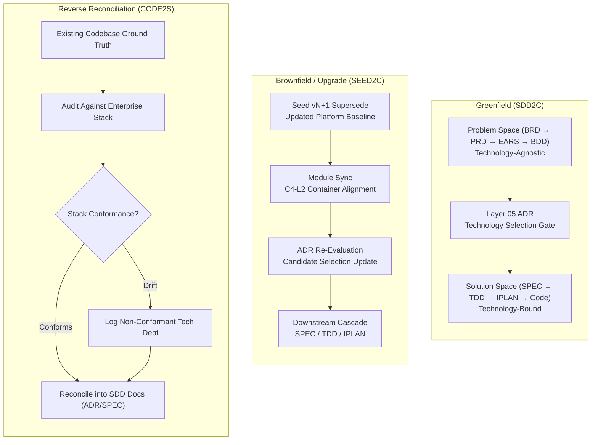

# Technology Stack Usage Guide: Enterprise Stack Alignment Across SDD Tiers

## Document Control

| Field | Value |
|---|---|
| Version | 1.2 |
| Status | Approved |
| Last Updated | 2026-10-13 |
| Author | Framework Maintainer |
| Framework Version | 0.92.2 |
| Authority | [Decision GD-73](DECISIONS.md#gd-73) (DEC-CHG-86), [Decision GD-72](DECISIONS.md#gd-72) (DEC-CHG-83), [Decision D-0013 / GD-13](DECISIONS.md), [CHG-92](../archive/CHG-92/CHG-92.yaml) & [CHG-93](../archive/CHG-93/CHG-93.yaml) |

---

## 1. Purpose & Relationship to Framework Core

The **`aidoc-flow-framework`** establishes a 10-layer Specification-Driven Development (SDD) contract:

```text
BRD (01) → PRD (02) → EARS (03) → BDD (04) → ADR (05) → SPEC (06) → TDD (07) → IPLAN (08) → Code → EVAL (10)
```

Per **Decision D-0013 / GD-13**, the core specifications (`framework/layers/` and `framework/governance/`) are **strictly engine-agnostic and vendor-neutral**: they define lifecycles, interface schemas, declarative workflow graphs (`.sw.yaml`), and quality gates without tying consumers to proprietary software or commercial SaaS.

To ensure consistency, resilience, and operational efficiency across all projects in our ecosystem, the organization defines an **Authoritative Platform Technology Stack** (documented in [vladm3105/technology-stack](https://github.com/vladm3105/technology-stack), and synthesized in [`RECOMMENDED_PLATFORM_STACK.md`](RECOMMENDED_PLATFORM_STACK.md)).

This guide defines **how and when** to use the approved platform technology stack within the SDD lifecycle. It establishes the **Progressive Refinement Model**, formalizes **Layer 05 (ADR, immediately after BDD)** as the authoritative technology selection gate, maps the stack across traversal flows (`SDD2C`, `SEED2C`, `CODE2S`), and establishes the **Architecture Variance & Exception Procedure**.

---

## 2. The Progressive Refinement Model

Technology stack integration is not a single, isolated event; it operates as a **progressive refinement funnel** across four architectural tiers:

```
┌──────────────────────────────────────────────────────────────────────────────────────────────────┐
│                                PROGRESSIVE REFINEMENT FUNNEL                                     │
├──────────────────────────────────────────────────────────────────────────────────────────────────┤
│ Tier 0: Enterprise Tech Stack (vladm3105/technology-stack)                                      │
│   • Global Approved Standard (Debian 13, Docker/gVisor, PG18 HA, Temporal, NATS, ClickHouse)   │
├──────────────────────────────────────────────────────────────────────────────────────────────────┤
│ Tier 1: Seed Documents (<project>/seed/)                                                         │
│   • Macro Environmental Realities, Platform Baselines & Non-Negotiable Invariants (C4-L1)        │
├──────────────────────────────────────────────────────────────────────────────────────────────────┤
│ Tier 2: Module Specifications (docs/modules/MODULE-NN_*)                                         │
│   • Structural Container Modeling (C4-L2), Trust Boundaries (DFD-L2) & Platform Archetypes       │
├──────────────────────────────────────────────────────────────────────────────────────────────────┤
│ SDD Problem Space (Layers 01-04: BRD → PRD → EARS → BDD)                                         │
│   • Technology-Agnostic: Business Goals, Feature Capabilities, Latency/Throughput & Scenarios    │
├──────────────────────────────────────────────────────────────────────────────────────────────────┤
│ SDD Selection Gate (Layer 05: ADR — AFTER BDD) ◄── [FORMAL SELECTION GATE]                       │
│   • Evaluates candidates from approved stack against BDD scenarios via MCDA utility scoring      │
├──────────────────────────────────────────────────────────────────────────────────────────────────┤
│ SDD Solution Space (Layers 06-10: SPEC → TDD → IPLAN → Code → EVAL)                              │
│   • Technology-Bound: Concrete DB Schemas, Protobuf contracts, testcontainers, Temporal state   │
└──────────────────────────────────────────────────────────────────────────────────────────────────┘
```

### 2.1 Tier 0: Enterprise Platform Baseline ([vladm3105/technology-stack](https://github.com/vladm3105/technology-stack))

- **Role:** The company-wide catalog of approved standards, shared multi-tenant infrastructure, and security baselines.
- **Core Principle:** Shared infrastructure over per-repository sprawl. Projects connect to the central 3-node HA **PostgreSQL 18** cluster (isolated databases), central **Temporal** server (isolated namespaces), central **NATS JetStream** broker (isolated accounts), and central **ClickHouse** cluster.
- **Execution Boundary:** Sandboxed agent execution runs under **Docker CE + gVisor (`runsc`)** with dropped capabilities and `--network=none`.

### 2.2 Tier 1: Seed Documents (`<project>/seed/`) — C4-L1 System Context

- **Role:** Establishes project foundation, problem statement, and external platform context.
- **Stack Integration:** In [`SEED-TEMPLATE.md`](../templates/SEED-TEMPLATE.md) Section 2 (*Environmental Realities & Constraints*) and Section 5 (*Architectural Principles & Non-Negotiable Invariants*), the architect binds the project to the enterprise baseline.
- **Rule:** The seed document declares platform constraints (e.g., *"System runs containerized in Docker with gVisor sandboxing and integrates with central PostgreSQL 18 and Temporal"*), but **does NOT select specific component libraries or internal schemas**.

### 2.3 Tier 2: Module Specifications (`docs/modules/MODULE-NN_*`) — C4-L2 Container Boundaries

- **Role:** Structural container modeling per [`SEED_TO_MODULE_DECOMPOSITION.md`](SEED_TO_MODULE_DECOMPOSITION.md).
- **Stack Integration:** Step 2 (*C4-L2 Container Definition*) maps bounded contexts into approved platform container archetypes:
  - *Worker Container:* Temporal workflow worker or LangGraph activity executor.
  - *Persistence Container:* PostgreSQL 18 transactional database or ClickHouse OLAP store.
  - *Messaging Container:* NATS JetStream asynchronous publisher/subscriber.
- **Rule:** Module documents identify container archetypes and trust boundaries (DFD-L2), but **defer concrete component interfaces and protocol definitions to SPEC (Layer 06)**.

### 2.4 Problem Space (Layers 01–04: BRD $\rightarrow$ PRD $\rightarrow$ EARS $\rightarrow$ BDD)

- **Role:** Capture business outcomes, product scope, and behavioral contracts.
- **Architecture Principle (Technology-Agnostic Requirements):** Requirements must define *WHAT* the user needs and *WHY*, never the internal implementation tool:
  - `01_BRD`: Captures business objectives and quality expectations. Enforces `BL-VENDOR-NAME-SCOPE`: capability titles must remain vendor-neutral (e.g. *"Requires scalable relational persistence with ACID guarantees"* rather than *"Must use PostgreSQL"*). Lists candidate topics in Section 8 `adr_topics`.
  - `02_PRD`: Decomposes capabilities into feature sets and elaborates `adr_topic_elaboration` without pre-selecting specific technologies.
  - `03_EARS`: Formulates testable, conditional requirements (WHEN/THE/SHALL/WITHIN), establishing latency budgets, throughput thresholds, and error conditions.
  - `04_BDD`: Formulates executable acceptance scenarios (Given-When-Then), modeling edge cases, network disruptions, and transactional failure modes.

### 2.5 The Selection Gate (Layer 05: ADR — AFTER BDD)

- **Role:** The C4 decision bridge between Container (PRD) and Component (SPEC).
- **Why After BDD?**  
  Sound architectural decisions cannot be made in a vacuum. By placing technology selection immediately after BDD:
  1. The decision engine evaluates candidates against concrete behavioral failure scenarios (`@bdd`) and strict latency/throughput budgets (`@ears`).
  2. Candidate alternatives are drawn directly from the approved enterprise stack ([vladm3105/technology-stack](https://github.com/vladm3105/technology-stack)).
  3. The decision evaluates trade-offs via quantitative **Multi-Criteria Decision Analysis (MCDA)** scoring across quality attributes (latency, resilience, operational cost, security).
  4. The ratified decision locks the exact technology choice with Context, Decision, and Consequences, unblocking technical specifications.
  5. The ratified technology, version constraint, authorizing ADR reference, security monitoring metadata (PURL, CPE, scanners), and automated update policy are recorded directly into the project's canonical agent-readable [`ADR-00_index.yaml`](../layers/05_ADR/ADR-00_index.TEMPLATE.yaml) registry under `technologies`.

### 2.6 Solution Space (Layers 06–10: SPEC $\rightarrow$ TDD $\rightarrow$ IPLAN $\rightarrow$ Code $\rightarrow$ EVAL)

- **Role:** Authoring implementation contracts and executing code within sandboxes.
- **Stack Integration:**
  - `06_SPEC`: Authors typed component interfaces, database schema migrations, and asynchronous event contracts (e.g., CloudEvents v1.0 / Protobuf over NATS JetStream, PostgreSQL 18 tables with UUIDv7 monotonic keys).
  - `07_TDD`: Defines test suites using ephemeral testcontainers running real PostgreSQL 18 and NATS JetStream instances for migration and contract verification.
  - `08_IPLAN`: Compiles execution DAGs into durable state machines with SAGA compensation rollbacks executed by Temporal.
  - `Code`: Executes inside isolated Git worktrees running under gVisor (`runsc`) sandboxes with secrets injected via memory-only mechanisms.
  - `10_EVAL`: Evaluates completed work against prompt datasets and telemetry traces correlated across APM and LLM observability engines.

---

## 3. SDD Traversal Flow Mappings

The framework's 6 traversal flows ([`CHG_REQUEST_FLOWS.md`](CHG_REQUEST_FLOWS.md)) apply technology stack governance according to their operational context:



1. **Greenfield (`SDD2C`):** Strict forward chain. Upstream tiers (Seed/Module) declare container archetypes; problem space layers (01–04) remain technology-neutral; Layer 05 ADR selects and locks the stack; downstream layers (06–10) implement the stack.
2. **Brownfield / Upgrades (`SEED2C`):** Triggered when an architectural baseline shifts (e.g. upgrading to PostgreSQL 18 or adopting NATS JetStream). Phase 0a updates Seed to vN+1, Phase 0b syncs affected Modules, and Phase 0c re-evaluates downstream ADRs.
3. **Reverse Reconciliation (`CODE2S`):** Used when onboarding existing working codebases into SDD. The codebase is audited against the enterprise technology stack ([vladm3105/technology-stack](https://github.com/vladm3105/technology-stack)). Conforming patterns are formalized into Layer 05 ADRs; non-conforming technologies are logged as technical debt and slated for migration.

---

## 4. Technology Stack Variance & Exception Governance

A project MUST NOT adopt libraries, databases, or runtime infrastructure outside the approved enterprise technology stack ([vladm3105/technology-stack](https://github.com/vladm3105/technology-stack)) without an approved **Architecture Variance Request**.

```mermaid
sequenceDiagram
    participant Proposer as Project Tech Lead / AI Agent
    participant ADR as Layer 05 ADR Proposal
    participant Crew as Review Crew (Architect + Security + Operator)
    participant CHG as Authorizing CHG (GATE-SPEC / GATE-03)

    Proposer->>ADR: Draft ADR with Non-Standard Alternative
    Note over ADR: Evaluates why approved stack cannot satisfy SLA/requirements
    ADR->>Crew: Dispatch Review Crew RFC Callback
    alt Crew Rejects Variance
        Crew-->>ADR: Objections present; require standard stack adoption
        ADR->>Proposer: Revise with standard platform component
    else Crew Approves Variance
        Crew-->>CHG: Consensus reached; submit formal Variance CHG
        CHG->>CHG: Require sandbox isolation & operational runbook
        CHG-->>Proposer: Variance approved; ratified as project-specific exception
    end
```

### The 4-Step Variance Procedure

1. **Demonstrate Deficit in ADR:** The author drafts an ADR evaluating the standard platform component (e.g., PostgreSQL 18) and provides quantitative benchmarks proving it fails non-functional requirements (e.g., sub-millisecond graph traversals requiring Neo4j).
2. **Strict Containment & Sandboxing:** The variance must specify how the non-standard technology is contained:
   - Must execute in an isolated container under gVisor (`runsc`).
   - Must NOT connect to shared multi-tenant databases or brokers without explicit ACLs.
   - Must provide an automated testcontainer fixture for Layer 07 TDD.
3. **Review Crew Consensus:** The review crew (specifically the `architect`, `security_engineer`, and `operator` personas) must achieve quorum and sign off with zero blocking vetoes.
4. **Formal Decision Ratification:** The variance is recorded in the project's authorizing Change Request (Section 1B `decision:`) and logged in the project ADR index.

---

## 5. Review Crew Verification Checklist

Review crews evaluating SDD artifacts ([`REVIEW_CREWS.yaml`](REVIEW_CREWS.yaml)) must assert the following criteria:

| SDD Layer | Review Persona | Mandatory Verification Rule |
|---|---|---|
| **01 BRD** | `business_analyst` | Titles and drivers in Section 8 `adr_topics` must describe business capabilities, NOT vendor products. |
| **02 PRD** | `architect` | Section 14 `adr_topic_elaboration` specifies technical dimensions without pre-deciding final selections. |
| **03 EARS** | `requirements_specialist` | Expresses timing, throughput, and error recovery SLAs necessary for MCDA scoring. |
| **04 BDD** | `chaos_engineer` | Includes edge scenarios (network partition, timeouts, duplicate events) to validate candidate resilience. |
| **05 ADR** | `architect` | Evaluates $\ge 2$ candidates from the approved enterprise technology stack; computes MCDA utility scores; attaches variance if non-standard. |
| **06 SPEC** | `tech_lead` | Adheres to platform contracts: typed interfaces, Protobuf schemas, UUIDv7 keys, and automated migration scripts. |
| **07 TDD** | `qa_lead` | Uses ephemeral testcontainers for real database and message broker contract testing. |
| **08 IPLAN**| `operator` | Workflow tasks map to Temporal activities carrying idempotent execution and SAGA rollbacks. |
