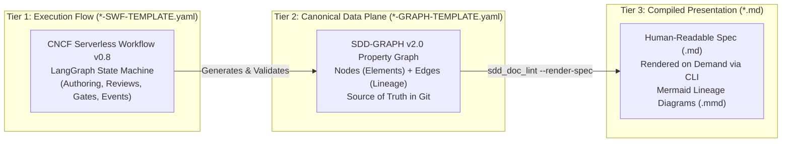

# SDD Specification Layers (01_BRD — 10_EVAL)

## Document Control

| Field | Value |
|---|---|
| Version | 2.0 |
| Status | Approved |
| Last Updated | 2026-10-17 |
| Author | Framework Maintainer |
| Framework Version | 0.96.15 |
| Authority | Decision DEC-CHG-113 (framework/archive/CHG-113/CHG-113.yaml) |

---

## 1. Overview & Chain of Custody

Specification-Driven Development (SDD) is a **10-layer documentation-to-code flow** that produces implementation-ready technical specifications from business requirements. Each layer represents a formal boundary in the chain of custody:

```text
01_BRD → 02_PRD → 03_EARS → 04_BDD → 05_ADR → 06_SPEC → 07_TDD → 08_IPLAN → [Code] → 10_EVAL
                                                                               ▲
09_CHG (Transactional Governance Overlay) ─────────────────────────────────────┘
```

| Layer | Directory | Primary Purpose | C4 Mapping |
|---|---|---|---|
| 01 | `01_BRD/` | Strategic business objectives, financial ROI, problem statements | Context |
| 02 | `02_PRD/` | Product feature definitions, personas, functional scopes | Container |
| 03 | `03_EARS/` | Formal requirements syntax (WHEN-THE-SYSTEM-SHALL) | Decision Bridge |
| 04 | `04_BDD/` | Behavioral state machines & acceptance scenarios (Given-When-Then) | Decision Bridge |
| 05 | `05_ADR/` | Architecture decision records & trade-off evaluations | Decision Bridge |
| 06 | `06_SPEC/` | Component interfaces, wire contracts, and data schemas | Component |
| 07 | `07_TDD/` | Test case definitions, assertions, and verification criteria | Quality Bridge |
| 08 | `08_IPLAN/` | Implementation tasks, file manifests, and execution bridges | Execution Bridge |
| 09 | `09_CHG/` | Transactional change governance and architectural overlays | Governance |
| 10 | `10_EVAL/` | Verification runs, test evaluation reports, and sign-offs | Audit / Verification |

---

## 2. The Three-Tier Layer Architecture

Every layer across the framework supports the **Three-Tier Architecture**, decoupling execution workflow, canonical project data, and presentation:



### Tier Descriptions:
1. **Tier 1: Workflow Execution State Machine (`*-SWF-TEMPLATE.yaml`)**:
   - **Format**: CNCF Serverless Workflow DSL v0.8 hybrid YAML envelope.
   - **Role**: Consumed by workflow engines (LangGraph, Temporal, Argo, or custom agent orchestrators) to execute authoring loops, multi-agent adversarial reviews, in-situ remediation, gate evaluation (`GATE-01` through `GATE-CODE`), baseline sealing, and CloudEvent dispatch.
2. **Tier 2: Canonical Data Plane (`*-GRAPH-TEMPLATE.yaml`)**:
   - **Format**: SDD-GRAPH v2.0 YAML specification (`schema_version: "2.0-graph"`).
   - **Role**: The single source of truth committed to git (`docs/sdd/graph/` or per-layer). Encodes discrete nodes (requirements, goals, states, endpoints, test cases) and directed typed dependency edges (`satisfies`, `decomposes_to`, `verifies`, `implements`, `depends_on`).
3. **Tier 3: Compiled Read Projection (`*.md`)**:
   - **Format**: GitHub-flavored Markdown.
   - **Role**: Ephemeral or compiled view rendered dynamically via `sdd_doc_lint --render-spec <graph.yaml>`. Guarantees humans have clean, formatted documentation without duplicating source data.
4. **Standard Declarative Alternative (`*-TEMPLATE.yaml`)**:
   - Standalone 16+ section YAML specification for focused, linear initiatives where an orchestrator state machine is unnecessary.

---

## 3. Graph Engine & Context Slicing: When and How to Use Kùzu

Per **Decision D-0013 / GD-13** (zero-runtime engine neutrality) and the **Quad-Pillar Architecture Standard**, the framework enforces strict separation between specification schemas and query engines:

```text
Pillar 1: aidoc-flow-framework (This Repo)
  └─ Defines declarative contracts (*.graph.yaml, *.swf.yaml).
  └─ ZERO runtime dependencies (Pure Python Standard Library + PyYAML).
  └─ NO native C++ binaries in git trees.

Pillar 4: aidoc-context-tools (External Tooling & FastMCP Server)
  └─ Embedded Kùzu OLAP Graph Engine (kuzu>=0.8.0).
  └─ Sub-millisecond openCypher graph traversals across SDD-GRAPH files.
  └─ Automatic graceful fallback to pure-Python DFS when Kùzu is unavailable.
```

### When to Use Kùzu:
- **Agent Context Slicing (`aidoc_slice_context` / `sdd:slice`)**:
  When an autonomous AI agent needs to extract the exact upstream contract closure ($\text{Ancestors}(T_k) \cap \{\text{SPEC}, \text{BDD}, \text{ADR}, \text{EARS}, \text{TDD}\}$) for an IPLAN task. Kùzu traverses variable-length paths (`-[:DEPENDS_ON*1..N]->`) in $<1\,\text{ms}$, reducing agent prompt overhead by 60–80%.
- **PR Blast Radius & Invariant Gating (`aidoc-ctx check-invariants` / `sdd:delta`)**:
  Evaluating which downstream interfaces, state machines, and acceptance tests are affected by a modified contract.
- **Ad-Hoc Knowledge Graph Inquiries (`aidoc_cypher_query` / `sdd:query-graph`)**:
  Enabling AI agents to run openCypher queries over project architecture (e.g. checking for orphan requirements, circular dependencies, or untested endpoints).

### When NOT to Use Kùzu:
- Single-document bilateral traceability verification (BTV) in `sdd_doc_lint` during individual layer drafting.
- Lightweight CI container jobs where installing native C++ extensions is disabled.

### How to Use Kùzu:
1. **Via FastMCP Server (AI Agents)**:
   In IDE settings (`.aidoc/mcp_config.json`), configure `aidoc-context-tools`:
   ```json
   {
     "mcpServers": {
       "aidoc-context": {
         "command": "uvx",
         "args": ["aidoc-context-tools", "serve"]
       }
     }
   }
   ```
   Agents invoke `aidoc_slice_context(task_id)` and `aidoc_cypher_query(query)` directly.
2. **Via Workstation CLI (`Taskfile.yml`)**:
   - `task sdd:setup-kuzu`: Provisions `kuzu` into the local virtualenv.
   - `task sdd:slice TASK=<ID>`: Slices ancestor closure.
   - `task sdd:query-graph QUERY="MATCH (n:ArtifactNode) RETURN n.node_id, n.title"`: Runs openCypher queries.
