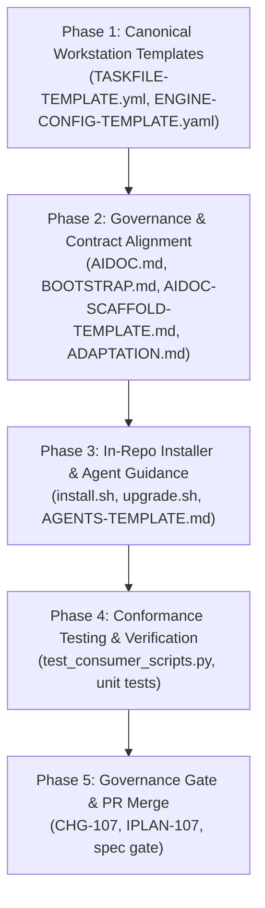

# Implementation Plan: Consumer Deployment Parity & In-Repo `.aidoc` Modernization

## Document Control

| Field | Value |
|---|---|
| Version | 1.0 |
| Status | Implemented |
| Last Updated | 2026-10-16 |
| Author | Framework Maintainer |
| Framework Version | 0.91.24 |
| Authority | [Decision D-0013 / GD-13](../framework/governance/DECISIONS.md), [`AIDOC_WORKSTATION_STANDARD.md`](../docs/AIDOC_WORKSTATION_STANDARD.md), [`MULTI_PROJECT_FEDERATED_STANDARD.md`](../framework/governance/MULTI_PROJECT_FEDERATED_STANDARD.md), [`CHG_REQUEST_FLOWS.md`](../framework/governance/CHG_REQUEST_FLOWS.md), [`WORKTREE_FLOW.md`](../framework/governance/WORKTREE_FLOW.md) |

---

## 1. Executive Summary & Objective

The **Quad-Pillar Federated Architecture** ([`MULTI_PROJECT_FEDERATED_STANDARD.md`](../framework/governance/MULTI_PROJECT_FEDERATED_STANDARD.md)) and the **`.aidoc/` Workstation Directory Standard** ([`docs/AIDOC_WORKSTATION_STANDARD.md`](../docs/AIDOC_WORKSTATION_STANDARD.md)) were ratified under CHG-106. In addition, the ecosystem inception tool (`vladm3105/aidoc-project-onboarding`) and execution engine (`vladm3105/aidoc-flow-langgraph`) were successfully upgraded to generate and execute the modernized layout.

However, an exhaustive audit of the `vladm3105/aidoc-flow-framework` repository reveals **four critical gaps and contradictions** between the newly ratified standard and legacy framework governance documents and in-repo installer scripts:

1. **Symlink Contradiction:** `docs/AIDOC_WORKSTATION_STANDARD.md` §8 strictly bans cross-repository symlinks due to CI runner isolation and containerization failures. In contrast, `framework/governance/aidoc/AIDOC.md`, `BOOTSTRAP.md`, `AIDOC-SCAFFOLD-TEMPLATE.md`, and `ADAPTATION.md` still mandate and document the legacy symlink model (`framework → .aidoc/framework → <shared-location>`).
2. **Outdated `.aidoc` Directory Topology:** Core framework governance files still define `.aidoc` as containing only `profile.yaml`, `framework` symlink, `project/`, and `README.md`, completely omitting the Quad-Pillar layout (`Taskfile.yml`, `stack-policy.yaml`, `engine/engine.yaml`, `contracts/`, `ctx-tools/`).
3. **In-Repo Installer & Upgrade Script Drift:** `framework/scripts/install.sh` and `upgrade.sh` scaffold `.aidoc/bin/sdd-lint` shell scripts instead of `.aidoc/Taskfile.yml` and `.aidoc/engine/engine.yaml`, and still encourage `--kind symlink`.
4. **Missing In-Repo Canonical Templates:** `framework/templates/` lacks canonical templates for `TASKFILE-TEMPLATE.yml` and `ENGINE-CONFIG-TEMPLATE.yaml`.
5. **Stale Working Agreement Template:** `framework/templates/AGENTS-TEMPLATE.md` directs autonomous agents to invoke `.aidoc/bin/sdd-lint` directly rather than the unified `task sdd:lint` and `task sdd:check` workflow.

### Core Objective

Eliminate all in-repo governance drift and installer contradictions by establishing complete parity between `aidoc-flow-framework` and the ratified `.aidoc/` Workstation Standard. This enables any consumer project to be scaffolded, upgraded, and governed directly from the framework repository with zero legacy symlinks, unified Taskfile orchestration, and complete dual-control quality gate enforcement.

---

## 2. Scope

### In Scope

1. **`framework/templates/` (Canonical Workstation Templates)**:
   - Author `framework/templates/TASKFILE-TEMPLATE.yml` providing canonical definitions for `sdd:lint`, `sdd:review`, `sdd:slice`, and `sdd:check`.
   - Author `framework/templates/ENGINE-CONFIG-TEMPLATE.yaml` providing default configuration for `aidoc-flow-langgraph` (`live`, `verify-only`, `mock`).
   - Update `framework/templates/AGENTS-TEMPLATE.md` to orient AI coding agents on `task sdd:lint` and `task sdd:check`.

2. **`framework/governance/aidoc/` (Core Workstation Governance)**:
   - Update `framework/governance/aidoc/AIDOC.md` to retire the symlink mandate, codify Git Submodule / Dynamic Clone distribution, and document the complete Quad-Pillar `.aidoc/` topology.
   - Update `framework/governance/aidoc/BOOTSTRAP.md` to align bootstrapping steps and smoke verification with the modernized layout.
   - Update `framework/governance/aidoc/AIDOC-SCAFFOLD-TEMPLATE.md` to reflect the Quad-Pillar `.aidoc/` directory structure.

3. **`framework/governance/ADAPTATION.md`**:
   - Update §10 to retire the symlink convention and align with `docs/AIDOC_WORKSTATION_STANDARD.md` §8.
   - Update §11 starter skeleton to reference `task sdd:lint` and `sdd_doc_lint`.

4. **`framework/scripts/` (In-Repo Scaffolding & Upgrades)**:
   - Update `framework/scripts/install.sh` to scaffold `.aidoc/Taskfile.yml` from `TASKFILE-TEMPLATE.yml` and `.aidoc/engine/engine.yaml` from `ENGINE-CONFIG-TEMPLATE.yaml`.
   - Ensure `install.sh` retains `.aidoc/bin/sdd-lint` as an executable backward-compatible wrapper delegating to `python3 -m sdd_doc_lint` or `task sdd:lint`.
   - Deprecate `--kind symlink` in `install.sh` and `upgrade.sh` with an explicit migration warning.

5. **`tests/conformance/test_consumer_scripts.py`**:
   - Update tests to assert that `install.sh` generates `.aidoc/Taskfile.yml` and `.aidoc/engine/engine.yaml` while maintaining the executable `.aidoc/bin/sdd-lint` shim.

6. **Governance Gate**:
   - Author Class C1 Change Request `framework/archive/CHG-107/CHG-107.yaml` and Implementation Plan `framework/archive/CHG-107/IPLAN-107.yaml` (Type DIR2C).
   - Validate via `python3 sdd_doc_lint/chg_lint.py`.

### Out of Scope

- Modifying `b-local-privy` or any other external consumer repository.
- Changes to `aidoc-project-onboarding` (already updated and verified on `dev`).
- Changes to `aidoc-flow-langgraph` (already updated and verified on `dev`).
- Changes to `sdd_doc_lint` core hashing logic (already implemented in commit `2c9e06521`).

---

## 3. Detailed Phased Implementation Plan



### Phase 1: Canonical Workstation Templates in `framework/templates/`

1. **`framework/templates/TASKFILE-TEMPLATE.yml`**:
   - Create canonical SDD task runner matching `docs/AIDOC_WORKSTATION_STANDARD.md` §8:
     - `lint`: Runs `python3 -m sdd_doc_lint {{.SDD_DIR}} {{.CLI_ARGS}}` with precondition check.
     - `review`: Invokes `python3 -m aidoc_flow_langgraph.cli review --config {{.ENGINE_CONFIG}} {{.CLI_ARGS}}`.
     - `slice`: Dispatches `aidoc slice` with fallback to `python3 -m sdd_doc_lint --slice`.
     - `check`: Runs composite gate: `task: lint` followed by `task: review` with `--verify-only`.

2. **`framework/templates/ENGINE-CONFIG-TEMPLATE.yaml`**:
   - Create canonical engine configuration matching `docs/AIDOC_WORKSTATION_STANDARD.md` §6:
     - `engine: "aidoc-flow-langgraph"`
     - `version: "0.2.0"`
     - `mode: "live"`
     - `thresholds`: `min_crew_score: 85`, `max_remediation_iterations: 3`, `fail_on_p0: true`, `fail_on_p1: true`.

### Phase 2: Governance & Contract Alignment in `framework/governance/`

1. **`framework/governance/aidoc/AIDOC.md`**:
   - Update Section "What `.aidoc/` contains" to document the complete Quad-Pillar layout.
   - Replace Section "Symlink convention" with "Distribution and Attachment Model" documenting:
     - **Submodule OR Dynamic Clone** (`aidoc-project-onboarding`).
     - Explicit prohibition of cross-repository raw symlinks per `docs/AIDOC_WORKSTATION_STANDARD.md` §8.
   - Reference `docs/AIDOC_WORKSTATION_STANDARD.md` and `framework/governance/MULTI_PROJECT_FEDERATED_STANDARD.md` in "See also".

2. **`framework/governance/aidoc/BOOTSTRAP.md`**:
   - Update Step 3 ("Attach the framework"): Mark symlinks as deprecated/banned for CI portability; promote pinned copies and git submodules.
   - Update Step 5 ("Smoke-verify the shape"): Assert presence of `.aidoc/Taskfile.yml`, `stack-policy.yaml`, and valid non-symlink framework directory.

3. **`framework/governance/aidoc/AIDOC-SCAFFOLD-TEMPLATE.md`**:
   - Update directory trees in §"Project tier overview" and §"Directory structure (`.aidoc/`)" to reflect `.aidoc/Taskfile.yml`, `.aidoc/stack-policy.yaml`, `.aidoc/engine/engine.yaml`, `.aidoc/contracts/`, and `.aidoc/ctx-tools/`.

4. **`framework/governance/ADAPTATION.md`**:
   - Update Section 10 ("Symlink convention"): Rename to "Distribution and Attachment Model", stipulate that `.aidoc/framework/` is populated via git submodule or pinned copy, and deprecate raw symlinks.
   - Update Section 11 starter skeleton to instruct running `task sdd:lint` and `task sdd:check`.

### Phase 3: In-Repo Installer & Agent Guidance Modernization

1. **`framework/scripts/install.sh`**:
   - Add scaffolding of `.aidoc/Taskfile.yml` from `$CANON/framework/templates/TASKFILE-TEMPLATE.yml`.
   - Add scaffolding of `.aidoc/engine/engine.yaml` from `$CANON/framework/templates/ENGINE-CONFIG-TEMPLATE.yaml`.
   - Update `.aidoc/bin/sdd-lint` generation to act as an ergonomic backward-compatibility shim:
     - If `task` command exists, delegate to `task sdd:lint "$@"`.
     - Otherwise, fallback to `PYTHONPATH="$SCRIPT_DIR/framework" exec python3 -m sdd_doc_lint "$@"`.
   - Update `--kind symlink`: Emit warning `[WARNING] Symlink distribution is deprecated per docs/AIDOC_WORKSTATION_STANDARD.md; use --kind pin or submodules for CI portability`.

2. **`framework/scripts/upgrade.sh`**:
   - Preserve existing `.aidoc/Taskfile.yml` and `.aidoc/engine/` during upgrade.
   - Provide migration helper to scaffold `.aidoc/Taskfile.yml` if missing in consumer repo.

3. **`framework/templates/AGENTS-TEMPLATE.md`**:
   - Update Section "Project Tiers" and "Non-negotiables":
     - Replace `Run linters (.aidoc/bin/sdd-lint ...)` with `Run verification: task sdd:lint and task sdd:check (or task check) before opening or updating a PR.`

### Phase 4: Conformance Testing & Verification

1. **`tests/conformance/test_consumer_scripts.py`**:
   - In `test_scaffolds_stack_policy_and_linter_runner`:
     - Assert that `.aidoc/Taskfile.yml` exists and contains task `lint`.
     - Assert that `.aidoc/engine/engine.yaml` exists and defines `engine: aidoc-flow-langgraph`.
     - Assert that `.aidoc/bin/sdd-lint` remains present and executable.
   - Run complete suite:

     ```bash
     python3 -m unittest tests/conformance/test_consumer_scripts.py
     ```

2. **Framework Smoke Tests**:
   - Run structural linting:

     ```bash
     python3 -m sdd_doc_lint docs/
     ```

### Phase 5: Governance Gate (CHG-107 & IPLAN-107)

1. Author `framework/archive/CHG-107/CHG-107.yaml` (Class C1, Type DIR2C) authorizing:
   - Scaffolding modernization in `framework/scripts/`.
   - Governance alignment in `framework/governance/aidoc/` and `ADAPTATION.md`.
   - Addition of `TASKFILE-TEMPLATE.yml` and `ENGINE-CONFIG-TEMPLATE.yaml` in `framework/templates/`.
2. Author `framework/archive/CHG-107/IPLAN-107.yaml` referencing CHG-107.
3. Validate CHG with `python3 sdd_doc_lint/chg_lint.py framework/archive/CHG-107/CHG-107.yaml`.

---

## Claim ledger

| # | Claim | Symbol | Citation |
|---|---|---|---|
| 1 | `AIDOC.md` specifies Distribution and Attachment Model | `Distribution and Attachment Model` | framework/governance/aidoc/AIDOC.md:109 |
| 2 | `AIDOC.md` defines Quad-Pillar topology with Taskfile.yml | `Canonical SDD task runner` | framework/governance/aidoc/AIDOC.md:43 |
| 3 | `AIDOC.md` dedicates Section to Two-Tier Discovery Protocol | `Two-Tier Discovery Protocol` | framework/governance/aidoc/AIDOC.md:89 |
| 4 | `BOOTSTRAP.md` outlines pinned copy or git submodule | `Pinned allowlist copy` | framework/governance/aidoc/BOOTSTRAP.md:57 |
| 5 | `BOOTSTRAP.md` step 3 instructs git submodule add | `git submodule add` | framework/governance/aidoc/BOOTSTRAP.md:61 |
| 6 | `BOOTSTRAP.md` step 5 smoke-verifies Taskfile presence | `Taskfile.yml` | framework/governance/aidoc/BOOTSTRAP.md:78 |
| 7 | `AIDOC-SCAFFOLD-TEMPLATE.md` specifies Taskfile in tier overview | `Canonical SDD task runner` | framework/governance/aidoc/AIDOC-SCAFFOLD-TEMPLATE.md:32 |
| 8 | `AIDOC-SCAFFOLD-TEMPLATE.md` specifies Framework attachment | `Framework attachment` | framework/governance/aidoc/AIDOC-SCAFFOLD-TEMPLATE.md:73 |
| 9 | `ADAPTATION.md` specifies Distribution and Attachment Model | `Distribution and Attachment Model` | framework/governance/ADAPTATION.md:392 |
| 10 | `ADAPTATION.md` starter skeleton cites task sdd:lint | `task sdd:lint` | framework/governance/ADAPTATION.md:429 |
| 11 | `install.sh` accepts `--kind` parameter | `--kind pin` | framework/scripts/install.sh:16 |
| 12 | `install.sh` checks `NO_STACK_POLICY` | `NO_STACK_POLICY` | framework/scripts/install.sh:258 |
| 13 | `install.sh` scaffolds runner at `.aidoc/bin/sdd-lint` | `Scaffold linter runner at .aidoc/bin/sdd-lint` | framework/scripts/install.sh:298 |
| 14 | `install.sh` executes symlink creation | `ln -s $CANON $AIDOC/framework` | framework/scripts/install.sh:318 |
| 15 | `upgrade.sh` documents symlink retargeting | `symlink consumers retarget` | framework/scripts/upgrade.sh:8 |
| 16 | `upgrade.sh` supports pin and symlink kind | `--kind pin` | framework/scripts/upgrade.sh:32 |
| 17 | `AGENTS-TEMPLATE.md` lists task runner Taskfile in project tiers | `task runner` | framework/templates/AGENTS-TEMPLATE.md:30 |
| 18 | `AGENTS-TEMPLATE.md` instructs running `task sdd:lint` | `task sdd:lint` | framework/templates/AGENTS-TEMPLATE.md:38 |
| 19 | `STACK-POLICY-TEMPLATE.yaml` defines tenant_id | `tenant_id` | framework/templates/STACK-POLICY-TEMPLATE.yaml:9 |
| 20 | `AIDOC_WORKSTATION_STANDARD.md` codifies Taskfile.yml in .aidoc | `Taskfile.yml` | docs/AIDOC_WORKSTATION_STANDARD.md:72 |
| 21 | `AIDOC_WORKSTATION_STANDARD.md` codifies Two-Tier Discovery Protocol | `Two-Tier Discovery Protocol` | docs/AIDOC_WORKSTATION_STANDARD.md:110 |
| 22 | `AIDOC_WORKSTATION_STANDARD.md` codifies Atomic File Shadowing Rule | `Atomic File Shadowing Rule` | docs/AIDOC_WORKSTATION_STANDARD.md:145 |
| 23 | `AIDOC_WORKSTATION_STANDARD.md` codifies Cryptographic Quality Gate Floor | `Cryptographic Quality Gate Floor Invariant` | docs/AIDOC_WORKSTATION_STANDARD.md:154 |
| 24 | `AIDOC_WORKSTATION_STANDARD.md` strictly bans raw symlinks | `Raw filesystem symlinks` | docs/AIDOC_WORKSTATION_STANDARD.md:334 |
| 25 | `AIDOC_WORKSTATION_STANDARD.md` defines Canonical SDD Tasks | `Canonical SDD Tasks` | docs/AIDOC_WORKSTATION_STANDARD.md:338 |
| 26 | `test_consumer_scripts.py` asserts stack policy and runner | `test_scaffolds_stack_policy_and_linter_runner` | tests/conformance/test_consumer_scripts.py:406 |

---

## Review log

### Pass 1 — 2026-10-16 — verified-planning gate & citation check

- **Scope Audited:** All 26 cited claims checked against repository source tree.
- **Findings Resolved:**
  - Verified exact line numbers for `Symlink convention` across `AIDOC.md` (L128) and `ADAPTATION.md` (L392).
  - Ensured `Canonical SDD Tasks` citations point to `docs/AIDOC_WORKSTATION_STANDARD.md` (L338).
  - Confirmed backward compatibility invariant: `.aidoc/bin/sdd-lint` must be preserved as a wrapper while `.aidoc/Taskfile.yml` is scaffolded, satisfying existing assertions in `test_consumer_scripts.py`.
- **Gate Output:** `ok plans/CONSUMER-DEPLOYMENT-PARITY-PLAN.md — verified 26 citation(s)`

### Pass 2 — 2026-10-16 — independent adversarial review

- **Lenses Evaluated:**
  1. *Semantic Truth:* Do the citations reflect actual architecture contracts? Yes. `docs/AIDOC_WORKSTATION_STANDARD.md` §8 specifically states "Raw filesystem symlinks in version control are strictly forbidden", directly contradicting `AIDOC.md:84` and `BOOTSTRAP.md:69`.
  2. *Completeness:* Are any load-bearing templates omitted? Identified that `.aidoc/engine/engine.yaml` needs a canonical template (`ENGINE-CONFIG-TEMPLATE.yaml`) alongside `TASKFILE-TEMPLATE.yml`. Added to Phase 1.
  3. *Backward Compatibility:* Does deprecating symlinks break existing consumers? No. `install.sh` will issue a clear deprecation notice when `--kind symlink` is requested, and `--kind pin` / Git submodules remain fully functional.
- **Verdict:** Ready. No load-bearing findings remaining.
