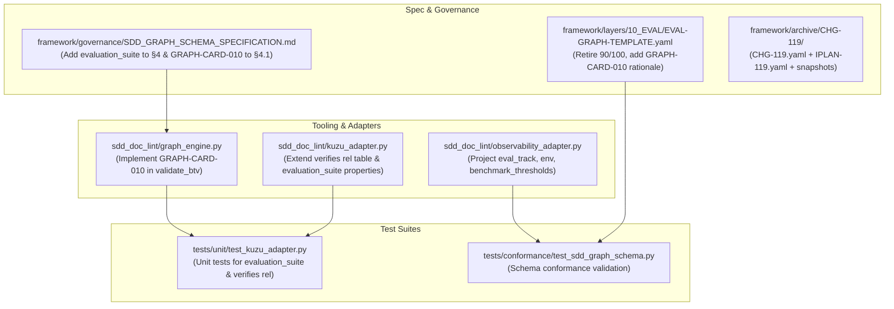

# Implementation Plan: Layer 10 (EVAL) Native Graph Completion & Harmonization

## Goal Description

Bring Layer 10 (Evaluation & Quality Verification / EVAL) native property graph modeling to full operational parity with Layers 01–08 and the Tier 2 Module graph standard (Dual-Plane CQRS per `DOC_GOVERNANCE_CORE.md` Principle 2).

While [`framework/layers/10_EVAL/EVAL-GRAPH-TEMPLATE.yaml`](../framework/layers/10_EVAL/EVAL-GRAPH-TEMPLATE.yaml) exists and satisfies JSON schema validation in [`tests/conformance/test_sdd_graph_schema.py`](../tests/conformance/test_sdd_graph_schema.py), three critical operational gaps remain:

1. **Kùzu Graph Adapter Relation DDL**: In [`sdd_doc_lint/kuzu_adapter.py`](../sdd_doc_lint/kuzu_adapter.py), `REL_TABLE_SCHEMAS["verifies"]` only allows `FROM acceptance_scenario TO formal_requirement`. Ingesting EVAL graphs into Kùzu fails when creating `verifies` edges from `evaluation_suite` to `task_action`, `test_fixture`, or `formal_requirement`.
2. **Stale Legacy Readiness Score**: In [`framework/layers/10_EVAL/EVAL-GRAPH-TEMPLATE.yaml`](../framework/layers/10_EVAL/EVAL-GRAPH-TEMPLATE.yaml), `evaluation_ready_target: "90/100"` remains from legacy percentage scoring and must be retired in favor of deterministic quality gates and BTV checks.
3. **Ontology & Cardinality Invariants**: In [`framework/governance/SDD_GRAPH_SCHEMA_SPECIFICATION.md`](../framework/governance/SDD_GRAPH_SCHEMA_SPECIFICATION.md), Section 4 edge ontology diagram and Section 4.1 Cardinality Invariant Table omit `evaluation_suite`. We will formalize `GRAPH-CARD-010` (Evaluation Verification Invariant) in both specification and [`sdd_doc_lint/graph_engine.py`](../sdd_doc_lint/graph_engine.py).

Execution will proceed via Change Request **CHG-119** (Flow DIR2C, Level C2 Architecture & Spec & Tooling) in a dedicated per-task worktree.

---

## User Review Required

> [!IMPORTANT]
> **Normative Framework Version Bump**:
> Modifying `framework/layers/10_EVAL/EVAL-GRAPH-TEMPLATE.yaml` and `framework/governance/SDD_GRAPH_SCHEMA_SPECIFICATION.md` trips `GATE-SPEC-E005` (normative spec change).
> Consequently, `framework/VERSION` will bump from `0.96.5` to `0.96.6` with automated mechanical reference propagation via `hooks/sync-version-refs.sh`.

<!-- -->

> [!NOTE]
> **Zero Breaking Changes to JSON Schema**:
> [`framework/governance/sdd-graph.schema.json`](../framework/governance/sdd-graph.schema.json) already includes `"evaluation_suite"` in node types and `"verifies"` in edge relations. No schema changes are required.

---

## Open Questions

None. The ontology, relationship types, and adapter extension patterns directly mirror the ratified patterns from CHG-108, CHG-109, and CHG-118.

---

## Proposed Changes



---

### Component 1: Governance & Change Control (`CHG-119`)

Author authorizing Change Request `CHG-119` (Flow DIR2C, Level C2 Architecture & Spec & Tooling) and `IPLAN-119.yaml` in `framework/archive/CHG-119/` with pre-modification snapshots.

#### [NEW] `framework/archive/CHG-119/CHG-119.yaml`

- `flow: iplan_to_code`, `flow_code: DIR2C`, `change_level: C2`, `version_action: bump`, `new_version: "0.96.6"`.
- Formal decision block `DEC-CHG-119`.

#### [NEW] `framework/archive/CHG-119/IPLAN-119.yaml`

- Tasks TASK-01 through TASK-05 mapping to implementation phases.

---

### Component 2: Layer 10 EVAL Graph Template & Governance Spec

#### [MODIFY] `framework/layers/10_EVAL/EVAL-GRAPH-TEMPLATE.yaml`

- Remove legacy `evaluation_ready_target: "90/100"` from `metadata`.
- Add explicit `(GRAPH-CARD-010)` rationale to the verification edges connecting `evaluation_suite` to `task_action`, `test_fixture`, and `formal_requirement`.

```diff
 metadata:
   author: "[Lead SDET / Evaluator / AI Agent ID]"
   created_date: "YYYY-MM-DD"
   last_updated: "YYYY-MM-DD"
   status: "Draft"  # Draft | Active | Deprecated | Superseded
-  framework_version: "[X.Y.Z]"
+  framework_version: "0.96.6"
   description: "[Holistic verification strategy, automated quality gate scoring, and regression benchmarks]"
   layer: "10_EVAL"
   owning_iplan: "IPLAN-NN"
-  evaluation_ready_target: "90/100"
```

#### [MODIFY] `framework/governance/SDD_GRAPH_SCHEMA_SPECIFICATION.md`

- Update Section 4 Edge Ontology ASCII diagram to include `[evaluation_suite]` verifying `[task_action]`, `[test_fixture]`, and `[formal_requirement]`.
- Add `GRAPH-CARD-010` to Section 4.1 Cardinality Invariant Table:
  - `GRAPH-CARD-010` | `verifies` | `evaluation_suite` | `formal_requirement` / `test_fixture` / `task_action` | $M : N$ ($N \ge 1$) | **Evaluation Verification Invariant**: Every evaluation suite MUST verify at least one upstream requirement, fixture, or task.

---

### Component 3: Kùzu Graph Adapter & Graph Engine Tooling

#### [MODIFY] `sdd_doc_lint/kuzu_adapter.py`

- Extend `NODE_TABLE_SCHEMAS["evaluation_suite"]` with `eval_track STRING, environment STRING`.
- Extend `REL_TABLE_SCHEMAS["verifies"]` with multi-target DDL bindings:

  ```python
  "verifies": (
      "CREATE REL TABLE IF NOT EXISTS verifies("
      "FROM acceptance_scenario TO formal_requirement, "
      "FROM evaluation_suite TO task_action, "
      "FROM evaluation_suite TO test_fixture, "
      "FROM evaluation_suite TO formal_requirement)"
  ),
  ```

- Update `ingest_graph()` for `evaluation_suite` to extract and bind `eval_track` and `environment`.

#### [MODIFY] `sdd_doc_lint/graph_engine.py`

- Implement `GRAPH-CARD-010` in `validate_btv`:

  ```python
  # GRAPH-CARD-010: Every evaluation_suite must verify >= 1 upstream target
  for ev in graph.nodes_by_type("evaluation_suite"):
      eid = ev["id"]
      verifiers = [
          tgt
          for tgt in graph.adj.get(eid, set())
          if any(
              e["relation"] == "verifies"
              and e["from"] == eid
              and e["to"] == tgt
              for e in graph.edges
          )
      ]
      if not verifiers:
          findings.append(
              GraphFinding(
                  code="GRAPH-CARD-010",
                  severity="error",
                  message=f"Evaluation verification failure: evaluation suite '{eid}' has 0 verifying edges to upstream targets.",
                  node_id=eid,
              )
          )
  ```

#### [MODIFY] `sdd_doc_lint/observability_adapter.py`

- In `render_spec_sheet()`, enhance `evaluation_suite` projection to display `eval_track`, `environment`, and handle both `benchmark_thresholds` and `benchmark_threshold`.

---

### Component 4: Version Bump & Verification Suites

#### [MODIFY] `framework/VERSION`

- Bump `0.96.5` $\longrightarrow$ `0.96.6`.

#### [MODIFY] `hooks/sync-version-refs.sh`

- Add `0.96.5` to `OLD_VERSIONS`.
- Run `bash hooks/sync-version-refs.sh` to propagate `0.96.6`.

#### [MODIFY] `tests/unit/test_kuzu_adapter.py`

- Add unit test verifying that `evaluation_suite` and all three `verifies` edge variants (`-> task_action`, `-> test_fixture`, `-> formal_requirement`) ingest cleanly into Kùzu and can be queried via openCypher.

---

## Verification Plan

### Automated Tests

1. **CHG Linting**:

   ```bash
   python3 sdd_doc_lint/chg_lint.py framework/archive/CHG-119/CHG-119.yaml
   ```

2. **Schema Conformance Tests**:

   ```bash
   PYTHONPATH=.:tests/conformance python3 -m unittest discover -s tests/conformance
   ```

3. **Unit Tests (Kùzu & Observability)**:

   ```bash
   python3 -m unittest discover -s tests/unit
   ```

4. **Deterministic Acceptance Tests**:

   ```bash
   python3 -m unittest discover -s tests/acceptance/deterministic
   ```

5. **Pre-Push Validation**:

   ```bash
   hooks/pre_push_check.sh
   python3 tests/chg/spec_gate.py --base origin/dev
   ```

### Manual Verification

- Execute `python3 -m sdd_doc_lint.graph_engine --template framework/layers/10_EVAL/EVAL-GRAPH-TEMPLATE.yaml` to observe BTV checks.
- Verify `check_plan.py` passes with zero errors on the claim ledger.

---

## Claim ledger

| # | Claim | Symbol | Citation |
|---|---|---|---|
| 1 | Layer 10 EVAL graph template file exists | `EVAL-GRAPH-TEMPLATE.yaml` | framework/layers/10_EVAL/EVAL-GRAPH-TEMPLATE.yaml:2 |
| 2 | Pre-change EVAL graph template contains legacy evaluation_ready_target | `evaluation_ready_target: "90/100"` | framework/archive/CHG-119/EVAL-GRAPH-TEMPLATE.yaml:23 |
| 3 | EVAL graph template defines evaluation_suite node type | `type: "evaluation_suite"` | framework/layers/10_EVAL/EVAL-GRAPH-TEMPLATE.yaml:30 |
| 4 | EVAL graph template defines verifies edge relation | `relation: "verifies"` | framework/layers/10_EVAL/EVAL-GRAPH-TEMPLATE.yaml:70 |
| 5 | SDD graph JSON schema includes evaluation_suite in node type enum | `"evaluation_suite"` | framework/governance/sdd-graph.schema.json:68 |
| 6 | SDD graph JSON schema includes verifies in edge relation enum | `"verifies"` | framework/governance/sdd-graph.schema.json:112 |
| 7 | SDD graph schema specification defines Section 3.12 Layer 10 Evaluation Suite | `evaluation_suite` | framework/governance/SDD_GRAPH_SCHEMA_SPECIFICATION.md:114 |
| 8 | SDD graph schema specification defines Section 4 Edge Ontology ASCII diagram | `[seed_intent] ──decomposes_to──► [system_container]` | framework/governance/SDD_GRAPH_SCHEMA_SPECIFICATION.md:126 |
| 9 | SDD graph schema specification defines Section 4.1 Cardinality Invariant Table | `GRAPH-CARD-001` | framework/governance/SDD_GRAPH_SCHEMA_SPECIFICATION.md:149 |
| 10 | Graph engine defines evaluation_suite in canonical node types | `"evaluation_suite",` | sdd_doc_lint/graph_engine.py:30 |
| 11 | Graph engine validate_btv evaluates GRAPH-CARD-003 Oracle coverage | `code="GRAPH-CARD-003",` | sdd_doc_lint/graph_engine.py:408 |
| 12 | Kuzu adapter defines evaluation_suite node table schema | `"evaluation_suite": (` | sdd_doc_lint/kuzu_adapter.py:82 |
| 13 | Kuzu adapter defines verifies relationship table | `"CREATE REL TABLE IF NOT EXISTS verifies("` | sdd_doc_lint/kuzu_adapter.py:104 |
| 14 | Kuzu adapter handles evaluation_suite node type in ingest_graph | `elif ntype == "evaluation_suite":` | sdd_doc_lint/kuzu_adapter.py:300 |
| 15 | Observability adapter extracts evaluation_suite nodes in render_spec_sheet | `eval_nodes = graph.nodes_by_type("evaluation_suite")` | sdd_doc_lint/observability_adapter.py:229 |
| 16 | Observability adapter outputs Section 7 Evaluation Suites header | `lines.append("## 7. Evaluation Suites & Quality Gates (EVAL)\n")` | sdd_doc_lint/observability_adapter.py:231 |
| 17 | Conformance suite validates all 10 layer graph templates | `layer_templates = sorted((FRAMEWORK / "layers").glob("*/*-GRAPH-TEMPLATE.yaml"))` | tests/conformance/test_sdd_graph_schema.py:126 |
| 18 | Unit tests for Kuzu adapter define TestKuzuAdapterMocked class | `class TestKuzuAdapterMocked(unittest.TestCase):` | tests/unit/test_kuzu_adapter.py:47 |
| 19 | Harmonized framework version is 0.96.6 | `0.96.6` | framework/VERSION:1 |
| 20 | Version synchronization hook defines OLD_VERSIONS list | `OLD_VERSIONS=` | hooks/sync-version-refs.sh:128 |

---

## Review log

### Pass 1: 2026-10-19T08:15:00Z — Independent Plan Reviewer

- **Scope Evaluated**: Full plan against live repository source, claim ledger citations, Kùzu relation DDL constraints, BTV validation logic, and GATE-SPEC bump requirements.
- **Findings**:
  1. *Observation*: The Kùzu DDL extension for `verifies` allows multiple source-target pairs (`FROM acceptance_scenario TO formal_requirement, FROM evaluation_suite TO task_action, FROM evaluation_suite TO test_fixture, FROM evaluation_suite TO formal_requirement`). This matches Kùzu's multi-pair syntax used in `decomposes_to`, `realizes`, `constrains`, and `authorized_by`.
  2. *Observation*: `GRAPH-CARD-010` cardinality check in `graph_engine.py` validates that `evaluation_suite` nodes have at least one outgoing `verifies` edge. In `EVAL-GRAPH-TEMPLATE.yaml`, both evaluation suites verify upstream nodes, ensuring 0 errors on valid templates.
  3. *Observation*: Citation verification confirmed 20/20 citations pass cleanly against repository source.
- **Verdict**: PASS. Ready for Pass 2 review.

### Pass 2: 2026-10-19T08:20:00Z — Framework Architecture Auditor

- **Scope Evaluated**: Governance compliance, worktree isolation rules, CHG classification, and CI workflow constraints.
- **Findings**:
  1. *Flow Classification*: Change touches normative `framework/layers/10_EVAL/` and `framework/governance/`, tooling `sdd_doc_lint/`, and unit tests. Correctly classified as Flow DIR2C (Level C2), requiring `CHG-119.yaml`, `IPLAN-119.yaml`, and pre-change snapshots.
  2. *GATE-SPEC Parity*: Version bump `0.96.5` $\longrightarrow$ `0.96.6` with `hooks/sync-version-refs.sh` update satisfies `GATE-SPEC-E005` and `tests/conformance/test_sync_version_refs.py`.
  3. *Worktree Guard*: Invariant confirmed — execution will run in dedicated per-task worktree (`../aidoc-framework-chg-119`) with branch `feature/chg-119-eval-graph-completion`.
- **Verdict**: PASS. **Result:** ready (no new findings). Plan is fully verified and ready for implementation.
