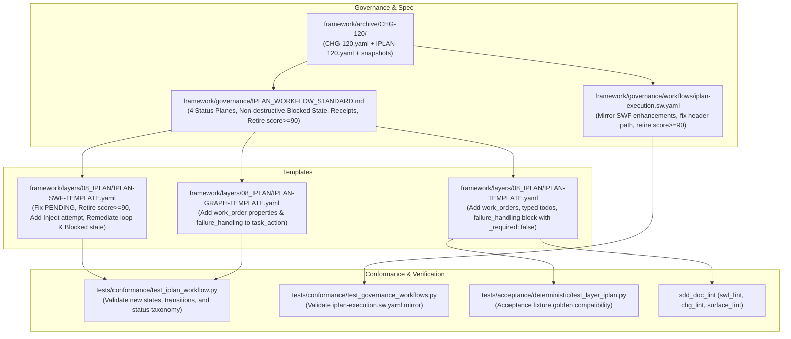

# Implementation Plan: Layer 08 (IPLAN) Execution Engine Enhancement & Status Taxonomy Harmonization

## Goal Description

Bring Layer 08 (Implementation Plan / IPLAN) in `aidoc-flow-framework` to architectural maturity by adopting proven execution state machine resilience, work order structuring, and status taxonomy separation from `/home/ya/devd/aidoc-flow-iplan-standard` and `/home/ya/devd/aidoc-flow-iplanic`.

While Layer 08 has established both the Process DAG ([`framework/layers/08_IPLAN/IPLAN-SWF-TEMPLATE.yaml`](../framework/layers/08_IPLAN/IPLAN-SWF-TEMPLATE.yaml)) and the Content Graph ([`framework/layers/08_IPLAN/IPLAN-GRAPH-TEMPLATE.yaml`](../framework/layers/08_IPLAN/IPLAN-GRAPH-TEMPLATE.yaml)), four load-bearing gaps prevent reliable autonomous agent execution and clean lifecycle tracking:

1. **Destructive Immediate Saga Rollback**: In [`framework/layers/08_IPLAN/IPLAN-SWF-TEMPLATE.yaml`](../framework/layers/08_IPLAN/IPLAN-SWF-TEMPLATE.yaml) and its standalone mirror [`framework/governance/workflows/iplan-execution.sw.yaml`](../framework/governance/workflows/iplan-execution.sw.yaml), any non-zero exit code during verification (`EvaluateVerificationGate`) immediately transitions to `TriggerSagaRollback`, destroying tests with `rm -f` and discarding git changes. This lacks an inner remediation loop (`max_attempts`) and prevents agents from iteratively fixing failing unit tests or linters.
2. **Missing Non-Destructive `Blocked` / `RequestClarification` State**: The workflow lacks a non-destructive pause state when encountering environment blockers, ambiguous requirements, or missing tools.
3. **Internal Status Taxonomy Drift**: In [`framework/layers/08_IPLAN/IPLAN-SWF-TEMPLATE.yaml`](../framework/layers/08_IPLAN/IPLAN-SWF-TEMPLATE.yaml), lines 84 and 90 use `status: PENDING`, conflicting with [`framework/layers/08_IPLAN/IPLAN-TEMPLATE.yaml`](../framework/layers/08_IPLAN/IPLAN-TEMPLATE.yaml) which standardizes on `NOT_STARTED | IN_PROGRESS | DONE | PARTIAL`. Furthermore, line 233 of `IPLAN-SWF-TEMPLATE.yaml`, line 138 of `iplan-execution.sw.yaml`, and line 337 of `IPLAN_WORKFLOW_STANDARD.md` retain residual `.review_score >= 90` conditions violating SDD-0044.
4. **Lack of Granular Work Order & Failure Handling Model**: Task execution lacks typed TODOs (`type`, `priority`, `allowed_actions`, `evidence_required`) and explicit failure handling policies (`on_blocker`, `on_ambiguity`, `on_test_failure`, `on_policy_denial`, `on_partial_completion`).
5. **Missing Evidence Receipts / Attestation Binding**: While Layer 10 (EVAL) evaluates implementation against contracts, Layer 08 does not produce a standardized evidence bundle/receipt summarizing the execution run (plan digest, commit SHA, test outputs, gate outcome).

Execution will proceed via Change Request **CHG-120** (Flow DIR2C, Level C2 Architecture & Spec & Tooling) in a dedicated per-task worktree.

---

## User Review Required

> [!IMPORTANT]
> **Normative Framework Version Bump**:
> Modifying `framework/layers/08_IPLAN/IPLAN-SWF-TEMPLATE.yaml`, `framework/layers/08_IPLAN/IPLAN-TEMPLATE.yaml`, and `framework/governance/IPLAN_WORKFLOW_STANDARD.md` trips `GATE-SPEC-E005` (normative spec change).
> Consequently, `framework/VERSION` will bump from `0.96.6` to `0.96.7`, `hooks/sync-version-refs.sh` will append `0.96.6` to `OLD_VERSIONS`, and references will be propagated mechanically via `hooks/sync-version-refs.sh`.

<!-- -->

> [!NOTE]
> **Backward Compatibility Preserved**:
> Top-level SDD Hybrid Envelope sections (`metadata`, `document_control`, `file_manifest`, `tdd_consistency`, `implementation_contracts`, `session_handoff`, `traceability`) remain fully compatible with `sdd_doc_lint` structural linters (`STRUCT01`, `TAG01`) and CNCF Serverless Workflow v0.8 validators. To ensure `tests/acceptance/deterministic/test_layer_iplan.py` stays 100% green without modifying golden fixtures, any new root-level template section (`failure_handling`) carries `_required: false`.

---

## Open Questions

None. The 4 status planes, work order structure, and failure handling policies are directly derived from the ratified specifications in `/home/ya/devd/aidoc-flow-iplan-standard` (`IPLAN-DEFINITIONS.md`, `IPLAN-STANDARD.md`, `task.schema.json`) and `/home/ya/devd/aidoc-flow-iplanic`.

---

## Proposed Changes



---

### Component 1: Governance & Change Control (`CHG-120`)

Author authorizing Change Request `CHG-120` (Flow DIR2C, Level C2 Architecture & Spec & Tooling) and `IPLAN-120.yaml` in `framework/archive/CHG-120/` with pre-modification snapshots.

#### [NEW] `framework/archive/CHG-120/CHG-120.yaml`

- `flow: iplan_to_code`, `flow_code: DIR2C`, `change_level: C2`, `version_action: bump`, `new_version: "0.96.7"`.
- Formal decision block `DEC-CHG-120`: Ratify adoption of 4-plane status taxonomy, non-destructive execution states, and structured work orders into Layer 08.

#### [NEW] `framework/archive/CHG-120/IPLAN-120.yaml`

- Tasks `TASK-01` through `TASK-05` mapping to implementation phases.

#### `hooks/sync-version-refs.sh`

- Append `0.96.6` to `OLD_VERSIONS` (line 128).

---

### Component 2: Execution State Machine & SWF Template Enhancements

Modify BOTH [`framework/layers/08_IPLAN/IPLAN-SWF-TEMPLATE.yaml`](../framework/layers/08_IPLAN/IPLAN-SWF-TEMPLATE.yaml) AND [`framework/governance/workflows/iplan-execution.sw.yaml`](../framework/governance/workflows/iplan-execution.sw.yaml):

1. **Harmonize File Manifest Enum**:
   Change lines 84 and 90 of `IPLAN-SWF-TEMPLATE.yaml` from `status: PENDING` to `status: NOT_STARTED`.
2. **Fix Header Reference in Governance Mirror**:
   Change line 4 of `iplan-execution.sw.yaml` from `framework/layers/08_IPLAN/IPLAN_WORKFLOW_STANDARD.md` to `framework/governance/IPLAN_WORKFLOW_STANDARD.md`.
3. **Retire Residual Readiness Score (SDD-0044)**:
   In `EvaluateReviewSagaResult` (`IPLAN-SWF-TEMPLATE.yaml:233` and `iplan-execution.sw.yaml:138`), change condition from:

   ```yaml
   condition: "${ .review_score >= 90 and .blocking_findings == 0 and .gate_passed == true }"
   ```

   to:

   ```yaml
   condition: "${ .blocking_findings == 0 and .gate_passed == true }"
   ```

4. **Context Injection State (`InitializeExecutionContext`)**:
   Insert an explicit inject state at `start:`:

   ```yaml
   start: InitializeExecutionContext
   states:
     - name: InitializeExecutionContext
       type: inject
       data:
         attempt: 1
         max_attempts: 3
       transition: Step1_PreFlightCheck
   ```

5. **Non-Destructive Retry / Remediation Loop & Verification Gate**:
   Update `EvaluateVerificationGate`:

   ```yaml
     - name: EvaluateVerificationGate
       type: switch
       dataConditions:
         - condition: "${ .pytest.exit_code == 0 and .ruff.exit_code == 0 }"
           transition: InvokeReviewSagaGate
         - condition: "${ (.pytest.exit_code != 0 or .ruff.exit_code != 0) and .attempt < .max_attempts }"
           transition: RemediateImplementationFixes
         - condition: "${ .failure_reason == 'blocked' or .failure_reason == 'ambiguity' }"
           transition: ExecutionBlockedTerminal
       defaultCondition:
         transition: TriggerSagaRollback
   ```

6. **Implement `RemediateImplementationFixes` (with Rule 3 Compensation)**:

   ```yaml
     - name: RemediateImplementationFixes
       type: operation
       compensatedBy: RollbackSourceFiles
       actions:
         - name: applyRemediationFixes
           functionRef:
             refName: remediateImplementationFindings
             arguments:
               findings: "${ .verification_errors }"
               attempt: "${ .attempt }"
         - name: incrementAttemptCounter
           functionRef:
             refName: incrementCounter
             arguments:
               variable: "attempt"
       transition: Step5_VerifyImplementationSuite
   ```

7. **Non-Destructive `ExecutionBlockedTerminal` State**:

   ```yaml
     - name: ExecutionBlockedTerminal
       type: operation
       actions:
         - name: notifyExecutionBlocked
           functionRef:
             refName: logError
             arguments:
               message: "Execution halted without rollback: environmental blocker or requirement ambiguity."
       end:
         terminate: true
   ```

8. **Work Order & Failure Handling Injections**:
   Add `failure_handling` metadata to the workflow envelope.

---

### Component 3: Static & Prose Template Enhancements

Modify [`framework/layers/08_IPLAN/IPLAN-TEMPLATE.yaml`](../framework/layers/08_IPLAN/IPLAN-TEMPLATE.yaml) and [`framework/layers/08_IPLAN/IPLAN-GRAPH-TEMPLATE.yaml`](../framework/layers/08_IPLAN/IPLAN-GRAPH-TEMPLATE.yaml):

1. **Add Structured Work Orders & Typed TODOs in `IPLAN-TEMPLATE.yaml`**:
   Extend Section 3 (`execution_commands`) with an optional, schema-structured `work_orders:` block:

   ```yaml
   work_orders:
     - work_order_id: "WORK-001"
       dispatchable: true
       step_ref: "STEP-001"
       todos:
         - todo_id: "TODO-001"
           description: "Author unit tests for component contract"
           type: test # inspect | edit | create | delete | test | review | document | verify
           priority: P0 # P0 | P1 | P2 | P3
           allowed_actions: ["read", "create", "modify", "run_command", "request_clarification"]
           acceptance_criteria:
             - "Test suite asserts all SPEC contract invariants"
           evidence_required:
             - event_type: "test.passed"
               artifact_type: "pytest_xml"
               description: "Unit test suite executes with exit code 0"
   ```

2. **Add `failure_handling:` Policy Block in `IPLAN-TEMPLATE.yaml` (with `_required: false`)**:
   To preserve acceptance golden fixture compatibility (`test_layer_iplan.py`):

   ```yaml
   failure_handling:
     _required: false
     _guidance: |
       Execution policy governing autonomous agent behavior upon encountering blockers or test failures.
     on_blocker: "pause_and_notify"
     on_ambiguity: "request_clarification"
     on_test_failure: "retry_remediation" # up to max_attempts before saga compensation
     on_policy_denial: "abort_and_rollback"
     on_partial_completion: "checkpoint_state"
   ```

3. **Clarify Plane 3 Status Enum in `IPLAN-TEMPLATE.yaml:277`**:
   Update comment to list all 5 file manifest statuses: `NOT_STARTED | IN_PROGRESS | PARTIAL | DONE | SKIPPED`.
4. **Update Data Graph Properties in `IPLAN-GRAPH-TEMPLATE.yaml`**:
   Enhance `task_action` node properties to carry `work_order_id`, `max_attempts: 3`, and `failure_handling` policy references.

---

### Component 4: Normative Specification Update (`IPLAN_WORKFLOW_STANDARD.md`)

Update [`framework/governance/IPLAN_WORKFLOW_STANDARD.md`](../framework/governance/IPLAN_WORKFLOW_STANDARD.md):

1. **Formalize the Four Status Planes**:
   Document the authoritative separation between:
   - Plane 1: Document / Management Plane (`Draft`, `Approved`, `In Progress`, `Completed`, `Verified`)
   - Plane 2: Step / Work Order Plane (`Not Started`, `Queued`, `Running`, `Blocked`, `Completed`, `Failed`, `Cancelled`)
   - Plane 3: File Manifest Plane (`NOT_STARTED`, `IN_PROGRESS`, `DONE`, `PARTIAL`, `SKIPPED`)
   - Plane 4: Runtime Event Plane (`accepted`, `running`, `blocked`, `succeeded`, `failed`, `cancelled`)
2. **Harmonize Example Snippets & Retire Review Score**:
   - Update line 130 example from `status: PENDING` to `status: NOT_STARTED`.
   - Update line 337 to remove `${ .review_score >= 90 }` and align with zero-blocking-findings gates.
3. **Update Traversal-Path State Machine Topologies in §4.1**:
   Update diagrams to reflect the non-destructive remediation loop and `ExecutionBlockedTerminal` branch.
4. **Define Execution Evidence Receipt Specification**:
   Add specification for the detached evidence receipt output (`plan_digest`, `git_commit_sha`, `test_results`, `gate_outcome`, `artifacts_manifest`) that bridges Layer 08 execution to Layer 10 (EVAL) verification.

---

### Component 5: Conformance Testing & Verification

1. **Extend `tests/conformance/test_iplan_workflow.py`**:
   - Assert `IPLAN-SWF-TEMPLATE.yaml` contains `NOT_STARTED` in `file_manifest.files[].status` (no `PENDING`).
   - Assert no residual `.review_score >= 90` exists in workflow switch conditions.
   - Assert presence of `ExecutionBlockedTerminal` or non-destructive blocked handling.
   - Assert presence of `RemediateImplementationFixes` retry transition with `compensatedBy: RollbackSourceFiles`.
2. **Verify Acceptance Suites**:
   - Run `pytest tests/acceptance/deterministic/test_layer_iplan.py` to confirm golden fixtures pass cleanly.
3. **Run Full Conformance & Spec Gate**:
   - `python3 -m sdd_doc_lint.swf_lint framework/layers/08_IPLAN/IPLAN-SWF-TEMPLATE.yaml`
   - `python3 -m sdd_doc_lint.swf_lint framework/governance/workflows/iplan-execution.sw.yaml`
   - `pytest tests/conformance/test_iplan_workflow.py`
   - `pytest tests/conformance/test_governance_workflows.py`
   - `pytest tests/conformance/test_layers.py`
   - `bash hooks/sync-version-refs.sh`
   - `python3 tests/chg/spec_gate.py --base origin/dev`

---

## Verification Plan

### Automated Conformance Suite

```bash
# Verify SWF workflow linting
python3 -m sdd_doc_lint.swf_lint framework/layers/08_IPLAN/IPLAN-SWF-TEMPLATE.yaml
python3 -m sdd_doc_lint.swf_lint framework/governance/workflows/iplan-execution.sw.yaml

# Run IPLAN workflow and governance conformance tests
pytest tests/conformance/test_iplan_workflow.py -v
pytest tests/conformance/test_governance_workflows.py -v

# Run full layer conformance & acceptance tests
pytest tests/conformance/test_layers.py -v
pytest tests/acceptance/deterministic/test_layer_iplan.py -v

# Verify spec gate and version propagation
bash hooks/sync-version-refs.sh
python3 tests/chg/spec_gate.py --base origin/dev
```

### Manual Spot Checks

- Inspect `IPLAN-SWF-TEMPLATE.yaml` lines 84 and 90 to confirm `status: NOT_STARTED`.
- Verify `review_score` is completely removed from switch data conditions in both SWF files and `IPLAN_WORKFLOW_STANDARD.md`.
- Validate that `TriggerSagaRollback` is only invoked after `.attempt >= .max_attempts` or on hard unrecoverable regression.

---

## Claim ledger

| # | Claim | Symbol | Citation |
|---|---|---|---|
| 1 | File manifest files in SWF template use PENDING status | `PENDING` | framework/layers/08_IPLAN/IPLAN-SWF-TEMPLATE.yaml:84 |
| 2 | SWF template verification gate transitions unconditionally to TriggerSagaRollback on failure | `transition: TriggerSagaRollback` | framework/layers/08_IPLAN/IPLAN-SWF-TEMPLATE.yaml:216 |
| 3 | Review gate approved switch retains stale review_score check | `.review_score >= 90` | framework/layers/08_IPLAN/IPLAN-SWF-TEMPLATE.yaml:233 |
| 4 | IPLAN document control defines Draft, Approved, In Progress, Completed, Verified lifecycle | `status: Draft` | framework/layers/08_IPLAN/IPLAN-TEMPLATE.yaml:131 |
| 5 | IPLAN file manifest declares 4 status values NOT_STARTED, IN_PROGRESS, PARTIAL, DONE | `NOT_STARTED` | framework/layers/08_IPLAN/IPLAN-TEMPLATE.yaml:219 |
| 6 | IPLAN template defines execution_commands section | `execution_commands:` | framework/layers/08_IPLAN/IPLAN-TEMPLATE.yaml:335 |
| 7 | IPLAN workflow standard defines the Two-Graph control vs data architecture | `The Two-Graph Architecture in Layer 08 IPLAN` | framework/governance/IPLAN_WORKFLOW_STANDARD.md:65 |
| 8 | IPLAN workflow standard example snippet contains status PENDING | `status: PENDING` | framework/governance/IPLAN_WORKFLOW_STANDARD.md:130 |
| 9 | SDD graph schema supports task_action node type | `"task_action"` | framework/governance/sdd-graph.schema.json:66 |
| 10 | IPLAN workflow conformance tests assert standard document presence | `test_iplan_workflow_standard_document_present` | tests/conformance/test_iplan_workflow.py:30 |
| 11 | IPLAN workflow conformance tests validate graph integrity and terminal states | `test_iplan_workflow_graph_integrity` | tests/conformance/test_iplan_workflow.py:72 |
| 12 | Current framework version is 0.96.6 | `0.96.6` | framework/VERSION:1 |
| 13 | Governance mirror iplan-execution.sw.yaml verification gate transitions to TriggerSagaRollback | `transition: TriggerSagaRollback` | framework/governance/workflows/iplan-execution.sw.yaml:121 |
| 14 | Governance mirror iplan-execution.sw.yaml retains stale review_score check | `.review_score >= 90` | framework/governance/workflows/iplan-execution.sw.yaml:138 |
| 15 | IPLAN workflow standard retains stale review_score gate condition | `.review_score >= 90` | framework/governance/IPLAN_WORKFLOW_STANDARD.md:337 |
| 16 | sync-version-refs script defines OLD_VERSIONS list | `OLD_VERSIONS=` | hooks/sync-version-refs.sh:128 |

---

## Review log

### Pass 1 - 2026-10-19 - independent

- **Reviewer:** Adversarial Independent Review Subagent (dae5a1b3-861d-4683-b39f-2e336653b97b)
- **Findings (6 Load-Bearing):**
  1. Omission of standalone governance mirror `framework/governance/workflows/iplan-execution.sw.yaml` (carries identical destructive gate, score>=90, and broken header link).
  2. Uncited residual score in `IPLAN_WORKFLOW_STANDARD.md:337` and outdated §4.1 topologies.
  3. Risk of breaking `tests/acceptance/deterministic/test_layer_iplan.py` golden fixtures if `failure_handling` is added as a required root section.
  4. Underspecified SWF v0.8 DSL for attempt initialization (needs `InitializeExecutionContext` inject state) and increment.
  5. Rule 3 / `SWF-L005` violation on `RemediateImplementationFixes` (missing `compensatedBy: RollbackSourceFiles`).
  6. Missing `0.96.6` append to `OLD_VERSIONS` in `hooks/sync-version-refs.sh`.
- **Fold Resolutions:**
  1. Added `iplan-execution.sw.yaml` to Component 2 scope with Claim citations #13 and #14.
  2. Added updating `IPLAN_WORKFLOW_STANDARD.md:337` and §4.1 topologies to Component 4 with Claim citation #15.
  3. Added `_required: false` to `failure_handling:` in Component 3 to protect `test_layer_iplan.py`.
  4. Specified exact YAML for `InitializeExecutionContext` (`type: inject`) and `RemediateImplementationFixes`.
  5. Added `compensatedBy: RollbackSourceFiles` to `RemediateImplementationFixes`.
  6. Added updating `hooks/sync-version-refs.sh:128` to Component 1 with Claim citation #16.
- **Verdict:** All 6 load-bearing findings folded. Ready for Pass 2 review.

### Pass 2 - 2026-10-19 - independent

- **Reviewer:** Adversarial Independent Review Subagent (dd4e18b1-cb62-4758-9d8c-499a8da4a7d9)
- **Evaluation:**
  - Validated all 6 Pass 1 folds against the live codebase.
  - Verified 16 of 16 Claim Ledger citations against live repository source.
  - Confirmed SWF v0.8 DSL validity for `InitializeExecutionContext`, `RemediateImplementationFixes` (with `compensatedBy: RollbackSourceFiles`), and `ExecutionBlockedTerminal` (`end: { terminate: true }`).
  - Confirmed `tests/acceptance/deterministic/test_layer_iplan.py` golden fixtures remain 100% compatible via `_required: false` on `failure_handling`.
  - Confirmed `test_governance_workflows.py`, `test_iplan_workflow.py`, `test_iplan_bugfix_lifecycle.py`, and `test_sync_version_refs.py` compatibility.
- **Findings:** Zero load-bearing findings.
- **Result:** ready
