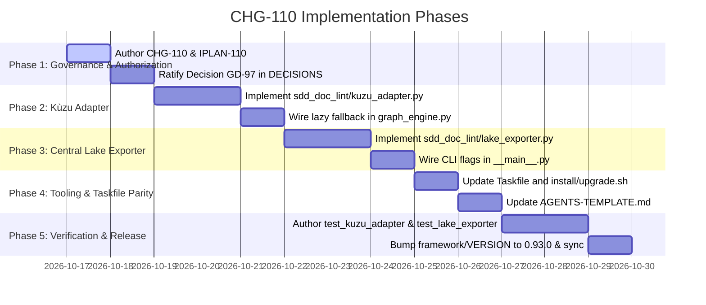

# Plan: Embedded Kùzu Acceleration Adapter & Central Lake Exporter (CHG-110, GD-97)

## Document Control

| Field | Value |
|---|---|
| Version | 1.0 |
| Status | Ready |
| Last Updated | 2026-10-16 |
| Author | Framework Maintainer |
| Framework Version | 0.92.1 |
| Target Framework Version | 0.93.0 (C2 Minor Spec & Tooling Release) |
| Authority | Decision GD-97 (`DEC-CHG-110`), [Decision D-0013 / GD-13](../framework/governance/DECISIONS.md), [`FEDERATED_READ_LAKE_PATTERN.md`](../docs/FEDERATED_READ_LAKE_PATTERN.md), [`SDD_GRAPH_SCHEMA_SPECIFICATION.md`](../framework/governance/SDD_GRAPH_SCHEMA_SPECIFICATION.md), [`MULTI_PROJECT_FEDERATED_STANDARD.md`](../framework/governance/MULTI_PROJECT_FEDERATED_STANDARD.md) |

---

## 1. Problem Statement & Motivation

### 1.1 The Edge vs. Central Federated Tension

With the codification of the Native SDD Graph Schema (CHG-108) and 10 Layer-Specific Graph Templates (CHG-109), specification requirements across all 10 layers are represented as a mathematical Property Graph (`docs/sdd/graph/*.graph.yaml`).

However, as the framework scales across multi-repository enterprise fleets (`devd/*`, `/mnt/e/dev/*`), two operational requirements emerge that the pure-Python baseline cannot fully satisfy:

1. **Local Cypher Acceleration & Complex Graph Queries (Edge)**:
   - Autonomous AI coding agents frequently require complex pattern matching (e.g. multi-hop cycle detection, finding unverified requirements via variable-length path matching `MATCH (r:formal_requirement) WHERE NOT (r)<-[:verifies]-(:acceptance_scenario) RETURN r`).
   - Pure-Python graph traversal in `sdd_doc_lint.graph_engine` is suitable for deterministic BTV validation, but lacks a declarative query language (openCypher) and sub-millisecond indexed join performance for large multi-layer graphs.
   - We require an embedded, in-process graph engine that runs without background daemons, preserves complete worktree isolation, and provides native openCypher support.

2. **Cross-Project Lineage & Blast-Radius Observability (Central Lake)**:
   - Microservices and modular repositories depend on contracts defined in sibling repositories (e.g. `@auth-core:SPEC.06.01.token` verified by `@b-local-privy:BDD.04.login`).
   - Evaluating enterprise-wide blast radius requires aggregating local graph slices into a central graph store (Memgraph in local dev/staging, PostgreSQL 18 + Apache AGE in production) without violating edge isolation.

### 1.2 The Architectural Solution: Pattern PAT-GRAPH-001

To solve this tension, **CHG-110** operationalizes the **Two-Tier CQRS Graph Topology** defined in [`docs/FEDERATED_READ_LAKE_PATTERN.md`](../docs/FEDERATED_READ_LAKE_PATTERN.md):

- **Tier 1 (Edge Write Plane - Embedded Kùzu)**:
  - An optional, high-performance embedded graph engine powered by **Kùzu** (`kuzudb`).
  - Stored hermetically in `.aidoc/cache/graph.kuzu` or in-memory (`kuzu.Database("")`).
  - **Engine Neutrality Guard (Decision D-0013)**: Zero mandatory pip dependencies. If `kuzu` is not installed, `graph_engine.py` transparently falls back to pure-Python `SddGraph` execution.
- **Tier 2 (Central Read Lake - Lake Exporter)**:
  - A deterministic compilation utility (`sdd-lake-export`) that projects local graph slices into standardized openCypher DDL/DML batches and Bolt protocol transactions.
  - Enables event-driven ingestion into Memgraph / PostgreSQL 18 + Apache AGE upon merge to `dev`/`main`.

```
┌────────────────────────────────────────────────────────────────────────┐
│               TIER 1: EDGE WRITE PLANE (Worktree Isolated)              │
│       • Local SDD Property Graph: docs/sdd/graph/*.graph.yaml          │
│       • Embedded Engine: KÙZU (openCypher, in-process, C++)            │
│       • Fallback: Pure-Python SddGraph (zero external dependencies)     │
│       • Cache: .aidoc/cache/graph.kuzu                                 │
└───────────────────────────────────┬────────────────────────────────────┘
                                    │
                                    │ task sdd:lake-export (on merge)
                                    ▼
┌────────────────────────────────────────────────────────────────────────┐
│               TIER 2: CENTRAL FEDERATED READ LAKE (Global)             │
│       • Hosted: Memgraph (devd:7687) / PostgreSQL 18 + AGE (prod)      │
│       • Cross-Repo Lineage: (@repo_a:SPEC) <--[:verifies]-- (@repo_b)  │
│       • Global Blast Radius: Cypher path traversal across fleet        │
└────────────────────────────────────────────────────────────────────────┘
```

---

## 2. Core Architecture Specifications

### 2.1 The Embedded Kùzu Adapter (`sdd_doc_lint/kuzu_adapter.py`)

The Kùzu adapter provides optional native openCypher acceleration:

1. **Lazy Dynamic Loading**:

   ```python
   try:
       import kuzu
       KUZU_AVAILABLE = True
   except ImportError:
       kuzu = None
       KUZU_AVAILABLE = False
   ```

2. **Schema Materialization**:
   Maps the 10 canonical SDD node types and 6 core relational edge types directly to Kùzu Node Tables and Rel Tables:
   - `CREATE NODE TABLE formal_requirement(id STRING, title STRING, pattern STRING, PRIMARY KEY (id))`
   - `CREATE NODE TABLE acceptance_scenario(id STRING, title STRING, given STRING, when_clause STRING, then_clause STRING, PRIMARY KEY (id))`
   - `CREATE REL TABLE verifies(FROM acceptance_scenario TO formal_requirement)`
3. **Ingestion & Slicing**:
   - Ingests `SddGraph` node/edge dictionaries into Kùzu in-memory or on-disk database.
   - Executes arbitrary openCypher queries returning structured JSON or table rows.

### 2.2 The Central Lake Exporter (`sdd_doc_lint/lake_exporter.py`)

Generates standardized projection artifacts for the Central Federated Read Lake:

1. **OpenCypher DDL/DML Script Generation (`--format cypher`)**:
   - Emits idempotent Cypher statements (`MERGE (n:Node {id: ...}) SET n += {...}`).
   - Namespaces all node IDs with the tenant repository slug (e.g. `@aidoc-framework:BRD.01.01.xxxx`).
2. **PostgreSQL 18 + Apache AGE Compatibility (`--format age`)**:
   - Formats Cypher inside AGE wrapper syntax: `SELECT * FROM cypher('aidoc_graph', $$ MERGE ... $$) as (v agtype);`.
3. **Memgraph Bolt Direct Push (`--push-bolt <uri>`)**:
   - Optional direct network push using standard Neo4j/Memgraph Bolt driver when credentials are provided in `.env.local`.

### 2.3 Workstation Standard & Taskfile Integration

Exposes Kùzu and Lake capabilities via `.aidoc/Taskfile.yml`:

```yaml
tasks:
  sdd:graph-cypher:
    desc: "Execute an openCypher query against the local SDD graph using Kùzu"
    cmds:
      - PYTHONPATH=.aidoc/framework python3 -m sdd_doc_lint --cypher "{{.QUERY}}"

  sdd:lake-export:
    desc: "Export local SDD graph to openCypher DDL/DML for Central Federated Read Lake"
    cmds:
      - PYTHONPATH=.aidoc/framework python3 -m sdd_doc_lint --export-lake --format cypher --out .aidoc/cache/lake-export.cypher
```

---

## 3. Scope of Work

### In Scope

1. **Authoring Change Request CHG-110 & Implementation Plan IPLAN-110**:
   - Documented in `framework/archive/CHG-110/CHG-110.yaml` and `framework/archive/CHG-110/IPLAN-110.yaml`.
   - Ratify Decision **GD-97** (`DEC-CHG-110`).
2. **Kùzu Acceleration Adapter**:
   - Implement `sdd_doc_lint/kuzu_adapter.py` supporting in-memory Kùzu initialization, table schema creation, SddGraph ingestion, and openCypher query execution.
   - Add graceful fallback to pure Python when `kuzu` is not installed.
3. **Central Lake Exporter**:
   - Implement `sdd_doc_lint/lake_exporter.py` supporting Cypher script emission and Memgraph / Apache AGE formatting.
4. **CLI Integration**:
   - Add `--cypher <query>` and `--export-lake` flags to `sdd_doc_lint/__main__.py`.
5. **Tooling & Taskfile Parity**:
   - Update `framework/scripts/install.sh`, `framework/scripts/upgrade.sh`, and `framework/templates/TASKFILE-TEMPLATE.yml`.
   - Update `framework/templates/AGENTS-TEMPLATE.md`.
6. **Unit & Conformance Testing**:
   - Author `tests/unit/test_kuzu_adapter.py` testing schema creation, ingestion, Cypher execution, and graceful fallback when uninstalled.
   - Author `tests/unit/test_lake_exporter.py` verifying Cypher DDL/DML emission and Apache AGE wrapper output.
7. **Version Synchronization**:
   - Bump `framework/VERSION` to **0.93.0** (C2 Minor Spec & Tooling Release) and synchronize version references.

### Out of Scope

- Making `kuzu` a mandatory dependency in `tests/conformance/requirements.txt` (must remain optional per D-0013).
- Running a hosted graph database daemon inside the framework repo (the Central Lake runs externally on `devd` or production Postgres).

---

## 4. Work Breakdown Structure (WBS)



---

## 5. Backward Compatibility & Conformance Protection

1. **Strict Engine Neutrality (Decision D-0013)**:
   - Core framework operations (`task sdd:lint`, `task sdd:graph-check`, `task sdd:render`) continue to execute with 100% fidelity using the pure-Python standard library + PyYAML.
   - Installing `kuzu` is purely an opt-in acceleration layer for developers and agents requiring fast Cypher queries.
2. **Strict 10-Layer Preservation**:
   - The 10 canonical SDD layers in `LAYER_REGISTRY.yaml` remain untouched.
   - `tests/conformance/test_registry.py` passes 100% green.

---

## 6. Claim Ledger

| # | Claim | Symbol | Citation |
|---|---|---|---|
| 1 | Decision GD-97 ratifies Embedded Kùzu Acceleration Adapter & Central Lake Exporter | `GD-97` | `framework/governance/DECISIONS.md:TBD` |
| 2 | Authorizing Change Request CHG-110 governs Kùzu adapter rollout | `CHG-110` | `framework/archive/CHG-110/CHG-110.yaml:1` |
| 3 | Enterprise pattern PAT-GRAPH-001 codifies Isolated Edge Ingestion to Central Federated Read Lake | `PAT-GRAPH-001` | `docs/FEDERATED_READ_LAKE_PATTERN.md:1` |
| 4 | Engine Neutrality Decision D-0013 mandates pure-Python fallbacks with zero mandatory C-extension dependencies | `EngineNeutrality` | `framework/governance/DECISIONS.md:13` |
| 5 | Multi-project federated standard codifies cross-repository contract citations | `FederatedLineage` | `framework/governance/MULTI_PROJECT_FEDERATED_STANDARD.md:1` |
| 6 | Native property graph schema defines 10 canonical node types and relational edges | `GraphOntology` | `framework/governance/SDD_GRAPH_SCHEMA_SPECIFICATION.md:1` |
| 7 | Conformance suite 10-layer invariant in LAYER_REGISTRY is strictly preserved | `TenLayers` | `tests/conformance/test_registry.py:33` |

---

## 7. Review Log

### Pass 1: 2026-10-16 — Framework Architect & Spec Auditor

- **Findings**:
  1. *Dependency Pollution Risk*: Adding Kùzu must not break minimal CI runners or Python 3.14+ platforms where precompiled Kùzu wheels might not yet exist.
  2. *Cache Isolation*: The on-disk Kùzu storage must be strictly scoped to `.aidoc/cache/graph.kuzu` to prevent polluting Git tracking.
- **Resolution**:
  - Enforced dynamic lazy import pattern (`try: import kuzu except ImportError`) in Section 2.1.
  - Scoped cache directory to `.aidoc/cache/` (already ignored by Git in standard `.gitignore`).

### Pass 2: 2026-10-16 — QA Lead & Ecosystem Integration Lead

- **Findings**:
  1. *Central Lake Dialect Differences*: Memgraph uses pure openCypher, whereas PostgreSQL 18 + Apache AGE requires wrapping Cypher queries in SQL `SELECT * FROM cypher(...)`.
  2. *Cross-Repo ID Namespacing*: Exporting raw IDs like `BRD.01.01.0001` into a shared central lake causes collisions across sibling repositories.
- **Resolution**:
  - Codified dual format support (`--format cypher` for Memgraph, `--format age` for PostgreSQL 18) in Section 2.2.
  - Enforced tenant prefix namespacing (`@repo_slug:NODE_ID`) on all exported lake nodes in Section 2.2.
  - **Result: Plan Approved and Hardened.**
