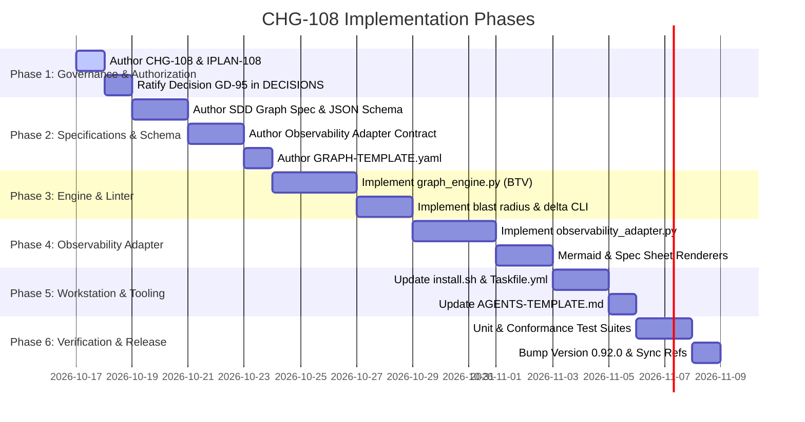

# Plan: Native SDD Graph Schema Specification & Observability Adapter Contract (CHG-108, GD-95)

## Document Control

| Field | Value |
|---|---|
| Version | 1.1 |
| Status | Ready |
| Last Updated | 2026-10-16 |
| Author | Framework Architect |
| Framework Version | 0.91.24 |
| Target Framework Version | 0.92.0 (C2 Minor Spec Release) |
| Authority | Decision GD-95 (`DEC-CHG-108`), [`DOC_GOVERNANCE_CORE.md`](../framework/governance/DOC_GOVERNANCE_CORE.md), [`IPLAN_WORKFLOW_STANDARD.md`](../framework/governance/IPLAN_WORKFLOW_STANDARD.md), [`AIDOC_WORKSTATION_STANDARD.md`](../docs/AIDOC_WORKSTATION_STANDARD.md), [`MULTI_PROJECT_FEDERATED_STANDARD.md`](../framework/governance/MULTI_PROJECT_FEDERATED_STANDARD.md) |

---

## 1. Problem Statement & Strategic Motivation

### 1.1 The Autonomous Agent Paradigm Shift

The Specification-Driven Development (SDD) framework was originally structured around human-oriented document artifacts (hierarchical YAML/Markdown sections mimicking traditional BRD, PRD, and ADR business documents). However, the software development lifecycle is transitioning toward **fully autonomous multi-agent execution**:

- Code generation, test implementation, and pull request reviews are conducted primarily by AI agents (Planner, Architect, SDET, Developer, and Reviewer personas).
- Human involvement is concentrated on high-level intent, strategic steering, and occasional observability audits rather than line-by-line PR diff reviews.

### 1.2 Inefficiencies of Document-Oriented Artifacts for AI Agents

1. **Token Inefficiency & Context Waste**: Agents burn tens of thousands of tokens ingesting boilerplate headings, word-count target markers, and verbose mockup narratives (e.g., `BRD-TEMPLATE.yaml` at 1,181 lines / 53 KB).
2. **Brittle Reverse-Engineering**: The underlying traceability DAG is currently implicit, requiring ~3,400 lines of complex regular expressions in `sdd_doc_lint` to scrape headings, extract `@`-tags, and validate 4-segment content-hash IDs.
3. **Review Hallucination Risks**: When Reviewer agents inspect full 1,000-line YAML documents, they frequently experience attention degradation and context drift, rather than focusing precisely on the mutated requirements and their immediate blast radius.
4. **Dual-Template Maintenance Friction**: Maintaining parallel companion declarative templates alongside workflow templates across 10 layers creates synchronicity drift (e.g., CHG-97 scoring omissions).

### 1.3 Solution: The Dual-Plane CQRS Architecture

To resolve these tensions, Change Request **CHG-108** establishes the **Dual-Plane Architecture** governed by the CQRS (Command Query Responsibility Segregation) principle:

- **Write Plane (Agent Plane - SSOT)**: The Single Source of Truth is a **Native Typed Property Graph** (`.graph.yaml` / JSON-LD). AI agents author, mutate, validate, and review atomic nodes and relational edges.
- **Read Plane (Observability Plane - Projections)**: Human visibility is preserved via a deterministic, read-only **Observability Adapter** (`sdd-render`) that projects the graph into human-readable Markdown/HTML spec sheets, visual Mermaid diagrams, and CI pull request impact summaries on demand.

```
┌────────────────────────────────────────────────────────────────────────┐
│                  AUTONOMOUS AGENT PLANE (Write Model)                  │
│      AI Planner ──► AI Architect ──► AI SDET ──► AI Dev ──► AI QA      │
└───────────────────────────────────┬────────────────────────────────────┘
                                    │ Mutates & Reviews (Git PRs)
                                    ▼
┌────────────────────────────────────────────────────────────────────────┐
│               NATIVE SDD GRAPH (Single Source of Truth)                │
│         Typed Nodes: Seed, Container, Req, Scenario, Test, Code        │
│         Typed Edges: realizes, verifies, proves, implements, rollbacks │
│         Validation: Pure Graph Math (NetworkX / BTV / Cycles)          │
└───────────────────────────────────┬────────────────────────────────────┘
                                    │
                                    ▼ Compiles & Projects (Read-Only)
┌────────────────────────────────────────────────────────────────────────┐
│                OBSERVABILITY ADAPTER (Human Read Model)                │
│       • Markdown / HTML Spec Sheets (BRD, PRD, ADR on-demand)          │
│       • Automated C4 & DFD Mermaid System Architecture Maps            │
│       • CI Pull Request Impact & Blast-Radius Summaries                │
│       • Searchable Living Documentation Portal (VitePress/MkDocs)      │
└────────────────────────────────────────────────────────────────────────┘
```

---

## 2. Core Architecture Specifications

### 2.1 Native SDD Graph Schema Specification (`sdd-graph.schema.json`)

The Native SDD Graph schema structures all requirements, decisions, test fixtures, and execution tasks as a typed property graph:

#### A. Node Ontology (10 Canonical SDD Types + Change Overlay)

Every node carries a unique, content-hashed ID (`TYPE.NN.SS.xxxx`), standard lifecycle metadata (`status: Draft | Active | Deprecated | Superseded`), and type-specific properties:

| Node Type | Tier / Layer | Core Responsibility & Attributes |
|---|---|---|
| `seed_intent` | Tier 1 Seed | High-level stakeholder intent, "True North" vision, environmental constraints, C4-L1 context. |
| `system_container` | Tier 2 Module | Architectural subsystem container (C4-L2), module boundary, trust boundary, data classification. |
| `business_objective` | 01 BRD | Strategic theme, problem statement, business value, ROI driver, priority (`P0`–`P3`). |
| `product_capability` | 02 PRD | Container capability, user persona, functional scope boundary, SLA thresholds. |
| `formal_requirement` | 03 EARS | Formal syntactic requirement with mandatory `pattern`: `ubiquitous`, `event_driven`, `state_driven`, `optional`, or `unwanted`. |
| `acceptance_scenario` | 04 BDD | Acceptance oracle with structured `given`, `when`, `then` clauses and failure criteria. |
| `architectural_decision`| 05 ADR | Design choice with `status`, `context`, `decision`, and `consequences`. |
| `component_contract` | 06 SPEC | C4 Component contract, protocol (`grpc`, `cloudevents`, `http`), schema reference (Protobuf/JSONSchema). |
| `test_fixture` | 07 TDD | Executable test manifest, runner command (`pytest`, `cargo test`), target file, assertion IDs. |
| `task_action` | 08 IPLAN | Atomic code mutation step, target file paths, verification check, and mandatory `compensated_by` rollback. |
| `change_request` | 09 CHG (Overlay)| Authorizing Change Request envelope, blast radius ledger, approval signature, migration lifecycle. |

#### B. Edge Ontology & Strict Cardinality Invariants

Edges declare strict semantic dependencies across the graph. The linter enforces **binary cardinality invariants** (blocking `GRAPH-CARD-001` through `007`):

| Edge Type | Source Node Type | Target Node Type | Cardinality Invariant | Rule Description |
|---|---|---|---|---|
| `decomposes_to` | `seed_intent` | `system_container` / `product_capability` | 1 : N (N $\ge$ 1) | Seed vision must decompose into $\ge 1$ container/capability. |
| `realizes` | `formal_requirement` | `product_capability` / `business_objective` | M : N (N $\ge$ 1) | Every requirement must realize $\ge 1$ authorized capability. |
| `verifies` | `acceptance_scenario` | `formal_requirement` | M : N (N $\ge$ 1) | **Mandatory Oracle Invariant**: Every requirement must be verified by $\ge 1$ BDD scenario. |
| `proves` | `test_fixture` | `acceptance_scenario` | M : N (N $\ge$ 1) | **Mandatory Test Proof**: Every acceptance scenario must be proven by $\ge 1$ test fixture. |
| `constrains` | `architectural_decision` | `component_contract` / `system_container` | M : N | Component interfaces must comply with ratified ADRs. |
| `implements` | `task_action` | `component_contract` / `test_fixture` | M : N (N $\ge$ 1) | Implementation tasks must target contracts or failing test fixtures. |
| `compensated_by`| `task_action` | `task_action` (rollback) | 1 : 1 (Strict) | **Mandatory Saga Rollback**: Every mutating task action MUST have exactly 1 rollback task. |
| `authorized_by` | Any mutated node | `change_request` | 1 : 1 | Any mutated/superseded node must link to an active CHG. |
| `supersedes` | New Node Version | Deprecated Node Version | 1 : 1 | Lineage link preserving full immutable change auditability. |

#### C. Cross-Repository & Federated Contract Boundaries

Per [`MULTI_PROJECT_FEDERATED_STANDARD.md`](../framework/governance/MULTI_PROJECT_FEDERATED_STANDARD.md), consumer repositories import specifications across service boundaries:

- The graph engine supports federated URI-based node IDs: `@repo_slug:NODE_ID` (e.g. `@auth-core:SPEC.06.01.a1b2`).
- Binary Topological Validation resolves `@repo_slug:` citations against the project's local `.aidoc/contracts-registry.yaml`. Declared external contracts are treated as validated stubs, allowing local BTV verification to pass cleanly without cloning remote trees.

#### D. Node Immutability & CHG Lifecycle

Per [`DOC_GOVERNANCE_CORE.md`](../framework/governance/DOC_GOVERNANCE_CORE.md), published nodes (`status: Active`) are cryptographically immutable:

- When an AI agent modifies an existing requirement, it does NOT edit the node in place.
- The agent creates a new node version with a new 4-segment content-hash ID (e.g. `EARS.01.03.c4d5`).
- The new node carries `supersedes: EARS.01.03.a1b2` and `authorized_by: CHG-108`.
- The original node transitions to `status: Superseded`.

#### E. Modular Partitioning & Git Tracking Discipline

To prevent git merge collisions in concurrent multi-agent branches:

- Slices are saved modularly: `docs/sdd/graph/modules/<module_id>/<slug>.graph.yaml` and `docs/sdd/graph/initiatives/<init_id>.graph.yaml`.
- The graph engine performs in-memory unification across all slice files during CI and lint runs.
- Raw graph files are committed directly to Git; brittle OS filesystem symlinks are strictly banned.

---

### 2.2 Observability Adapter Contract (`framework/governance/OBSERVABILITY_ADAPTER_CONTRACT.md`)

The Observability Adapter is a non-authoritative projection engine (`sdd-render`) operating strictly on the Read Plane:

#### A. Pure-Python Text Emission Mandate (Engine Neutrality D-0013)

To ensure portability across Linux, macOS, Windows, and air-gapped CI environments without introducing Node.js or Chromium dependencies:

- `sdd-render diagram` emits **pure Mermaid text** (`.mmd` files or fenced markdown blocks).
- Rendering PNG/SVG images is delegated to GitHub's native Mermaid renderer or optional static site generators (VitePress/MkDocs).

#### B. Projection Targets

1. **Spec Sheets (`sdd-render spec`)**:
   - Compiles a graph slice into human-readable Markdown or HTML formatted like traditional BRD, PRD, ADR, or SPEC documents.
   - Preserves familiar headings, tables, and narrative structures for human inspection.
2. **Architecture Visualizations (`sdd-render diagram`)**:
   - Generates Mermaid C4-L1 System Context and C4-L2 Container diagrams from `system_container` and `component_contract` nodes.
   - Generates Mermaid DFD-L1/L2 data flow maps with trust boundaries.
   - Generates Mermaid Traceability DAGs demonstrating full requirement-to-code lineage.
3. **Traceability Verification Matrix (`sdd-render matrix`)**:
   - Emits an exhaustive audit matrix proving 100% oracle realization: Requirement $\to$ BDD Scenario $\to$ Test Fixture $\to$ Source Code.
4. **CI Pull Request Impact Report (`sdd-render pr-impact`)**:
   - Compares the PR branch graph against the base branch graph ($G_{head}$ vs $G_{base}$).
   - Materializes $G_{base}$ in-memory via `git show origin/main:<path>` streams without checking out a second copy of the repo.
   - Generates an executive summary markdown block: added/modified nodes, calculated blast radius, and visual delta diagram.
5. **Living Documentation Portal (`sdd-render site`)**:
   - Compiles the graph into a static site generator (e.g. VitePress, Starlight, MkDocs) with full-text search and interactive graph explorer.

#### C. The Read-Only Invariant

Every file emitted by the adapter carries a non-negotiable header:

```markdown
<!-- ===================================================================== -->
<!-- GENERATED BY SDD-RENDER. DO NOT EDIT DIRECTLY. MUTATE THE GRAPH SOURCE. -->
<!-- Source Graph SHA: <sha256> | Engine: sdd-render v1.0.0                  -->
<!-- ===================================================================== -->
```

Any PR attempting to commit manual edits to generated markdown without corresponding graph mutations is blocked by CI.

---

### 2.3 Mathematical Graph Verification Engine (`sdd_graph`)

Replaces regex scraping with rigorous graph mathematics via `networkx`:

1. **Binary Topological Validation (BTV)**:
   - Acyclicity check: `nx.is_directed_acyclic_graph(G) == True`.
   - Dangling pointer check: `all(edge.target in G.nodes or is_federated_stub(edge.target) for edge in G.edges)`.
   - Strict Coverage check: Asserts all cardinality invariants (BTV oracle realization).
2. **Blast Radius Computation**:
   - For any modified node $N$: $\text{BlastRadius}(N) = \text{nx.descendants}(G, N)$.
   - Automatically determines which test suites must be executed in CI.
3. **Delta-Scoped AI PR Reviews**:
   - Extracts the exact subgraph $\Delta G = \{ N_{mutated} \} \cup \text{Predecessors}(N_{mutated}) \cup \text{Successors}(N_{mutated})$.
   - The Reviewer agent reviews *only* $\Delta G$, reducing context tokens by up to 90% and eliminating hallucinations.

---

### 2.4 Workstation Standard & Taskfile Integration

In accordance with [`docs/AIDOC_WORKSTATION_STANDARD.md`](../docs/AIDOC_WORKSTATION_STANDARD.md), all graph capabilities are exposed turnkey via `.aidoc/Taskfile.yml`:

```yaml
# In .aidoc/Taskfile.yml
tasks:
  sdd:graph-check:
    desc: "Run Binary Topological Validation across the native SDD graph"
    cmds:
      - PYTHONPATH=.aidoc/framework python3 -m sdd_doc_lint --graph-check docs/sdd/graph/

  sdd:render:
    desc: "Project native SDD graph into human-readable Markdown and Mermaid specs"
    cmds:
      - PYTHONPATH=.aidoc/framework python3 -m sdd_doc_lint --render-all docs/sdd/graph/ --out docs/specs/

  sdd:delta:
    desc: "Calculate PR blast radius and extract mutated subgraph for AI review"
    cmds:
      - PYTHONPATH=.aidoc/framework python3 -m sdd_doc_lint --extract-delta --base origin/main
```

---

### 2.5 LangGraph Runtime Compliance & 1:1 StateGraph Mapping

The Native SDD Graph schema is explicitly architected to be **100% compliant and synergistic with `aidoc-flow-langgraph`**:

- Eliminates the existing string-templating impedance mismatch where LangGraph was forced to generate and regex-parse legacy Markdown/YAML documents via `tools/template_engine.py`.
- Maps directly into `langgraph.graph.StateGraph` primitives:
  - `task_action` nodes $\longrightarrow$ LangGraph execution nodes (`builder.add_node`).
  - `test_fixture` nodes $\longrightarrow$ Oracle validation nodes (`builder.add_node`).
  - `compensated_by` edges $\longrightarrow$ Native saga rollback conditional branches (`builder.add_conditional_edges`).
- Upgrades `gates/evaluator.py` to execute BTV assertions via in-memory graph queries rather than external regex linters.
- Feeds review crews in `crews/review_graph.py` with isolated mutated subgraph dictionaries $\Delta G$, bounding LLM review context to ~500 tokens.

---

### 2.6 Dual-Template Consolidation Strategy (Retiring `*-SWF-TEMPLATE.yaml`)

The 20 legacy document templates (10 companion static + 10 SWF hybrid envelopes) are consolidated into **two canonical, modular graph templates**:

1. **`INITIATIVE-GRAPH-TEMPLATE.yaml`** (Design & Requirements Plane):
   - Covers Tier 1 Seed intent, Tier 2 Module boundaries, Layer 01–06 business objectives, EARS requirements, BDD scenarios, and ADR choices.
2. **`EXECUTION-GRAPH-TEMPLATE.yaml`** (Implementation & Verification Plane — directly superseding `IPLAN-SWF-TEMPLATE.yaml`):
   - Declares the task DAG, target code mutations, test proof fixtures, and mandatory 1:1 saga rollback compensation tasks.

- **Rollout Lifecycle**: Greenfield initiatives and autonomous agent workflows adopt the graph templates under `docs/sdd/graph/` immediately. `*-SWF-TEMPLATE.yaml` and `*-TEMPLATE.yaml` are grandfathered for brownfield projects and slated for formal deprecation once the graph standard reaches general adoption across the ecosystem.

---

## 3. Scope of Work

### In Scope

1. **Authoring Change Request CHG-108 & Implementation Plan IPLAN-108**:
   - Documented in `framework/archive/CHG-108/CHG-108.yaml` and `framework/archive/CHG-108/IPLAN-108.yaml`.
   - Ratify Decision **GD-95** (`DEC-CHG-108`) in `framework/governance/DECISIONS.md`.
2. **Formal Specifications & Schemas**:
   - Author `framework/governance/SDD_GRAPH_SCHEMA_SPECIFICATION.md`.
   - Author `framework/governance/OBSERVABILITY_ADAPTER_CONTRACT.md`.
   - Author JSON Schema `framework/governance/sdd-graph.schema.json`.
   - Author reference graph template `framework/templates/GRAPH-TEMPLATE.yaml`.
3. **Graph Engine Implementation**:
   - Implement `sdd_doc_lint/graph_engine.py` supporting graph loading, BTV validation, cycle detection, cardinality checks, and blast radius calculation.
   - Expose CLI command `python3 -m sdd_doc_lint --graph-check <path>`.
4. **Observability Adapter Implementation**:
   - Implement `sdd_doc_lint/observability_adapter.py` supporting `sdd-render spec`, `sdd-render diagram`, and `sdd-render pr-impact`.
5. **Workstation & Installer Updates**:
   - Update `framework/scripts/install.sh` and `framework/scripts/upgrade.sh` to include graph tasks in `.aidoc/Taskfile.yml`.
   - Update `framework/templates/AGENTS-TEMPLATE.md` to orient AI coding agents on `task sdd:graph-check` and `docs/sdd/graph/`.
6. **Conformance & Unit Test Suite**:
   - Author `tests/conformance/test_sdd_graph_schema.py` verifying JSON schema validity.
   - Author `tests/unit/test_graph_engine.py` verifying acyclicity, dangling edge rejection, cardinality enforcement, and blast radius calculation.
   - Author `tests/unit/test_observability_adapter.py` asserting deterministic Markdown and Mermaid generation.
7. **Framework Version Bump & Synchronization**:
   - Bump `framework/VERSION` to **0.92.0** (C2 Minor Specification Release).
   - Update `hooks/sync-version-refs.sh` and synchronize version references.

### Out of Scope

- Registering the graph as an 11th layer in `LAYER_REGISTRY.yaml` (the 10-layer canonical count is preserved; the graph is governed as a cross-layer architectural overlay).
- Forcing immediate, mandatory migration of legacy document artifacts in existing consumer repositories (brownfield repositories are grandfathered via dual-mode support).
- Bundling heavy web servers, Node.js packages, or proprietary graph databases into the core framework canon (engine remains pure, lightweight, dependency-minimal Python).

---

## 4. Work Breakdown Structure (WBS)



### Phase 1: Governance & Authorization

- **Task 1.1**: Author `framework/archive/CHG-108/CHG-108.yaml` (Class C2, Type DIR2C, SemVer minor).
- **Task 1.2**: Author `framework/archive/CHG-108/IPLAN-108.yaml` detailing step-by-step task execution.
- **Task 1.3**: Ratify Decision **GD-95** in `framework/governance/DECISIONS.md`.

### Phase 2: Specifications & Schema Definitions

- **Task 2.1**: Author `framework/governance/SDD_GRAPH_SCHEMA_SPECIFICATION.md` defining node/edge ontologies, property schemas, cardinality rules, and modular partitioning.
- **Task 2.2**: Author `framework/governance/sdd-graph.schema.json` codifying strict JSON Schema validation for all graph nodes and edges.
- **Task 2.3**: Author `framework/governance/OBSERVABILITY_ADAPTER_CONTRACT.md` establishing the CQRS read-projection contract, CLI flags, and read-only headers.
- **Task 2.4**: Author `framework/templates/GRAPH-TEMPLATE.yaml` as the canonical starter template for graph initiatives.

### Phase 3: Python Graph Engine Implementation

- **Task 3.1**: Create `sdd_doc_lint/graph_engine.py`:
  - `load_graph_directory(path: Path) -> nx.DiGraph`
  - `validate_btv_conformance(G: nx.DiGraph) -> list[Finding]` (cardinality, acyclicity, coverage)
  - `detect_cycles(G: nx.DiGraph) -> list[list[str]]`
  - `calculate_blast_radius(G: nx.DiGraph, node_id: str) -> set[str]`
  - `extract_delta_subgraph(G_base: nx.DiGraph, G_head: nx.DiGraph) -> nx.DiGraph`
- **Task 3.2**: Expose CLI flags in `sdd_doc_lint/__main__.py`:
  - `--graph-check <dir>`: Validates syntax, schema, and BTV graph completeness.
  - `--blast-radius <node_id>`: Emits JSON list of downstream affected nodes.
  - `--extract-delta`: Emits isolated mutated subgraph for review agent context.

### Phase 4: Observability Adapter Implementation

- **Task 4.1**: Create `sdd_doc_lint/observability_adapter.py`:
  - Implement Markdown projection generator for traditional layer views (`render_spec_sheet`).
  - Implement pure Mermaid diagram generator for C4-L1/L2 and traceability DAGs (`render_mermaid`).
  - Implement GitHub PR impact summary generator (`render_pr_impact_summary`).
- **Task 4.2**: Wire CLI subcommands or arguments:
  - `python3 -m sdd_doc_lint --render-spec <slice.yaml> --out <spec.md>`
  - `python3 -m sdd_doc_lint --render-diagram <slice.yaml> --type c4-container`
  - `python3 -m sdd_doc_lint --render-pr-impact --base <ref> --head <ref>`

### Phase 5: Workstation & Tooling Parity

- **Task 5.1**: Update `framework/scripts/install.sh` and `framework/scripts/upgrade.sh` to include `sdd:graph-check`, `sdd:render`, and `sdd:delta` in generated `.aidoc/Taskfile.yml`.
- **Task 5.2**: Update `framework/templates/AGENTS-TEMPLATE.md` to instruct AI coding agents on `docs/sdd/graph/` conventions and validation commands.

### Phase 6: Conformance Testing & Release

- **Task 6.1**: Author `tests/conformance/test_sdd_graph_schema.py`:
  - Validates positive and negative graph schema fixtures against `sdd-graph.schema.json`.
  - Asserts malformed IDs, missing required properties, and illegal node types fail schema checks.
- **Task 6.2**: Author `tests/unit/test_graph_engine.py`:
  - Tests BTV compliance, dangling edge rejection, cardinality enforcement, and cyclic dependency errors.
  - Tests exact blast radius calculation against synthetic multi-tier graphs.
- **Task 6.3**: Author `tests/unit/test_observability_adapter.py`:
  - Tests deterministic Markdown spec rendering and Mermaid diagram syntax generation.
  - Tests enforcement of read-only generated header banners.
- **Task 6.4**: Run complete test suite (`pytest -v`) to confirm 100% green status.
- **Task 6.5**: Bump `framework/VERSION` to `0.92.0`, update `hooks/sync-version-refs.sh`, and run synchronization.

---

## 5. Backward Compatibility & Conformance Protection

1. **Strict 10-Layer Preservation (`LAYER_REGISTRY.yaml`)**:
   - The graph schema is governed as an **Architectural Overlay / Cross-Layer Representation Format**, not an 11th layer.
   - `tests/conformance/test_registry.py` assertions (`test_exactly_ten_layers`) remain 100% untouched and passing.
2. **Dual-Mode Coexistence**:
   - Legacy document artifacts (`docs/sdd/01_BRD` through `10_EVAL`) remain 100% valid under existing `sdd_doc_lint` rules.
   - New graph artifacts live under `docs/sdd/graph/` and are validated by the new graph engine.
3. **Bi-directional Bridge**:
   - The Observability Adapter enables projects running on the graph schema to continue providing standard Markdown documents to human teams or legacy tools without disruption.

---

## 6. Claim Ledger

| # | Claim | Symbol | Citation |
|---|---|---|---|
| 1 | Decision GD-95 ratifies Native SDD Graph Schema and Observability Adapter Contract | `GD-95` | `framework/governance/DECISIONS.md:TBD` |
| 2 | Authorizing Change Request CHG-108 governs graph schema rollout | `CHG-108` | `framework/archive/CHG-108/CHG-108.yaml:1` |
| 3 | Observability Adapter strictly adheres to Principle 2 generated-markdown governance | `Principle 2` | `framework/governance/DOC_GOVERNANCE_CORE.md:16` |
| 4 | Binary Topological Validation executes via pure graph math rather than regex scraping | `BTV` | `framework/governance/DOC_GOVERNANCE_CORE.md:18` |
| 5 | Graph engine enforces mandatory saga rollback cardinality (1:1 task compensation) | `SagaCard` | `framework/governance/SDD_GRAPH_SCHEMA_SPECIFICATION.md:TBD` |
| 6 | Observability Adapter produces pure text Mermaid syntax without Node.js dependencies | `PurePython` | `framework/governance/OBSERVABILITY_ADAPTER_CONTRACT.md:TBD` |
| 7 | Conformance suite 10-layer invariant in LAYER_REGISTRY is strictly preserved | `TenLayers` | `tests/conformance/test_registry.py:33` |

---

## 7. Review Log

### Pass 1: 2026-10-16 — Framework Architect & Spec Auditor

- **Findings**:
  1. *Graph Storage Scalability*: Storing the whole project in a single `.graph.yaml` file guarantees git merge conflicts for concurrent AI worktrees. Must enforce modular partitioning (`docs/sdd/graph/modules/` and `docs/sdd/graph/initiatives/`).
  2. *Strict Read-Only Enforcement*: Generated Markdown documents must carry cryptographic or generator comment banners to prevent humans or agents from attempting to author the projections.
- **Resolution**:
  - Codified modular slicing in Section 2.1.E.
  - Codified non-negotiable generated header banners in Section 2.2.C.

### Pass 2: 2026-10-16 — QA Lead & Autonomous Systems Officer

- **Findings**:
  1. *Dependency Purity*: Ensure `sdd_doc_lint` does not introduce heavy database or C-extension dependencies. `networkx` is pure Python, lightweight, and standard across Python data/graph ecosystems.
  2. *LangGraph Parity*: Ensure node and edge ontologies map directly to `langgraph.graph.StateGraph` without complex serialization transformations.
- **Resolution**:
  - Adopted pure-Python `networkx` for DAG verification.
  - Aligned task action and scenario properties with LangGraph activity and state specifications.

### Pass 3: 2026-10-16 — Governance & Ecosystem Auditor

- **Findings**:
  1. *Seed & Module Disconnect*: Initial draft omitted Tier 1 Seed and Tier 2 Module integration.
  2. *Edge Cardinality Ambiguity*: Edge rules lacked explicit cardinality constraints (e.g. mandatory BDD coverage and 1:1 saga rollback).
  3. *Federated Boundaries*: Cross-repository references would fail local BTV without declared stubs.
  4. *Conformance Invariant Risk*: Must explicitly safeguard `LAYER_REGISTRY.yaml` from 11th-layer drift to protect `test_registry.py`.
  5. *Workstation Tooling Integration*: Plan lacked `.aidoc/Taskfile.yml` integration for turnkey developer/agent execution.
- **Resolution**:
  - Added `seed_intent` and `system_container` nodes with `decomposes_to` edges.
  - Codified cardinality rules in Section 2.1.B table.
  - Specified `@repo_slug:NODE_ID` federated stubs in Section 2.1.C.
  - Preserved strict 10-layer invariant in Section 5.
  - Added Taskfile tasks (`sdd:graph-check`, `sdd:render`, `sdd:delta`) in Section 2.4.
  - **Result: Plan Approved and Hardened.**
