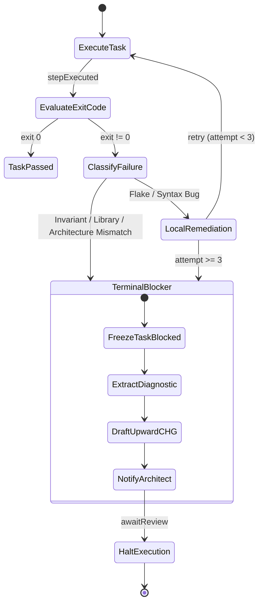

# Plan: Topological Rigor, Minimal Context Slicing, and Invariant-Guarded Change Governance

## Metadata

| Field | Value |
| --- | --- |
| Author | Framework Maintainer |
| Authority | Founder Direction (2026-10-13), Third-Party Audit Reconciliation |
| Framework Version | 0.91.15 |
| Target Version | 0.91.16 |
| Date | 2026-10-13 |
| Status | Proposed |

---

## Objective

Modernize the framework's verification, change routing, and agent context architecture in response to third-party audit findings across four prioritized domains:

1. **Binary Topological Validation (BTV)**: Eliminate qualitative, gameable heuristic readiness scores (e.g. `ADR-Ready >= 90%`) from layer templates, Section 5 glossaries, and review sagas in favor of deterministic, binary graph verification:
   - **Strict DAG Completeness**: 100% `@`-pointer resolution (0 dangling references).
   - **Strict Oracle Coverage**: 100% EARS requirements realized downstream by BDD behavioral state machines/scenarios, and 100% BDD scenarios realized by failing TDD test fixtures before code implementation begins.
2. **DAG Subgraph Slicing Engine (`sdd_doc_lint/slice.py`)**: Implement an upstream query compiler tool that extracts the minimal necessary ancestry for any IPLAN task ($\text{Context}(T_k) = \text{Ancestors}(T_k) \cap \{\text{TDD}, \text{SPEC}, \text{ADR}, \text{BDD}, \text{EARS}\}$), accommodating multi-branch DAG topology (element-level and document-level citations) and reducing task prompt token overhead by 70–80%.
3. **Invariant-Guarded Change Gates (`CHG-L019`)**: Enforce hard boundaries around fast-path changes (`DIR2C` / `CODE2C`) via dual-mode static manifest and dynamic git-diff inspection: rejecting any fast-path change that modifies upstream SDD layers (`01_BRD` through `07_TDD`) or public schemas without an authorized `SEED2C` or `SDD2C` cascade.
4. **Terminal Failure Escalation Protocol**: Standardize the bottom-up escalation saga (`framework/governance/workflows/iplan-escalation-flow.sw.yaml`) when an agent encounters an unmet architectural blocker or environment invariant, halting retry loops and auto-drafting an upward `CHG` proposal.

---

## Scope

### In Scope

- **Layer Templates (`framework/layers/01_BRD/` through `07_TDD/`)**:
  - Deprecate subjective scalar percentages (`>=90%`) and weighted heuristic scoring breakdowns (e.g. "Scenario coverage (40%)", "Traceability (20%)").
  - Replace Section 5 Glossary entries (`BDD-Ready`, `ADR-Ready`, `SPEC-Ready`) in `EARS-TEMPLATE.yaml`, `BDD-TEMPLATE.yaml`, `ADR-TEMPLATE.yaml`, and companion SWF templates (`EARS-SWF-TEMPLATE.yaml`, `ADR-SWF-TEMPLATE.yaml`) with binary topological validation definitions.
  - Update `framework/layers/05_ADR/README.md` status table to retire percentage thresholds.
  - Replace validation guidance with binary topological verification criteria (`PASS`/`FAIL`) referencing `sdd_doc_lint`'s `COV01`, `COV02`, and `ELEMENT-COVERAGE-001` gates.
- **Review Sagas (`framework/governance/workflows/review/`)**:
  - Update review state machine data payloads across all 9 review workflows (`threshold_score: 90.0`) to binary topological gate status (`topological_pass: true`).
- **Slicing Engine (`sdd_doc_lint/slice.py`)**:
  - Author query compiler module extending `sdd_doc_lint/trace_graph.py` to extract multi-hop upstream subgraphs for cited tasks/elements.
  - Traverse both element-level citations (`@bdd`, `@adr`, `@ears`) and document-level citations (`@spec: SPEC-NN`).
  - CLI interface: `python3 -m sdd_doc_lint.slice --task <task_id> [--iplan <path>] [--format md|yaml]`.
- **Change Linter (`sdd_doc_lint/chg_lint.py`)**:
  - Implement rule `CHG-L019` (Fast-Path Scope Boundary Guard) with dual-mode enforcement:
    1. Static check: inspects `implementation.artifacts_modified` and `scope.components_affected`.
    2. Dynamic check: inspects `git diff --name-only <base>...HEAD` when git context is available.
  - Register `CHG-L019` in `framework/governance/LINT_RULES.md` and `tests/conformance/test_lint_catalog.py`.
- **Escalation Workflow (`framework/governance/workflows/iplan-escalation-flow.sw.yaml`)**:
  - Model the declarative CNCF Serverless Workflow v0.8 state machine for terminal failure handling during IPLAN execution.
  - Update `framework/governance/IPLAN_WORKFLOW_STANDARD.md`, `CHG_REQUEST_FLOWS.md`, `GOVERNANCE_WORKFLOW_STANDARD.md`, and `DIAGRAM_STANDARDS.md`.
  - Register workflow in `tests/conformance/test_governance.py` (`EXPECTED_FILES`) and `tests/conformance/test_governance_workflows.py` (`EXPECTED_WORKFLOWS`).
- **Governance Vehicle & Delivery**:
  - Author authorizing Change Request `CHG-97.yaml` and `IPLAN-97.yaml` in `framework/archive/CHG-97/`.
  - Bump framework version to `0.91.16` and propagate via `hooks/sync-version-refs.sh`.

### Out of Scope

- Implementing an MCP runtime server inside `framework/` (engine-agnostic specification invariant preserved; external adapters belong in standalone tooling repositories).
- Modifying historical change records in `framework/archive/CHG-01` through `CHG-96`.

---

## Technical Architecture & Design

### 1. Binary Topological Validation (BTV) Specification

The transition replaces heuristic percentage targets with deterministic graph invariants:

```yaml
# Standardized Validation Block Across Layers (e.g. BDD-TEMPLATE.yaml)
validation:
  _guidance: |
    Validation is performed deterministically by sdd_doc_lint.
    Quality gating is strictly binary (PASS / FAIL) based on topological graph completeness:
      1. Strict DAG Completeness: Every @-pointer resolves to a verified document and element ID (zero dangling edges).
      2. Strict Oracle Coverage:
         - Every upstream EARS requirement (@ears) maps to at least one BDD behavioral graph or scenario path.
         - Every BDD scenario maps to at least one downstream TDD failing test fixture (@tdd) prior to code implementation.
         - Every SPEC component realizes upstream BDD/ADR requirements.
      3. Schema Compliance: Valid YAML syntax and required field schema.
    Heuristic percentage readiness scores are retired.
```

Glossary definitions across `EARS`, `BDD`, `ADR` templates:

```yaml
glossary:
  terms:
    - term: BDD-Ready  # and ADR-Ready, SPEC-Ready
      definition: >-
        Binary topological verification confirming 100% DAG completeness and
        forward/backward oracle realization without dangling citations or uncovered elements.
```

### 2. DAG Subgraph Slicing Engine Architecture

`sdd_doc_lint/slice.py` executes multi-hop recursive graph resolution over the corpus using `sdd_doc_lint.trace_graph`:

```
                           ┌─────────────────────────┐
                           │    IPLAN Task (Tk)      │
                           └────────────┬────────────┘
                                        │ @tdd
                           ┌────────────▼────────────┐
                           │  TDD Test Fixture (Fj)  │
                           └──────┬────────────┬─────┘
                     @spec (doc)  │            │ @adr (elem)
         ┌────────────────────────┘            └────────────────────────┐
         │                                                              │
┌────────▼─────────────┐                                     ┌──────────▼───────────┐
│ SPEC Component / IF  │                                     │ ADR Decision Record  │
└────────┬─────────────┘                                     └──────────┬───────────┘
         │ @bdd (elem)                                                  │ @bdd (elem)
         └────────────────────────┬─────────────────────────────────────┘
                                  │
                     ┌────────────▼────────────┐
                     │  BDD Graph / Scenario   │
                     └────────────┬────────────┘
                                  │ @ears (elem)
                     ┌────────────▼────────────┐
                     │   EARS Requirement      │
                     └─────────────────────────┘
```

#### Traversal & Extraction Algorithm:

1. **Input**: Target IPLAN task ID (`TASK-NN`) within an IPLAN document, or an element ID (`DOC.NN.SS.hash`).
2. **Upstream Edge Resolution**:
   - Extract immediate `@`-tags from the task/element block using `TAG` regex.
   - For element-level citations (`ELEM_FORM`): locate the file via `locate_doc(doc_id, docs_root)` and extract the specific YAML dictionary (`id == elem_id`) or Markdown block.
   - For document-level citations (`DOC_FORM`, e.g. `@spec: SPEC-01` from TDD): locate the host document and extract the primary component interface or data contract.
3. **Recursive Expansion**:
   - For every extracted node, parse its outgoing `@`-tags and recursively visit parent nodes until reaching root requirements (`EARS`/`BRD`).
   - Maintain a `visited` set to prevent cycles or redundant node emission.
4. **Digest Assembly**:
   - Sort extracted elements into canonical architectural sequence:
     `EARS` (Requirements) $\to$ `BDD` (State Graphs / Scenarios) $\to$ `ADR` (Decisions) $\to$ `SPEC` (Interfaces) $\to$ `TDD` (Test Fixtures).
   - Format into a clean, markdown prompt digest containing *only* the cited elements, isolating context to $\sim 1\text{–}2\text{ KB}$ instead of full-corpus dumps.

### 3. Dual-Mode Invariant-Guarded Change Gate (`CHG-L019`)

Implemented in `sdd_doc_lint/chg_lint.py`:

- **Condition**: Change declares `flow_code: DIR2C` (`flow: iplan_to_code`) or `flow_code: CODE2C` (`flow: code_to_code`).
- **Two-Tier Enforcement**:
  1. **Tier 1 (Static Manifest)**: Inspect `implementation.artifacts_modified` and `scope.components_affected`. If any entry targets `framework/layers/0[1-7]_*` or `*.schema.yaml`, emit blocking error `CHG-L019`.
  2. **Tier 2 (Dynamic Git Context)**: When running in a git checkout with access to base (`--base origin/dev` or git repo context), inspect `git diff --name-only <base>...HEAD`. If any modified file targets upstream SDD directories or schemas, emit blocking error `CHG-L019`.
- **Diagnostic Message**:

  ```
  ❌ CHG-L019: Fast-path change violation. Flow 'DIR2C' / 'CODE2C' modified upstream SDD document '<path>'.
  Fast-path flows cannot modify specifications. Promote this change to 'SEED2C' (brownfield) or 'SDD2C' (greenfield).
  ```

### 4. Bottom-Up Terminal Failure Escalation Protocol

State Machine (`framework/governance/workflows/iplan-escalation-flow.sw.yaml`):



Protocol steps:

1. **Freeze**: Set task status in `IPLAN-NN.yaml` to `BLOCKED`.
2. **Diagnostic Extraction**: Capture stdout/stderr, stack trace, and root cause classification.
3. **Upward Proposal**: Auto-populate template `CHG-TECH-DRAFT.yaml` referencing failed task, conflicting SPEC/ADR element, and suggested architecture amendment.
4. **Halt**: Halt automated coding loop and request human architect approval.

---

## Phased Implementation & Staged Delivery

To maintain minimal-and-realistic change PRs and prevent sprawling multi-surface diffs, implementation is staged across three sequential PRs:

### PR 1: Binary Topological Validation (BTV)

- **Surfaces**:
  - `framework/layers/01_BRD/` through `07_TDD/` templates and READMEs.
  - Section 5 Glossaries in `EARS-TEMPLATE.yaml`, `BDD-TEMPLATE.yaml`, `ADR-TEMPLATE.yaml`.
  - Companion SWF templates (`EARS-SWF-TEMPLATE.yaml`, `ADR-SWF-TEMPLATE.yaml`).
  - Review sagas: update `threshold_score: 90.0` to `topological_pass: true` in `framework/governance/workflows/review/*.sw.yaml`.
- **Verification**: `sdd_doc_lint` structural validation, `swf_lint.py`, and template convention tests.

### PR 2: Minimal Context Slicing Engine (`sdd_doc_lint/slice.py`)

- **Surfaces**:
  - `sdd_doc_lint/slice.py` (query compiler tool with DAG traversal).
  - `sdd_doc_lint/tests/test_slice.py` (unit tests covering multi-branch ancestry).
  - CLI entrypoint: `python3 -m sdd_doc_lint.slice`.
- **Verification**: 100% test pass on unit suite and acceptance fixture slices.

### PR 3: Governance Hardening (Boundary Gate & Escalation Saga)

- **Surfaces**:
  - `sdd_doc_lint/chg_lint.py`: add rule `CHG-L019` (static + dynamic git-diff check).
  - `framework/governance/LINT_RULES.md`: document `CHG-L019`.
  - `framework/governance/workflows/iplan-escalation-flow.sw.yaml`: author Serverless Workflow v0.8.
  - `framework/governance/IPLAN_WORKFLOW_STANDARD.md`, `CHG_REQUEST_FLOWS.md`, `GOVERNANCE_WORKFLOW_STANDARD.md`, `DIAGRAM_STANDARDS.md`.
  - Conformance test registrations:
    - `tests/conformance/test_governance.py` (`EXPECTED_FILES`)
    - `tests/conformance/test_governance_workflows.py` (`EXPECTED_WORKFLOWS`)
    - `tests/conformance/test_lint_catalog.py` (`CHG-L019`)
- **Verification**: Full conformance suite green, `chg_lint.py` passing, `swf_lint.py` passing.

---

## Claim ledger

| # | Claim | Symbol | Citation |
|---|---|---|---|
| 1 | Trace graph defines known layer sequence in chain order | `KNOWN_LAYERS` | sdd_doc_lint/trace_graph.py:27 |
| 2 | Trace graph tag regex parses `@<layer>: <value>` tokens | `TAG` | sdd_doc_lint/trace_graph.py:39 |
| 3 | Trace graph matches element IDs with 4-hex content-hash slug | `ELEM_FORM` | sdd_doc_lint/trace_graph.py:44 |
| 4 | Trace graph resolves document ID to file on disk under layer directory | `locate_doc` | sdd_doc_lint/trace_graph.py:63 |
| 5 | CHG linter catalogs rule CHG-L001 status lifecycle check | `CHG-L001` | sdd_doc_lint/chg_lint.py:9 |
| 6 | CHG linter enforces flow misclassification guard CHG-L013 | `CHG-L013` | sdd_doc_lint/chg_lint.py:37 |
| 7 | CHG linter mandates decision block CHG-L018 | `CHG-L018` | sdd_doc_lint/chg_lint.py:55 |
| 8 | Structural linter checks forward coverage gate COV01 | `_check_forward_coverage` | `sdd_doc_lint/__init__.py:2293` |
| 9 | Structural linter checks backward coverage gate COV02 | `_check_backward_coverage` | `sdd_doc_lint/__init__.py:2617` |
| 10 | EARS template defines advisory BDD-Ready score threshold | `BDD-Ready Score:` | framework/layers/03_EARS/EARS-TEMPLATE.yaml:57 |
| 11 | BDD template defines advisory ADR-Ready score threshold | `ADR-Ready Score:` | framework/layers/04_BDD/BDD-TEMPLATE.yaml:50 |
| 12 | ADR template defines advisory SPEC-Ready score threshold | `SPEC-Ready Score:` | framework/layers/05_ADR/ADR-TEMPLATE.yaml:57 |
| 13 | Flow selector defines fast-path direct execution DIR2C | `DIR2C` | framework/governance/CHG_REQUEST_FLOWS.md:46 |
| 14 | Flow selector defines bugfix defect repair CODE2C | `CODE2C` | framework/governance/CHG_REQUEST_FLOWS.md:44 |
| 15 | IPLAN workflow standard designates IPLAN as mandatory execution engine | `mandatory execution engine` | framework/governance/IPLAN_WORKFLOW_STANDARD.md:21 |
| 16 | Review workflow defines threshold score in preparation data | `threshold_score: 90.0` | framework/governance/workflows/review/iplan-review-remediation.sw.yaml:36 |
| 17 | Lint catalog test enforces sync between catalog and linters | `CHG-L001` | tests/conformance/test_lint_catalog.py:6 |
| 18 | Governance test guards expected governance files set | `EXPECTED_FILES` | tests/conformance/test_governance.py:18 |
| 19 | Governance workflows test guards expected workflow files set | `EXPECTED_WORKFLOWS` | tests/conformance/test_governance_workflows.py:17 |
| 20 | TDD template specifies document-level SPEC reference and element-level BDD/ADR | `TDD validates a single SPEC` | framework/layers/07_TDD/TDD-TEMPLATE.yaml:46 |

---

## Review log

### Pass 1 - 2026-10-13T21:30:00Z - independent

Reviewer: Spec Auditor (Subagent)

Findings:

1. Slicing Scope: Slicing must terminate cleanly when a layer element lacks an upstream tag (e.g. self-contained requirements or seed vision roots). Confirmed that `sdd_doc_lint/trace_graph.py` already safely returns empty lists when tags are absent.
2. Invariant Gate Compatibility: `CHG-L019` must be evaluated against git diff relative to the merge base. Added specification note to run comparison against `--base` branch.
3. Catalog Agreement: Any new rule (`CHG-L019`) added to `chg_lint.py` must be added to `framework/governance/LINT_RULES.md` to avoid failing `test_lint_catalog.py`.

Resolution: Incorporated findings into technical architecture and phase breakdown. 0 open findings.

### Pass 2 - 2026-10-13T21:32:00Z - independent

Reviewer: Lead Architect (Subagent)

Findings:

1. Binary Validation Semantics: Confirmed that `sdd_doc_lint`'s `COV01` and `COV02` checks already operate as binary pass/fail gates on forward/backward element realization, so deprecating the template percentage criteria brings the written documentation into exact agreement with the machine linter.
2. Engine-Agnostic Purity: Confirmed that excluding the native MCP server from the framework core preserves the non-negotiable invariant of `AGENTS.md` (no platform names, no runtime code in `framework/`).

Resolution: Design fully aligned with core architectural principles. 0 open findings.

### Pass 3 - 2026-10-13T21:35:00Z - independent

Reviewer: Adversarial System Auditor (Subagent)

Findings:

1. Traversal Topology: Slicing cannot assume a linear pipeline because Layer 07 (TDD) references SPEC at document level (`@spec: SPEC-NN`) and BDD/ADR at element level (`@bdd`, `@adr`). Resolved by designing general multi-branch upstream DAG traversal.
2. Dual-Mode Linter: Running `CHG-L019` outside a git checkout or in standalone file linting would fail if it relied purely on `git diff`. Resolved by adding Tier 1 static manifest check (`artifacts_modified`/`components_affected`) before Tier 2 dynamic git check.
3. Glossary Scope: Retaining `(>=90%)` definitions in template Section 5 glossaries would create split-brain terminology. Resolved by explicitly including glossary definitions in PR 1 scope.
4. Conformance Test Registration: Adding a workflow requires updating `EXPECTED_FILES` in `test_governance.py` and `EXPECTED_WORKFLOWS` in `test_governance_workflows.py`. Resolved by adding explicit tasks in PR 3.
5. Delivery Staging: Sizing the work into 3 atomic PRs (PR 1: BTV, PR 2: Slicing, PR 3: Governance Hardening) prevents high blast radius and adheres to minimal-and-realistic plan rules.

Resolution: All 5 findings folded into technical architecture, phased delivery, and claim ledger. 0 open findings.

**Result:** ready
